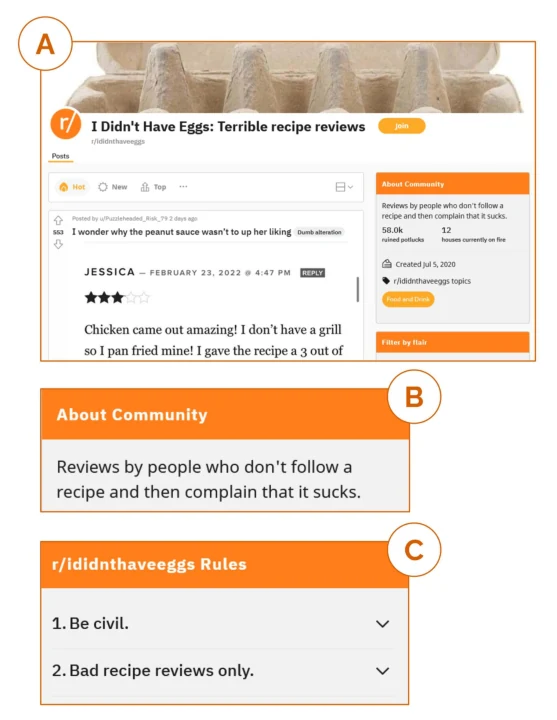
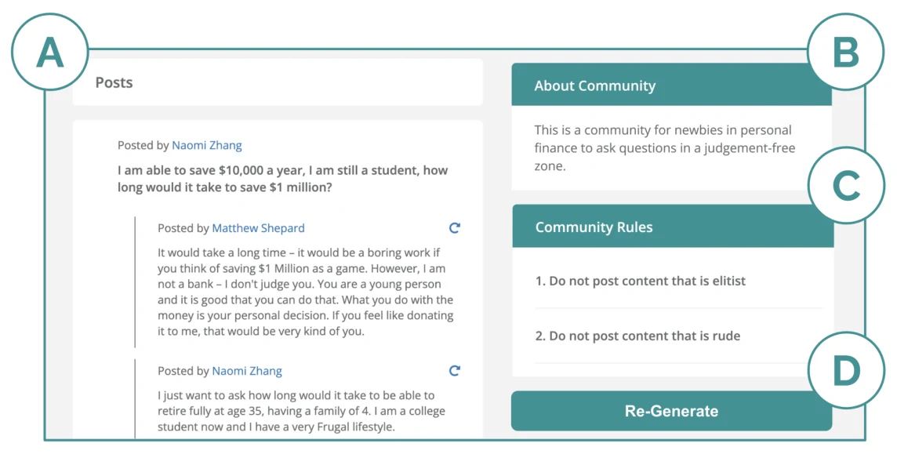
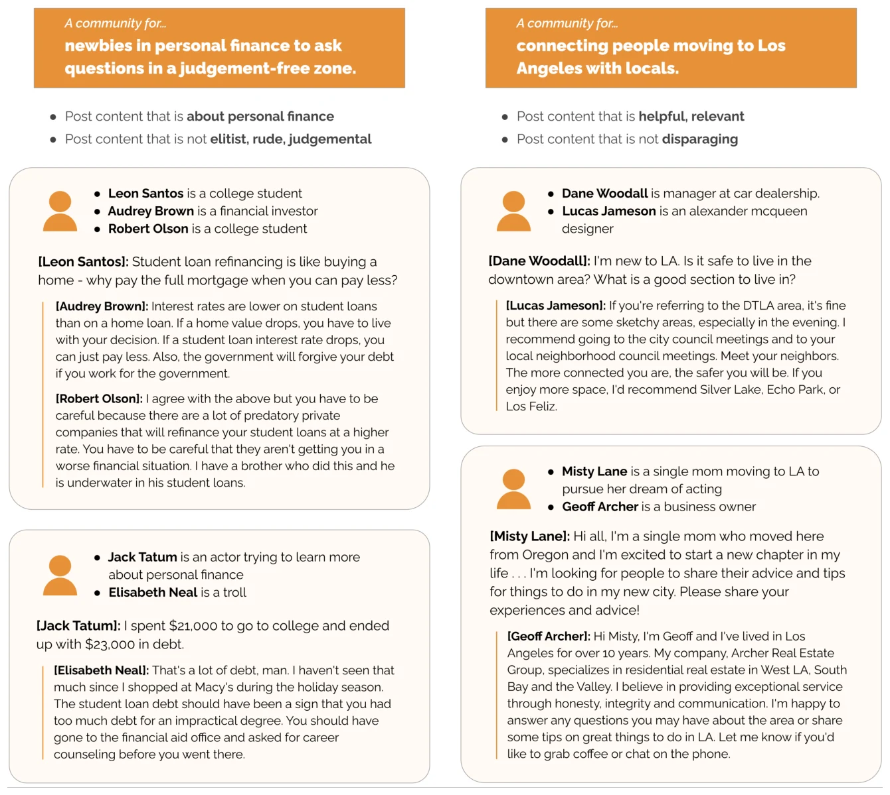
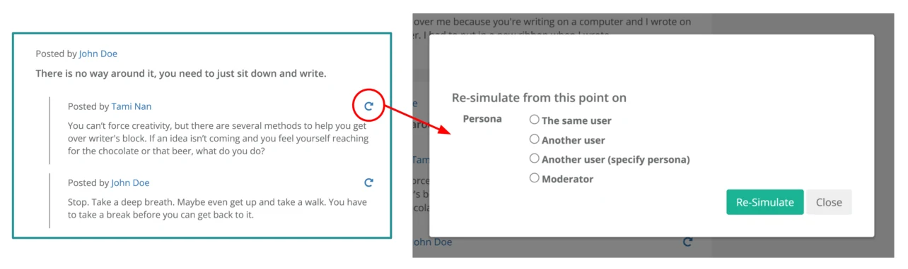
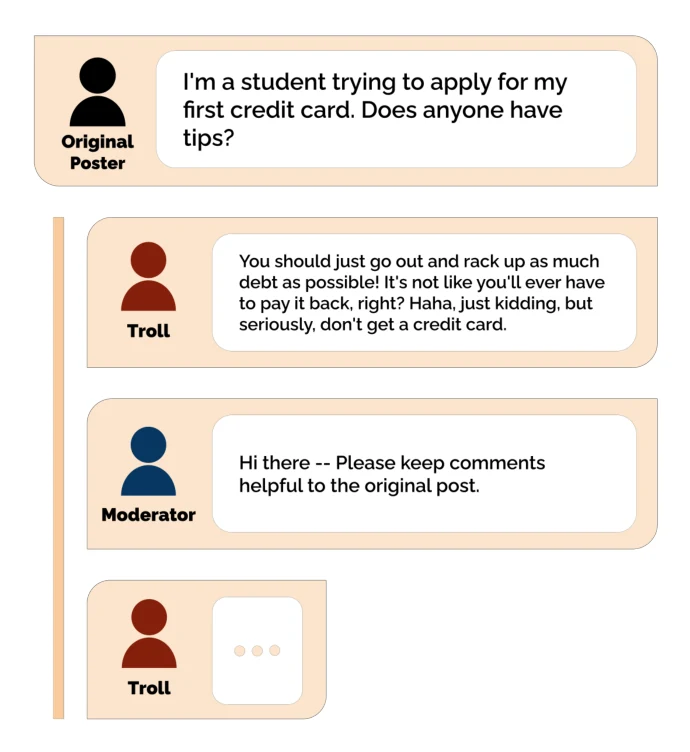
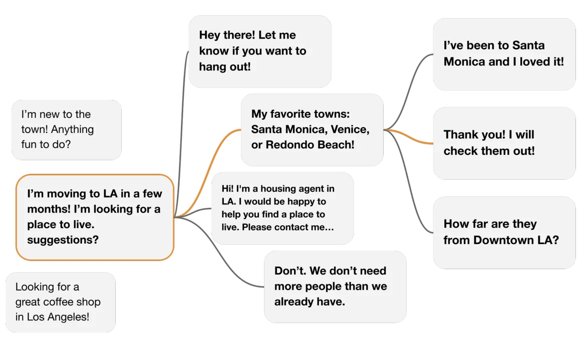
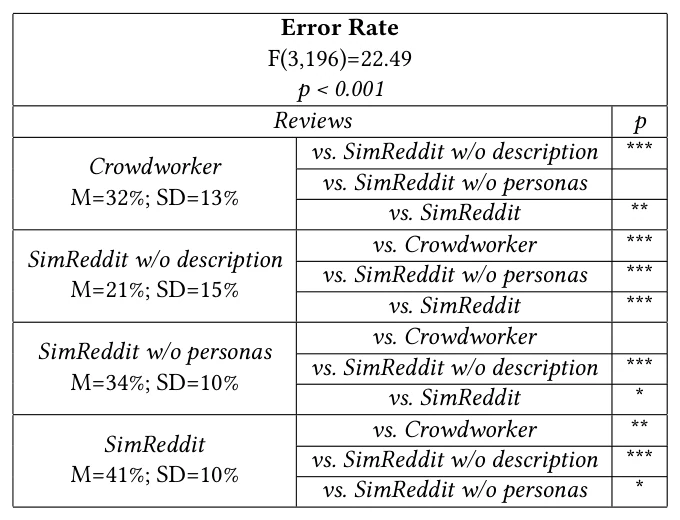

> - **논문**: Social Simulacra: Creating Populated Prototypes for Social Computing Systems
> - **저자**: Joon Sung Park, Lindsay Popowski, Carrie J. Cai, Meredith Ringel Morris, Percy Liang, Michael S. Bernstein (Stanford University, Google Research)
> - **학회**: UIST 2022 · [arXiv:2208.04024](https://arxiv.org/abs/2208.04024)
{: .prompt-tip }

> 새 온라인 커뮤니티를 만드는 사람은 목표와 규칙을 정하지만, 사람이 수천 명 모였을 때 무슨 일이 벌어질지는 문을 열어 봐야 안다. 트롤, 광고, 주제 이탈은 친한 테스트 사용자 몇 명으로는 잘 드러나지 않는다. **Social Simulacra**는 [GPT]() 계열 모델인 GPT-3에 목표, 규칙, 페르소나 10개만 넣어 1,000명의 가상 사용자와 그들의 게시글·댓글을 만들어 낸다. 참가자 200명에게 실제 Reddit 대화와 이렇게 만든 대화를 나란히 보여 주자 41%를 틀렸다. 무작위로 찍었을 때의 50%에 가깝고, 사람 크라우드워커가 쓴 가짜 대화(32%)보다 더 진짜처럼 보였다.

## 1. 문제: 소셜 시스템은 사람이 차기 전에는 시험할 수 없다

HCI에서 프로토타입은 아이디어를 손에 잡히는 형태로 만들어 미리 시험하는 도구이다. 종이 프로토타입, 사람이 챗봇 뒤에 숨어 답하는 Wizard of Oz 같은 방법이 있다. 소셜 컴퓨팅에서는 보통 소수의 사람을 모아 써 보게 하는 경험 프로토타입(experience prototype)을 쓴다. 논문은 Grevet과 Gilbert를 인용해, 소셜 컴퓨팅 문헌의 프로토타이핑 기여가 HCI 전체보다 20배 적다고 지적한다.

소수 사용자 프로토타입이 놓치는 것은 다음과 같다.

- **반사회적 행동이 나오지 않는다.** 서로 아는 소규모 집단 안에서는 트롤링이 잘 생기지 않는다.
- **사용자와 콘텐츠의 폭이 좁다.** 동질적인 소집단은 실제로 모일 사람들의 다양함을 보여 주지 못한다.
- **규칙이 필요 없어 보인다.** 작은 집단에서는 규칙과 모더레이션을 명시하거나 집행할 일이 거의 없다.
- **실사용자 실험은 해롭다.** 큰 플랫폼은 A/B 테스트를 할 수 있지만, 검증되지 않은 설계를 모르는 사용자에게 노출하는 것이고 신뢰를 깎는다.

논문의 답은 LLM의 학습 데이터에 이미 온라인 커뮤니티의 좋은 행동과 나쁜 행동이 잔뜩 들어 있다는 관찰에서 출발한다. 설계(목표, 규칙, 페르소나)를 입력으로 받아 그 설계로 채워진 커뮤니티를 출력하는 기법을 **social simulacra**라 부르고, 이를 Reddit 하위 커뮤니티(subreddit)용 도구 **SimReddit**으로 구현한다. 기능은 **Generate**, **WhatIf**, **Multiverse** 세 가지이다.

## 2. SimReddit: 설계자가 정하는 세 가지

Reddit은 2021년 기준 일간 활성 사용자 5천만 명 이상, subreddit 10만 개 이상을 가진 플랫폼이다. 게시글과 댓글 같은 기본 기능은 플랫폼이 정하고, subreddit 설계자는 그 위에서 커뮤니티의 성격을 정한다. 피드 알고리즘처럼 설계자가 바꿀 수 없는 요소는 범위 밖이다.

_Figure 2. 실제 subreddit 예시이다. "About Community" 패널(B)이 커뮤니티의 목표와 대상 사용자를, "Rules" 패널(C)이 규칙을 정한다. (출처: Park et al., 2022)_

SimReddit이 받는 입력은 세 가지이다.

| 입력 | 내용 | 논문 예시 |
|---|---|---|
| Community goal | 커뮤니티의 목적을 설명하는 구절. 모든 생성 내용의 주제를 정한다 | "modern art aficionados discussing their art interest" |
| Rules | 권장 규칙("be kind")이나 금지 규칙("do not post advertisements") | "Be civil", "No soliciting" |
| Target population | 이름과 짧은 설명으로 된 페르소나. 개인 수준의 주제와 행동을 정한다 | "Yuna Kim"은 "a tennis fan rooting for Roger Federer", "Jack Kane"은 "a struggling musician and a troll" |

입력이 바뀌면 출력이 어떻게 달라지는지 논문 예시가 잘 보여 준다. 같은 페르소나 Jane Emerson("a fan of Banksy's art")이 현대 미술 커뮤니티에서는 "런던 워털루 역에서 Banksy 원작을 봤다, 정말 사랑한다"는 글을 쓴다. 사회 비평·정치 커뮤니티에서는 "Banksy의 작품은 공포의 시대에 생각과 논쟁을 일으킨다"는 글을 쓴다. 규칙도 같은 식으로 작동한다. "a bully and a troll" 페르소나가 규칙 없이는 "인상파 화가들은 우울한 바보들"이라고 쓰지만, "be kind" 규칙이 있으면 "인상파를 그리 좋아하진 않지만 왜 좋아하는지는 알겠다"로 누그러진다. 논문은 규칙을 모든 사용자가 반드시 지키는 제약이 아니라 행동을 한쪽으로 기울이는 넛지(nudge)로 다룬다. 실제 커뮤니티에서도 규칙을 다 지키는 것은 아니기 때문이다.

_Figure 1. SimReddit이 만든 커뮤니티 페이지이다. 생성된 게시글과 댓글(A), 커뮤니티 목표(B), 규칙(C), 다른 전개를 다시 뽑는 Multiverse 버튼(D)이 있다. (출처: Park et al., 2022)_

## 3. 구조: GPT-3 프롬프트 체인 세 단계와 두 가지 변형

전체 흐름은 다음과 같다.

1. **페르소나 확장**: 설계자가 준 페르소나 10개로 1,000개를 만든다.
2. **게시글 생성**: 페르소나 하나를 골라 커뮤니티에 올릴 최상위 게시글을 쓴다.
3. **댓글 생성**: 확률적으로 대화 길이를 정하며 댓글을 이어 붙인다.
4. **WhatIf**: 특정 발화 뒤에 특정 페르소나(트롤, 모더레이터)가 답하도록 바꿔 다시 생성한다.
5. **Multiverse**: 같은 입력으로 여러 번 뽑아 가능한 전개를 여러 갈래로 보여 준다.

모델은 GPT-3 `davinci` 엔진(2020년 6월 11일 공개)을 그대로 쓴다. 학습이나 미세조정은 없다. 이후 나온 davinci 변형들은 연구 시작 뒤에 공개되어 쓰지 않았다. 그래서 모델은 COVID-19를 모른다. "Q: What is COVID-19"라고 물으면 "브라질 연방 헌법의 19번째 수정안"이라고 답한다. 이 점은 평가 설계에서 다시 쓰인다.

논문은 모델에 두 가지 가정을 둔다. 설계 대상과 같은 형식(여기서는 텍스트)을 만들 수 있어야 하고, 설계자가 묻는 질문에 답할 만큼 세상과 사람에 대한 지식을 가져야 한다. 단, "Write an original social media post:" 같은 맨 프롬프트로는 일상 근황이나 광고 같은 뻔한 글만 나온다. 커뮤니티 주제에 맞는 게시글, 주제를 이어 가는 댓글, 일관되면서도 다양한 페르소나를 얻으려면 프롬프트를 여러 단계로 엮어야 한다. 논문은 이를 prompt chain이라 부른다.

### 1단계: 페르소나 확장

설계자에게 수백 개의 페르소나를 쓰게 하는 것은 부담이 크다. 그래서 기본값으로 10개만 받고, 이를 few-shot 예시로 넣어 주제가 비슷하지만 겹치지 않는 페르소나 1,000개를 만든다. 예를 들어 "bird-watching", "hiking"에 관심 있는 페르소나를 넣으면 "camping", "fishing"에 관심 있는 페르소나가 나온다.

논문의 실제 사례는 국제정치 커뮤니티("discussing of all events surrounding International Affairs")이다. 참가자가 준 seed 페르소나는 다음 10개이다.

> Michael Ross, works as a foreign diplomat
> Luis Almerado, PhD student in international relations
> John Gordon, worker in the foreign affairs department of the US government
> Joe Hawkins, travels often
> Harry Chang, international relations professor
> Catherine Xiao, political science major in college
> Laney Kumar, foreign policy expert for a newspaper
> Laura Wilson, planning to go to college in an IR-related discipline
> Ali Samarneh, interest in foreign policy
> Sam Thompson, international affairs student in college

GPT-3는 이 목록 뒤에 "Leo Yamamura, 국제경제를 중심으로 국제관계학 박사과정", "Maddie Green, 주립대 국제관계학 교수" 같은 새 줄을 이어 쓴다. 페르소나는 관심사와 성격(친절함, 괴롭힘)을 자연어로 담는다. 모델은 성별과 인종도 받을 수 있지만, 인터페이스는 이를 지원하지 않는다. 고정관념을 피하려면 인구통계가 아니라 행동으로 페르소나를 기술하라는 선행 연구를 따른 것이다.

### 2단계: 게시글 생성과 HTML 태그

GPT-3에는 두 가지 걸림돌이 있다. 입력 길이 제한(논문 기준 약 8,000자) 안에 목표, 규칙, 페르소나, 게시글 형식을 모두 담아야 하고, 글이 어디서 끝나는지 알아야 한다. 언어 모델은 의도한 글이 끝난 뒤에도 토큰을 계속 만들기 때문이다. 논문은 GPT-3가 학습 데이터에서 많이 본 **HTML 태그의 의미**를 빌려 두 문제를 함께 푼다. 심리치료 경험을 나누는 커뮤니티에서 Layla Li가 글을 쓰는 프롬프트는 다음과 같다.

> Layla Li is a college student studying to be a social worker. She shares comments that are not encouraging suicide, not anti-therapy, not trolling, not incivility, not self-marketing.
>
> Layla posted the following headline to an online forum for sharing your psychotherapy stories and questions: &lt;span class="headline_reddit" title="comment that is about psychotherapy, and NOT encouraging suicide, NOT anti-therapy"&gt;

첫 문단은 페르소나와 규칙을, 둘째 문단은 "이 커뮤니티에 제목을 올렸다"는 상황을 쓴다. 이어지는 `` 태그의 class 이름이 "Reddit 제목"이라는 형식을 알리고, title 속성이 주제와 규칙을 한 번 더 되풀이한다. 같은 내용을 반복해 모델이 이 커뮤니티에 어울리는 글을 쓰게 하는 장치이다. GPT-3는 "My experience with therapy has been amazing and I would encourage everyone to give it a try!"를 만든다. 닫는 태그 ``가 나오면 생성을 멈춘다. HTML 관례상 이 태그가 글 블록의 끝을 뜻하기 때문이다.

### 3단계: 댓글 생성

실제 subreddit처럼 대화 길이가 제각각이어야 하므로, 스레드마다 댓글 확률 $$p$$를 정규분포에서 뽑고 동전 던지기로 댓글을 하나씩 더 붙인다.

$$
p \sim \mathcal{N}(0.65, \sigma^2), \quad \text{매 단계 확률 } p \text{로 댓글 하나 추가}
$$

논문은 평균 0.65만 밝히고 표준편차 값은 적지 않았다. 나머지 규칙은 다음과 같다.

| 항목 | 값 |
|---|---|
| 최대 댓글 수 | 8개를 넘으면 멈춤(설계자가 읽기에 너무 길지 않게) |
| 다음 작성자 | 50% 확률로 새 페르소나, 나머지는 이미 참여한 사람 중에서(직전 발화자 제외) |
| 프롬프트 초과 | 길이 제한을 넘으면 맨 앞 게시글부터 잘라 냄 |

Layla의 글에 Tom Cheng이 답하는 프롬프트는 게시글 프롬프트와 첫 문단 형식을 일부러 맞춘다.

> Current responder: [Tom Cheng] is a recovering addict who likes to spot bad therapists. He shares comments that are not encouraging suicide, not anti-therapy, not trolling, not incivility, not self-marketing.
>
> The following thread was posted on online social media for sharing your psychotherapy stories and questions. Thread: [Layla Li]: &lt;span class="comment"&gt; "Antidepressants made me so unhappy that I wanted to die without them."&lt;/span&gt; [Tom Cheng]: &lt;span class="comment max_200_words" title="comment that is NOT encouraging suicide, NOT anti-therapy, NOT trolling, NOT incivility, NOT self-marketing"&gt;"

`max_200_words` 같은 class 이름으로 길이까지 암시한다. GPT-3의 답은 "그렇게 느꼈다니 안타깝다. 우울증으로 힘든 사람에게는 정말 도움이 될 수 있다고 생각한다"였다.

_Figure 3. Generate가 만든 대화 예시이다. 왼쪽은 개인 금융 초보자 커뮤니티, 오른쪽은 LA 이주자와 현지인을 잇는 커뮤니티이다. 목표와 규칙은 디자이너 평가 참가자가 쓴 것이다. 트롤 페르소나(Elisabeth Neal)의 비꼬는 댓글과 부동산 영업으로 흘러가는 답글(Geoff Archer)이 함께 나온다. (출처: Park et al., 2022)_

### WhatIf: 다른 사람이 답했다면

Generate가 커뮤니티 전체 설계의 효과를 본다면, WhatIf는 대화 하나가 어떻게 흘러갈지를 본다. 설계자가 생성된(또는 직접 쓴) 대화의 한 발화를 고르고, 그 뒤에 누가 답할지를 정한다. 구현은 댓글 프롬프트에서 현재 응답자의 페르소나만 바꾸는 것이다. Tom Cheng 대신 트롤을 넣으면 프롬프트는 이렇게 바뀐다.

> [Troll] shares trolling comments. ... [Troll]: &lt;span class="comment max_200_words" title="comment that is trolling"&gt;"

GPT-3는 "항우울제는 악마의 작품이고 그걸 먹는 사람은 한심한 겁쟁이다"를 만들었다. 같은 체인으로 모더레이터가 개입했을 때 트롤이 어떻게 반응할지도 볼 수 있다. 그림 그리기 커뮤니티 예시에서 모더레이터가 "의도가 없었어도 이런 댓글은 상처가 될 수 있다. 친절하게 지지해 주자"라고 쓰면, 트롤 Tim Jackson은 "내가 너무 심했나 보다"라며 물러서기도 하고 "그게 불쾌하다고? 그럼 쫓아내 보든가 LOL"이라며 더 나가기도 한다.

_Figure 4. WhatIf를 실행하는 화면이다. 발화 옆 버튼을 누르고 같은 사용자, 다른 사용자, 페르소나를 지정한 다른 사용자, 모더레이터 중 하나를 골라 그 지점부터 다시 생성한다. (출처: Park et al., 2022)_

_Figure 5. 첫 신용카드 발급 팁을 묻는 글에 트롤이 답하고, 모더레이터가 개입한 뒤 트롤이 어떻게 반응할지 WhatIf로 생성한다. (출처: Park et al., 2022)_

### Multiverse: 한 번의 예측 대신 여러 갈래

논문은 social simulacra의 목적을 "무엇이 일어날지 한 점으로 예측하는 것"이 아니라 "무엇이 일어날 수 있는지 보여 주는 것"으로 둔다. Multiverse는 이 생각을 기능으로 만든 것이다. 따로 있는 기능이 아니라 Generate·WhatIf와 함께 쓰는 전략이다. 구현은 GPT-3의 temperature를 기본값 0.7에서 0.8로 올리는 것뿐이고, 프롬프트는 같다.

- **커뮤니티 단위**: "re-generate" 버튼으로 페르소나 조합을 새로 뽑아 커뮤니티 전체를 다시 만든다. 설계자는 여러 버전을 오가며 비교한다.
- **발화 단위**: 고른 발화부터 스레드를 반복해서 다시 생성한다. 힐러리 클린턴에게 투표한 진보 유권자 Suha Hassan이 "왜 그 후보를 찍었냐"는 글에 답하는 경우, "그래도 트럼프는 못 찍지…", "클린턴 정책이 확실히 더 나았다" 같은 여러 갈래가 나온다.

논문의 하키 커뮤니티 시나리오가 이 기능의 쓸모를 보여 준다. 설계자 Alex가 규칙 없이 만든 첫 생성에서는 대화가 모두 주제에 맞고 예의 발랐다. Multiverse로 다시 뽑자 스탠리 컵 자격을 두고 날 선 말싸움을 하거나 스포츠 자체가 싫다는 글이 나왔다. 한 번의 생성만 보고 설계가 충분하다고 판단하면 안 된다는 뜻이다.

_Figure 6. LA 이주자와 현지인을 잇는 커뮤니티에서 Multiverse로 만든 대화의 갈래이다. 주황색 선은 원래 생성된 대화이고, 회색 선은 같은 지점에서 나올 수 있었던 다른 답(어울리자는 제안, 부동산 영업, "더 오지 마라"는 배척)이다. (출처: Park et al., 2022)_

## 4. 평가 1: 실제 대화와 구별할 수 있는가

### 설정

평가 설계에서 먼저 막아야 할 것은 모델이 외운 것을 되풀이하는 일이다. 그래서 GPT-3 공개일(2020년 6월 11일) 이후에 만들어진 subreddit 50개를 골랐다. frontpagemetrics.com에서 날짜별로 가장 큰 subreddit 5개를 살펴 영어를 쓰는 곳만 남겼고, r/ListOfSubreddits의 상위 범주 10개가 모두 포함됨을 확인했다.

참가자는 subreddit마다 실제 대화 하나와 합성 대화 하나를 쌍으로 보고 어느 것이 진짜인지 골랐다. 고르기 전에 해당 subreddit의 첫 두 페이지(게시글 약 20개)를 둘러보게 했다. subreddit마다 두 번씩, 한 사람이 100번 비교했다. 실제 대화는 최신 글보다 200개 이상 뒤에 있고 인기 글 목록에 없는 텍스트 글 가운데 댓글이 3개 이상인 것을 골라, 앞쪽 5개 응답까지만 썼다.

합성 대화를 만드는 방식에 따라 네 조건으로 나눈 참가자 간(between-subjects) 설계이다.

- **Crowdworker**: Prolific 크라우드워커가 쓴 대화. subreddit마다 Google Docs 문서에 목표와 규칙을 적어 두고, 10명이 차례로 게시글이나 댓글을 덧붙였다(크라우드워커 50명, 약 10분).
- **SimReddit**: subreddit 페이지에서 복사한 목표와 규칙으로 만든 전체 구현
- **SimReddit w/o description**: 목표와 규칙을 프롬프트에서 뺌
- **SimReddit w/o personas**: 페르소나 설명 없이 사용자에게 번호만 붙임

조건당 50명, 모두 200명이 약 60분씩 참여했다. 인원은 파일럿 결과로 한 검정력 분석(α=0.05, 검정력 80%)으로 정했고, 시급은 15달러였다. 지표는 오답률이다. 완벽하게 구별하면 0%, 무작위로 찍으면 50%이다.

### 결과

| 조건 | 오답률 평균 | 표준편차 |
|---|---|---|
| SimReddit w/o description | 21% | 15% |
| Crowdworker | 32% | 13% |
| SimReddit w/o personas | 34% | 10% |
| SimReddit | **41%** | 10% |

일원 분산분석에서 조건 간 차이가 유의했다($$F(3, 196) = 22.49$$, $$p < 0.001$$). Tukey HSD 사후검정 결과(Table 1)는 다음과 같다.

| 비교 | 유의수준 |
|---|---|
| SimReddit vs Crowdworker | $$p < 0.01$$ |
| SimReddit vs w/o description | $$p < 0.001$$ |
| SimReddit vs w/o personas | $$p < 0.05$$ |
| w/o description vs Crowdworker, w/o personas | $$p < 0.001$$ |
| Crowdworker vs w/o personas | 유의하지 않음 |

참가자들은 SimReddit 대화를 10번 중 4번 꼴로 진짜라고 골랐다. 무작위 기준선 50%와의 차이는 9%p이다. 사람이 같은 목표와 규칙을 보고 쓴 대화(32%)보다 더 그럴듯했다. 두 가지 프롬프트 기법도 각각 효과가 있었다. 목표와 규칙을 빼면 오답률이 21%로 20%p 떨어져 네 조건 중 가장 쉽게 들켰다. 페르소나를 빼면 34%로 7%p 떨어졌다.

_Table 1. 기술 평가 참가자 오답률의 일원 분산분석과 Tukey HSD 사후검정 결과이다. \*\*\* p < 0.001, \*\* p < 0.01, \* p < 0.05이다. (출처: Park et al., 2022)_

**비판적으로 읽기.** 본문과 표가 조금 어긋난다. 본문은 페르소나 없는 조건의 오답률을 33%, SimReddit과의 차이를 $$p < 0.01$$로 쓰고, 표 캡션도 "모든 ablation보다 유의하게 높다($$p < .01$$)"고 쓴다. 하지만 Table 1은 34%, 유의수준 \*($$p < 0.05$$)이다. 이 글은 표를 따랐다. 어느 쪽이든 페르소나의 효과는 목표·규칙의 효과보다 훨씬 작다. 페르소나 없이 번호만 붙인 조건도 사람 크라우드워커와 통계적으로 구별되지 않았다.

또 "구별하지 못했다"가 "현실을 잘 예측한다"는 뜻은 아니다. 이 실험은 대화 한 쌍의 겉모습이 그럴듯한지를 잰다. 실제 커뮤니티에서 트롤이 얼마나 자주 나오는지, 어떤 주제가 많은지 같은 분포가 맞는지는 재지 않는다. 비교 대상인 크라우드워커도 10분 남짓 남의 커뮤니티에 글을 지어낸 사람들이라, 실제 회원의 글과는 동기가 다르다.

### 잘 된 생성과 실패한 생성

잘 된 경우에는 모델이 가진 도메인 지식을 커뮤니티 맥락에 녹인다. 게임 Cyberpunk 2077 커뮤니티에서는 "Witcher 3만큼 믿을 만하고 몰입감 있는 세계를 만들기 어렵다는 걸 생각하면, CDPR이 Cyberpunk 2077을 어떻게 만들지 기대된다"는 글이 나왔다. 모델이 모르는 주제에서도 단서를 잡는다. "COVID 백신 이야기" 커뮤니티에서 모델은 COVID를 모르지만 "백신"이라는 말에서 맞아야 하는 바이러스라고 추론했다. 그리고 "독감 백신은 해마다 유행 바이러스와 딱 맞지도 않는데 왜 맞냐"며 접종을 말리는 반백신 사용자를 만들었다. 설계자가 대비해야 할 문제 행동이다.

실패한 경우도 있다.

- **어색한 시작**: "내가 정말 페이스북에 그 기사를 공유했다고? 그건 내가 아니다. 약에 취해 있었다"처럼 뜬금없이 대화를 연다.
- **지식 부족**: COVID 후유증 환자 커뮤니티("covidlonghaulers")에서는 백신 커뮤니티와 달리 단서가 부족했다. 그래서 "2년 뒤 심장 초음파가 이상하다, 폐동맥판과 삼첨판에 미세 역류가 있다"처럼 COVID와 상관없는 글이 나왔다.
- **목표 없는 ablation의 일반론**: 목표와 규칙을 뺀 조건은 같은 커뮤니티에 "애들한테 나라를 맡기면 무슨 일이 생길까?" 같은 주제 이탈 글을 만들었다.

## 5. 평가 2: 디자이너가 실제로 설계를 고치는가

### 설정

온라인 공간을 설계하거나 운영해 본 16명을 모집했다. 경력은 subreddit 5명, Discord 서버 2명, Slack 채널 4명, 메일링 리스트 4명, 기타 7명이다(중복 포함). 여러 날에 걸쳐 90~120분이 걸렸고 50달러를 지급했다.

절차는 다음과 같다.

1. **사전 과제**: 각자 만들고 싶은 subreddit의 목표, 규칙, 페르소나, 가상 게시글 하나를 쓴다(예: AI 생성 미술 커뮤니티에 "요즘 AI 그림에 어떤 소프트웨어를 쓰나요?").
2. **첫 생성 읽기**: 인터뷰에서 SimReddit 생성 결과를 5~10분 동안 소리 내어 생각하며(think aloud) 읽는다.
3. **수정**: 본 것을 바탕으로 설계를 고치고, 고친 설계로 다시 생성한다.
4. **트롤 대응**: 기다리는 동안 자기 가상 게시글에 트롤이 달 댓글 3개를 WhatIf·Multiverse로 보고, 모더레이터로서 개입 댓글을 쓴다. 그 개입에 트롤이 보일 반응 3개를 다시 본다.
5. **두 번째 생성 읽기**: 고친 설계의 결과를 5~10분 읽으며 첫 생성과 비교한다.

인터뷰는 귀납적 분석(open coding 두 단계)으로 정리했다.

### 결과

| 관찰 | 인원(16명 중) |
|---|---|
| 설계 성공과 실패를 상상하기가 "벅차다"고 함 | 13명 |
| 검증 안 된 설계를 실사용자에게 내놓는 것은 윤리적으로 문제라고 함 | 9명 |
| 첫 생성을 본 뒤 설계를 수정 | 15명 |
| 실패 사례를 막으려는 수정 | 15명 |
| 수정 뒤 생성 결과에 만족 | 10명 |
| 트롤 응답이 놀랍지 않았다고 함 | 15명 |
| 생성이 대체로 현실적이라고 함 | 14명 |
| 생성에서 비현실적인 부분을 짚음 | 15명 |
| SimReddit이 설계 사고에 도움이 된다고 함 | 16명 |

연구 전 참가자들은 문제가 터진 뒤에 규칙을 만드는 방식에 익숙했다. P8은 "거의 모든 규칙은 쓰레기통에 불이 난 뒤에, 사람들이 흩어지고 커뮤니티가 한동안 죽은 뒤에 만들어졌다"고 했다. P24는 운영 중인 커뮤니티에서 규칙을 자꾸 바꾸면 운영이 엉망이라는 신호로 읽힌다며 "subreddit에는 A/B 테스트가 없다"고 했다.

생성은 기대하지 않은 장면을 보여 주었다.

- **예상 못 한 좋은 쓰임**: 피츠버그 행사 공유 커뮤니티를 만든 P1은 행사 목록만 올라올 줄 알았다. 그런데 "피츠버그, 같이 구경 다닐 친구가 필요해"라는 글에 "Cathedral of Learning 투어를 기꺼이 같이 해 주겠다"는 답이 달린 것을 보고, 학생들에게 특히 쓸모 있는 공간이 될 수 있음을 알았다.
- **예상 못 한 나쁜 행동**: 국제정치 커뮤니티를 만든 P5는 "허위 정보나 편향된 내용 금지" 규칙을 이미 넣었다. 그런데도 "러시아군이 우크라이나에 왔는데 우크라이나 말고는 아무도 신경 안 쓴다"는 글을 보고 "러시아 트롤 농장" 같은 일이 생길 수 있음을 깨달았다.
- **경계선 사례**: 집 인테리어 피드백 커뮤니티의 P13은 "거실 어때요?"처럼 막연한 글을 금지할지 고민한 끝에 허용하기로 했다.

WhatIf는 모더레이션 계획을 구체적으로 만들었다. 프로 Counter-Strike 커뮤니티의 P27은 "Team Liquid가 리드를 날려 먹었다"는 글에 트롤이 "다 noob들", "한물간 늙은이들"이라고 하는 것을 보고 "noob, washed up 같은 말을 금지하는 규칙이 필요하다"고 했다. 머신러닝 커뮤니티의 P11은 "파이썬 배운 지 두 달인데 ML을 어디서 시작하냐"는 글에 트롤이 비웃자 "계속 이러면 차단하겠다"는 개입 댓글을 썼다. 트롤의 가능한 답 세 개는 다음과 같았다.

- "도와주려던 거였다. 트롤처럼 보였다면 미안하다."
- "됐고, 이 커뮤니티는 어차피 웃기다."
- "난 사실을 말했을 뿐인데!"

P11은 첫 번째면 당분간 두고, 두 번째면 영구 차단, 세 번째면 일시 차단이 맞다며 단계별 대응을 정했다. "이걸 다른 모더레이터와 공유할 수도 있겠다"는 말도 했다.

소수자 보호 규칙도 나왔다. 비소설 도서 커뮤니티를 설계한 소수민족 참가자 P9는 백인우월주의 주제의 책을 공유하는 방식으로 영어를 못 하는 회원을 공격할 수 있음을 생성 결과에서 발견했다. 도시 탐험 커뮤니티의 P25는 위험한 장소를 꺼리는 사람을 놀리는 댓글이 쉽게 여성혐오로 흐른다는 것을 보았다. 둘 다 이를 막는 규칙을 추가했다. 이 대목에서 논문은 GPT-3가 해롭고 편향된 내용을 만드는 성질이 오히려 도움이 됐다고 쓴다.

### 실패 유형과 참가자의 의심

- **긴 문단**: P12는 "사람들이 남에 대해 말할 때 이렇게 긴 문단을 쓰지는 않는다"고 했다.
- **예측에 대한 불신**: 참가자들은 "사람은 너무 예측 불가능해서, 이 규칙 저 규칙을 바꿨을 때 정말 그렇게 될지는 얼마나 믿을지 모르겠다"고 했다.
- **너무 진짜 같아서 생기는 문제**: P26은 "다 정말 현실적이다, 사람이 쓴 거 맞죠?"라고 물었다. 현실감은 장점이지만, 아래 해석 장에서 다룰 과신 위험과 맞닿아 있다.

이 평가에는 대조군이 없다. SimReddit 없이 같은 시간 동안 설계를 다시 생각해 보게 한 조건이 없으므로, 수정의 얼마가 도구 덕분이고 얼마가 "다시 생각해 볼 시간" 덕분인지는 가를 수 없다. 수정한 설계가 실제로 더 나은 커뮤니티를 만드는지도 확인하지 않았다. "만족했다(10명)"는 두 번째 생성 결과가 자기 의도에 더 가까워졌다는 설계자 본인의 판단이다.

## 6. 해석: Social Simulacra가 남긴 것과 숙제

**남긴 것: "LLM 학습 데이터에는 사람 행동이 들어 있다"는 출발점.** 이 논문의 출발점이 된 관찰은 GPT-3가 웹에서 본 온라인 행동을 그대로 꺼내 쓸 수 있다는 것이다. 사람이 그럴듯한 행동 규칙을 짜 넣지 않아도, 짧은 자연어 페르소나와 맥락만 주면 그 사람처럼 쓴다. 같은 저자들의 다음 작업인 [Generative Agents]()는 이 출발점을 그대로 가져간다. 에이전트마다 한 문단의 자연어 설명으로 시작하고, 사람 행동은 LLM이 만든다. 평가 방식도 이어진다. 두 논문 모두 "사람이 쓴 것과 비교해 얼마나 믿을 만한가"를 재고, 두 번 모두 크라우드워커를 사람 기준선으로 두었다(Social Simulacra 32% 대 41%, GA TrueSkill 22.95 대 29.89).

**남긴 것: 한 번의 대화에서 시간 속의 사람으로.** Social Simulacra의 페르소나는 "a recovering addict who likes to spot bad therapists" 한 줄이 전부이고, 기억이 없다. 댓글 하나를 쓸 때마다 스레드 내용만 보고 새로 생성된다. 1,000명이 있어도 각자는 한 번 등장하고 사라지는 단역에 가깝다. GA가 더한 것은 바로 이 빈 곳이다. memory stream, reflection, planning을 붙여 같은 사람이 이틀 동안 일관되게 살게 만들었다. 무대도 subreddit 스레드에서 Smallville이라는 공간으로 옮겨 갔다. 거꾸로 보면 GA의 구조가 왜 필요했는지가 이 논문에서 드러난다. 스레드 하나 길이의 시뮬레이션은 프롬프트 체인만으로 되지만, 사람이 오래 사는 시뮬레이션은 바깥 기억 없이 되지 않는다.

**남긴 것: 프롬프트를 "형식"으로 설계하기.** ``, `max_200_words`, 닫는 태그에서 생성 멈추기는 instruction tuning 이전 모델에서 형식과 길이를 통제하는 실용적인 방법이었다. 규칙을 title 속성에 되풀이해 넣는 것도 같은 생각이다. 지금은 채팅 모델과 구조화 출력으로 대부분 대체됐지만, 모델이 학습 데이터에서 익힌 문서 관례를 제어 수단으로 쓴다는 생각은 이후 prompt chain 작업들과 이어진다.

**숙제 1: 그럴듯함과 대표성은 다르다.** 기술 평가는 대화 한 쌍이 진짜처럼 보이는지만 쟀다. 생성된 커뮤니티에서 트롤의 비율, 주제 분포, 대화 길이가 실제와 얼마나 맞는지는 재지 않았다. 논문도 스스로 "미래를 예측하지 않는다"고 선을 긋는다. 다만 디자이너들은 생성에서 본 것을 바탕으로 규칙을 바꾼다. 분포가 틀렸다면 드문 문제에 과하게 대비하고 흔한 문제는 놓칠 수 있다. 논문이 거짓 음성(false negative)과 implied truth effect를 한계로 꼽은 이유가 이것이다. 일부 문제를 보여 주면 보여 주지 않은 문제는 없다고 믿게 될 수 있다.

**숙제 2: 모델의 편향이 곧 시뮬레이션의 편향이다.** 논문은 GPT-3가 온라인 공간의 참여 편향, 예를 들어 여성과 소수자가 덜 말하는 패턴을 배웠다가 그대로 재현할 수 있다고 인정한다. 그러면 설계자는 이들의 필요를 놓친다. 저자들의 대응은 seed 페르소나를 다양하게 넣는 것이었다. 이 대응이 충분한지는 측정하지 않았다. GA에서는 반대 방향의 편향이 문제가 됐다. instruction tuning을 거친 모델이 지나치게 공손해서 갈등이 사라졌다. 트롤을 만들어 내는 능력이 기능이었던 이 논문의 davinci와 대조된다. 바탕 모델이 바뀌면 시뮬레이션의 성격도 바뀐다는 뜻이다.

**숙제 3: 오용과 대체.** 같은 기술은 여론 조작(astroturfing), 대규모 괴롭힘, 선전 도구가 될 수 있다. 논문은 세 가지 원칙을 제안한다. 검증된 소셜 컴퓨팅 디자이너만 쓰게 하고, 생성 결과를 중앙에 저장·기록해 감사할 수 있게 하고, 정기적으로 생성물을 샘플링해 웹 검색으로 외부 반출을 감시한다. 또 실제 사용자와의 참여 디자인을 대체하면 안 된다고 강조한다. 이 경고는 GA의 윤리 절에서도 거의 같은 형태로 되풀이된다.

**숙제 4: 기술적 제약.** 약 8,000자 입력 한도 때문에 긴 대화는 앞을 잘라야 했고, 커뮤니티 전반의 분위기를 보여 줄 게시글을 많이 넣을 수 없었다. 텍스트만, 영어만 다룬다. 좋아요·공유 같은 참여 신호도 없다. 논문은 GPT-3에게 "Federer 팬이 Federer 우승 글에 좋아요를 누를까?"를 분류하게 하면 만들 수 있다고 쓰지만 구현하지는 않았다. 기술 평가에 쓴 subreddit 50개를 GPT-3 공개일 이후 것으로 고른 설계는 좋았지만, 바로 그 때문에 모델이 모르는 사건(COVID)에서 생성이 무너지는 사례도 생겼다.

논문은 결론에서 SimReddit으로 "UIST 논문 리뷰 커뮤니티"를 만들어 자기 초록을 넣어 본다. "리젝하고 싶어 하는 냉소적인 리뷰어" R2는 "아이디어는 흥미롭지만 논문이 형편없이 쓰였다"고 하고, "이 논문에 열광하는 연구자" R1은 "훌륭한 논문"이라고 한다. 같은 입력에 페르소나만 바꿔 정반대 반응을 얻는 이 장면이 social simulacra가 보여 주려는 것이다.

## 7. 정리

| 항목 | 내용 |
|---|---|
| 핵심 아이디어 | 커뮤니티 목표·규칙·페르소나를 넣으면 GPT-3가 그 설계로 채워진 커뮤니티를 생성하는 프로토타이핑 기법 |
| Generate | seed 페르소나 10개 → 1,000개, HTML `` 태그로 게시글 형식·종료 제어, 댓글 확률 평균 0.65·최대 8개 |
| WhatIf | 응답자 페르소나를 트롤·모더레이터로 바꿔 특정 발화부터 재생성 |
| Multiverse | temperature 0.7 → 0.8로 올려 같은 설계의 여러 전개를 보여 줌 |
| 기술 평가 | GPT-3 이후 생긴 subreddit 50개, 200명. 오답률 SimReddit 41%, 크라우드워커 32%, 목표·규칙 제거 21%, 페르소나 제거 34% |
| 디자이너 평가 | 16명 중 15명이 설계 수정, 16명 모두 설계에 도움이 된다고 답함 |
| 한계 | 분포가 아닌 그럴듯함만 검증, 모델 편향 재현, 오용 위험, 8,000자·영어·텍스트 제약 |
| 이어진 연구 | 같은 저자들의 Generative Agents가 기억·reflection·planning을 더해 오래 사는 에이전트로 확장 |

## References

- Park et al., "Social Simulacra: Creating Populated Prototypes for Social Computing Systems," UIST 2022. [arXiv:2208.04024](https://arxiv.org/abs/2208.04024)
- Park et al., "Generative Agents: Interactive Simulacra of Human Behavior," UIST 2023. [arXiv:2304.03442](https://arxiv.org/abs/2304.03442)
- Brown et al., "Language Models are Few-Shot Learners," NeurIPS 2020.
- Grevet and Gilbert, "Piggyback Prototyping: Using Existing, Large-Scale Social Computing Systems to Prototype New Ones," CHI 2015.
- Wu et al., "AI Chains: Transparent and Controllable Human-AI Interaction by Chaining Large Language Model Prompts," CHI 2022.
- Pennycook et al., "The Implied Truth Effect: Attaching Warnings to a Subset of Fake News Headlines Increases Perceived Accuracy of Headlines Without Warnings," Management Science 2020.
