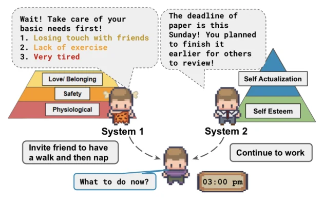
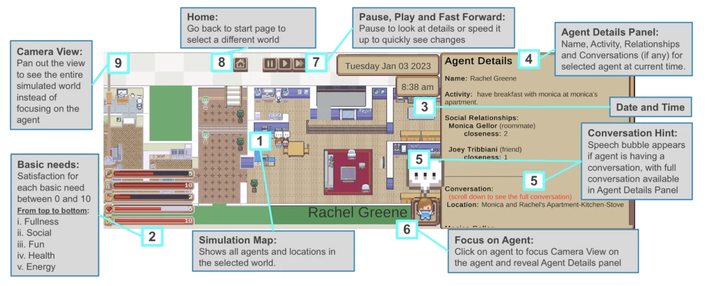
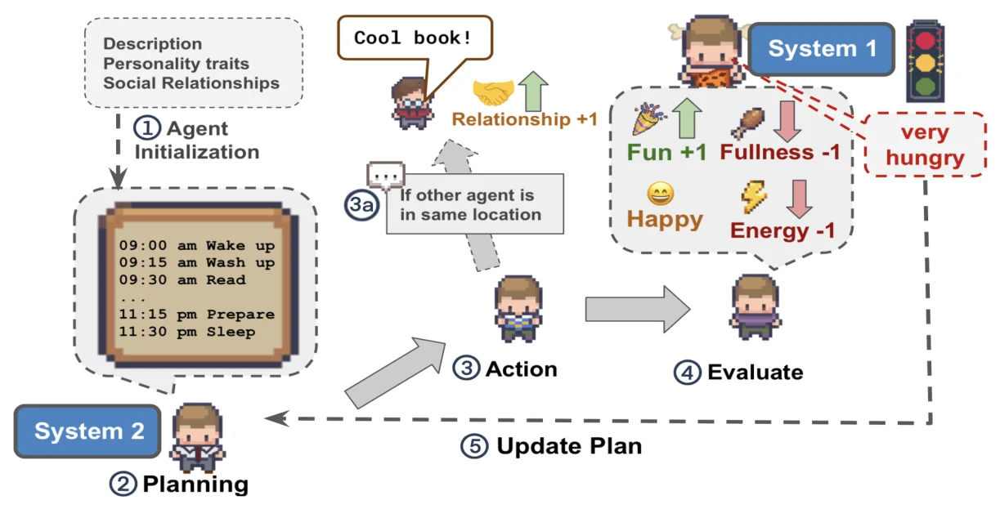
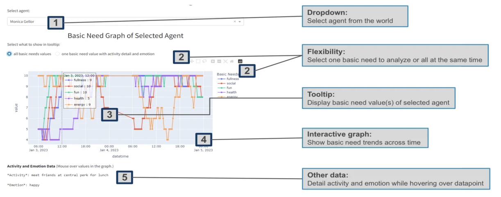

> - **논문**: Humanoid Agents: Platform for Simulating Human-like Generative Agents
> - **저자**: Zhilin Wang, Yu Ying Chiu, Yu Cheung Chiu (University of Washington, NVIDIA, The University of Hong Kong)
> - **학회**: EMNLP 2023 System Demonstrations · [arXiv:2310.05418](https://arxiv.org/abs/2310.05418) · [Code](https://github.com/HumanoidAgents/HumanoidAgents)
{: .prompt-tip }

> [Generative Agents]()의 주민들은 하루를 미리 짜고 그 계획을 15분 단위로 충실히 따른다. 하지만 사람은 그렇게 살지 않는다. 오후 3시에 너무 피곤하면 자정으로 잡아 둔 잠을 기다리지 않고 낮잠부터 잔다. **Humanoid Agents**는 이 "몸과 마음의 상태"를 0~10 욕구 점수, 7가지 감정, 0~30 친밀도라는 숫자로 에이전트에 붙이고, 숫자가 나빠지면 계획을 고치게 한다. 건강 점수를 0으로 두고 하루를 시작하면 에이전트들이 건강을 챙기는 데 쓰는 시간이 평소보다 평균 156% 늘어난다.

## 1. 문제: 계획만 따르는 에이전트는 몸이 없다

Generative Agents(GA)는 memory stream, reflection, planning으로 25명이 이틀을 사는 마을을 만들었다. 행동은 대부분 아침에 세운 하루 계획을 시간 단위, 15분 단위로 쪼갠 결과이고, 관찰이 들어올 때만 계획을 고친다.

저자들은 이 구조를 Kahneman의 두 사고 체계로 설명한다. System 2는 논리적이고 의도적이며 느리고, System 1은 직관적이고 즉각적이다. 논문은 GA가 "System 2에 집중하느라 System 1을 희생했다"고 본다.

- **욕구가 행동을 바꾸지 못한다.** 계획 단계에서 휴식 시간을 넣어 둘 수는 있다. 하지만 지금 피곤하다는 신호가 없으니 오후 3시에 낮잠을 자는 식의 적응이 일어나지 않는다.
- **감정이 없다.** 화가 난 에이전트라면 달리기나 명상처럼 감정을 풀 행동을 해야 한다.
- **관계의 거리가 대화에 반영되지 않는다.** 사람은 상대와 얼마나 가까운지에 따라 말을 고른다. 기존 persona 기반 대화 연구는 고정된 인물 설명 위에서만 답을 만들어, 시간에 따라 변하는 친밀도를 다루지 못했다.

논문의 답은 GA 위에 System 1에 해당하는 세 가지 수치 상태를 얹는 것이다. **기본 욕구(basic needs)**, **감정(emotion)**, **관계 친밀도(closeness)**이다.


_Figure 1. Humanoid Agents는 기본 욕구 같은 몸의 상태에 반응하는 System 1과 명시적으로 계획하는 System 2를 함께 따른다. 오후 3시에 System 2는 마감이 이번 일요일이니 일을 계속하라고 하고, System 1은 친구와 멀어졌고 운동이 부족하고 몹시 피곤하니 친구와 산책한 뒤 낮잠을 자라고 한다. (출처: Wang et al., 2023)_

## 2. 세 개의 세계와 시간

GA의 Smallville 25명을 그대로 쓰지 않고, 작은 세계 세 개를 만들었다.

| 세계 | 에이전트 | 초기 친밀도 |
|---|---|---|
| Lin's Family | John Lin, Eddy Lin (GA 논문에서 정보를 가져옴) | 5 (rather close) |
| Friends | Monica Gellor, Rachel Greene, Joey Tribbiani | 1~5 |
| Big Bang Theory | Sheldon Cooper, Leonard Hofstadter, Penny | 1~5 |

Friends와 Big Bang Theory 인물은 팬 위키의 인물 정보를 바탕으로 ChatGPT 3.5에게 설명과 예시 하루 계획을 만들게 했다. 이때 각 시리즈 시즌 1 1화 이전에 알려진 정보만 쓰게 했고, 초기 친밀도도 첫 화 시점에 서로 얼마나 아는 사이인지에 맞춰 1~5로 낮게 잡았다.

시뮬레이션은 평일 이틀, 오전 6시부터 자정까지 15분 간격이다. 하루가 72 time step이다. 모든 생성에는 GA와 같은 ChatGPT 3.5를 쓰고, 학습은 없다.


_Figure 3. Unity WebGL 게임 화면. 왼쪽 아래에 다섯 가지 기본 욕구가 0~10 막대로, 오른쪽 패널에 선택한 에이전트(Rachel Greene)의 활동, 친밀도, 대화가 나온다. 시뮬레이션이 남긴 JSON 상태 파일을 읽어 애니메이션으로 바꾼다. (출처: Wang et al., 2023)_

## 3. 구조: GA 위에 얹은 세 개의 숫자

전체 흐름은 Figure 2의 다섯 단계이다.

1. **초기화**: 설명, 성격, 관계와 함께 욕구·감정·친밀도의 시작 값을 정한다.
2. **계획**: GA처럼 하루 계획을 세우고 1시간, 15분 단위로 쪼갠다.
3. **행동**: 15분마다 계획에 있는 행동을 한다. 같은 장소에 다른 에이전트가 있으면 대화할 수 있다(3a).
4. **평가**: 방금 한 행동이 욕구를 채웠는지, 어떤 감정을 드러내는지 LLM에게 묻고 숫자를 갱신한다.
5. **계획 수정**: 욕구가 부족하거나 감정이 neutral이 아니면 남은 계획을 고친다.


_Figure 2. Humanoid Agents 구조. 1단계에서 사용자가 준 정보로 에이전트를 초기화하고, 2단계에서 하루를 계획하고, 3단계에서 행동한다. 4단계에서 행동이 욕구와 감정을 바꾸는지 평가하고, 5단계에서 그 결과로 앞으로의 계획을 고친다. 3a단계에서 같은 장소의 에이전트와 대화하면 관계 친밀도가 바뀐다. (출처: Wang et al., 2023)_

GA와 겹치는 부분(15분 단위 계획, 장소 선택, 대화 여부 판단)은 거의 그대로 쓴다. 새로 들어간 것은 4단계와 5단계, 그리고 대화 프롬프트에 붙는 상태 문장이다.

### 기본 욕구: 0~10 정수, 한 번에 1씩

Maslow의 욕구 위계에서 가져온 다섯 가지 욕구를 둔다. 각각 0(전혀 채워지지 않음)부터 10(완전히 채워짐)까지의 정수이다.

| 욕구 | 시작 값 | 채우는 행동(판정 프롬프트의 satisfaction-action) | 부족할 때 형용사 |
|---|---|---|---|
| fullness | 5 | eating food | hungry |
| social | 5 | interacting with other people | lonely |
| fun | 5 | doing something enjoyable | bored |
| health | 5 | doing something that improves their own physical health | unwell |
| energy | 10 | resting or having a break | tired |

energy만 10에서 시작하는 것은 아침에 막 일어난 상태를 흉내 낸 것이다. 갱신 규칙은 15분마다 욕구 $$k$$에 대해 다음과 같다.

$$
n_k \leftarrow \begin{cases} \min(10,\ n_k + 1) & \text{LLM이 "이 행동은 } k\text{를 채운다"고 답함} \\ \max(0,\ n_k - 1) & \text{그 밖의 경우, 확률 } p_k \\ n_k & \text{그 밖의 경우, 확률 } 1 - p_k \end{cases}
$$

판정은 욕구마다 따로 하는 yes/no 질문이다. 부록의 평가 템플릿은 "Does the activity {activity} involve {satisfaction-action}? Please respond only with either yes or no."이다. 친구와 점심을 먹는 행동은 fullness, social, fun을 한꺼번에 1씩 올릴 수 있다.

감소 확률 $$p_k$$는 논문 4.2절에 "5시간 동안 얼마나 줄어드는가"로 적혀 있다. 5시간은 20 step이다.

| 욕구 | 5시간당 감소(논문) | step당 감소 확률 $$p_k$$ |
|---|---|---|
| fullness | 1 | 0.05 |
| health | 1 | 0.05 |
| social | 4 | 0.20 |
| fun | 4 | 0.20 |
| energy | 5 | 0.25 |

저자들은 이 값을 "에이전트가 활동으로 욕구를 채우는 속도에 맞춰, 욕구가 행동에 충분히 영향을 주도록" 정했다고 쓴다. 사람의 생리에서 가져온 값이 아니라 시뮬레이션이 잘 움직이게 맞춘 값이다. 공개 저장소의 기본 설정 파일(`default_agent_config.json`)에는 다른 값이 들어 있다. fullness 0.05, social 0.05, fun 0.3, health 0.2, energy 0.2이다. 논문 실험이 어느 값으로 돌았는지는 논문만으로는 확인할 수 없다.

### 상태를 문장으로 바꿔 계획 고치기

숫자는 LLM이 읽을 수 있게 문장으로 바뀐다. 욕구가 3 이하이면 부족한 것으로 보고, 값에 따라 수식어를 붙인다.

| 욕구 값 | 수식어 | 문장 예 |
|---|---|---|
| 3 | slightly | John Lin is slightly hungry. |
| 2 | (없음) | John Lin is hungry. |
| 1 | very | John Lin is very hungry. |
| 0 | extremely | John Lin is extremely hungry. |
| 4 이상 | 문장 없음 | |

감정이 neutral이 아니면 공개 코드 기준으로 "John Lin is feeling extremely angry." 같은 문장이 붙는다. 이렇게 만든 상태 문장이 하나라도 있으면, 매 step 남은 15분 단위 계획과 함께 LLM에게 묻는다. 공개 코드의 프롬프트는 다음과 같다.

> Original plan: {planned_activities}
> Feelings: {agent_states_nl}
> Should {name} change their original plan? Please respond with either yes or no. If yes, please also then suggest a specific change in 1 sentence.

답이 yes이면 그 한 문장 제안과 원래 계획을 다시 LLM에 넣어 남은 계획 전체를 새로 쓴다. 논문의 예는 이렇다. 지금 몹시 배고픈데 제대로 된 식사는 3시간 뒤로 잡혀 있으면, 하던 일을 계속하면서 간식을 먹는 쪽으로 계획이 바뀐다.

GA에서 계획 수정은 외부 관찰(아들이 산책하는 것을 봤다)이 계기였다. 여기서는 에이전트 내부의 숫자가 계기이다. 상태 문장이 없는 step에는 이 질문 자체를 하지 않으므로, 욕구 4 이상에 감정이 neutral이면 GA와 같은 방식으로 계획만 따른다.

```python
import numpy as np

rng = np.random.default_rng(0)
STEPS = 72   # 6:00~24:00, 15분 간격

# 평소 하루 18시간 중 그 욕구를 채우는 활동 시간(논문 5.2절) → 15분마다 채울 확률
p_sat = {"fun": 11/18, "social": 8.75/18, "energy": 5.75/18,
         "fullness": 2.75/18, "health": 2.75/18}
# 채우지 못한 15분마다 1 줄어들 확률: 논문 4.2절(5시간=20스텝에 n만큼) / 공개 코드 설정값
p_dec_paper = {"fun": 4/20, "social": 4/20, "energy": 5/20, "fullness": 1/20, "health": 1/20}
p_dec_code  = {"fun": 0.3,  "social": 0.05, "energy": 0.2,  "fullness": 0.05, "health": 0.2}

def unmet_steps(ps, pd, runs=2000):
    # 0에서 시작해 행동을 바꾸지 않을 때, 하루 72스텝 중 '3 이하(unmet)'로 남는 스텝 수 평균
    total = 0
    for _ in range(runs):
        v = 0
        for _ in range(STEPS):
            total += v <= 3
            if rng.random() < ps:
                v = min(10, v + 1)
            elif rng.random() < pd:
                v = max(0, v - 1)
    return total / runs

print(f"{'need':9s} {'p_sat':>6s} | {'paper':>13s} | {'code':>13s}")
for k in p_sat:
    a = unmet_steps(p_sat[k], p_dec_paper[k])
    b = unmet_steps(p_sat[k], p_dec_code[k])
    print(f"{k:9s} {p_sat[k]:6.3f} | {a:5.1f} ({a/4:4.1f}h) | {b:5.1f} ({b/4:4.1f}h)")
```

```text
need       p_sat |         paper |          code
fun        0.611 |   7.5 ( 1.9h) |   8.1 ( 2.0h)
social     0.486 |  10.3 ( 2.6h) |   8.7 ( 2.2h)
energy     0.319 |  25.7 ( 6.4h) |  21.7 ( 5.4h)
fullness   0.153 |  34.9 ( 8.7h) |  34.1 ( 8.5h)
health     0.153 |  34.7 ( 8.7h) |  59.4 (14.9h)
```

이 토이는 욕구 하나를 0으로 두고, 에이전트가 행동을 전혀 바꾸지 않는다고 가정한다. 채울 확률은 논문이 밝힌 평소 하루의 활동 시간(18시간 중 fun 11시간, social 8.75시간, 휴식 5.75시간, 식사와 건강 각 2.75시간)에서 가져왔다. 그 상태에서 "부족함" 문장이 프롬프트에 몇 시간 동안 남는지를 센다. fun과 social은 평소에도 자주 채워지기 때문에 2시간 남짓이면 문장이 사라진다. fullness와 health는 8시간 넘게 남는다. 계획을 고치라는 압력이 오래 남을수록 행동 변화도 커질 것이므로, 이 결과는 5장에서 fun·social의 효과가 작게 나온 이유를 논문 설명과 같은 방향으로 보여 준다. 다만 토이는 행동이 바뀌는 효과를 넣지 않았고, energy가 fullness보다 효과가 큰 논문 결과(56% 대 35%)는 설명하지 못한다. 공개 코드 설정값을 쓰면 health는 평소 행동만으로는 거의 회복되지 않는다(14.9시간). 감소 확률을 어떻게 잡느냐가 실험 결과를 크게 좌우할 수 있다는 뜻이다.

### 감정: 7개 중 하나, 단계 없이 바뀐다

감정은 Ekman의 기본 감정에 neutral을 더한 7개 중 하나이다. angry, sad, afraid, surprised, happy, neutral, disgusted이며, 시작은 neutral이다. 행동을 할 때마다 LLM에게 그 행동이 드러내는 감정을 묻는다. 부록에 실린 판정 템플릿은 다음과 같다.

> In the following activity {activity}, what emotion is expressed? Please respond only with one word from this list ["neutral", "disgusted", "afraid", "sad", "surprised", "happy", "angry"].

욕구와 달리 감정에는 세기나 누적이 없다. 마지막 행동에서 읽어 낸 감정이 그대로 현재 감정이 된다. 대화가 끝나면 대화 기록으로 한 번 더 감정을 판정한다. 논문도 이 점을 인정한다. 슬픈 채로 일어난 에이전트가 세수 한 번 하고 나면 neutral로 돌아간다. 그래서 감정 실험(5장)에서는 감정 갱신을 아예 끄고 하루 내내 한 감정에 고정했다.

### 관계 친밀도: 대화 한 번에 ±1

각 에이전트는 다른 에이전트마다 0~30 정수의 친밀도를 가진다. 대화 프롬프트에는 숫자가 아니라 구간 이름이 들어간다.

| 친밀도 | 구간 | 프롬프트 문장 |
|---|---|---|
| 0~4 | distant | John Lin is feeling distant to Eddy Lin |
| 5~9 | rather close | John Lin is feeling rather close to Eddy Lin |
| 10~14 | close | John Lin is feeling close to Eddy Lin |
| 15 이상 | very close | John Lin is feeling very close to Eddy Lin |

기본 시작 값은 5이다. 구간의 맨 아래에서 시작해 관계가 어느 쪽으로든 움직일 수 있게 한 것이다. 대화 흐름은 GA와 같다. 같은 장소에 있으면 성격, 현재 행동, 상대의 행동 등을 보고 대화할지와 주제를 정한다. 상대는 대화 기록을 보고 답할지 정하고, 이것을 한쪽이 답하지 않을 때까지 번갈아 한다. 여기에 감정, 욕구 상태 문장과 친밀도 문장이 프롬프트에 더해진다. 대화 길이는 4096 토큰 context를 넘지 않도록 최대 10턴으로 자른다.

대화가 끝나면 각자 "Given this conversation {conversation}, did {name} enjoy the conversation?"에 yes/no로 답한다. yes이면 그 상대에 대한 친밀도가 1 오르고, no이면 1 내린다. 구간 하나가 5칸이므로, 구간이 바뀌려면 즐거운 대화가 최소 다섯 번 쌓여야 한다. 공개 코드에서 친밀도는 비대칭이다. John이 Eddy를 느끼는 값과 Eddy가 John을 느끼는 값이 따로 움직인다.

### GA와 무엇이 다른가

| 항목 | Generative Agents | Humanoid Agents |
|---|---|---|
| 계획 수정의 계기 | 외부 관찰에 대한 반응 판단 | 외부 관찰 + 내부 상태(욕구 3 이하, 감정 ≠ neutral) |
| 몸의 상태 | 없음 | 욕구 5개, 0~10, 행동마다 +1 또는 확률적 −1 |
| 감정 | 없음 | 7개 중 하나, 행동·대화마다 LLM이 다시 판정 |
| 관계 | memory stream 속 기억과 reflection으로 암묵적으로 표현 | 상대별 0~30 정수, 대화 후 enjoy 여부로 ±1 |
| 대화 프롬프트 | 에이전트 요약, 관련 기억 요약 | 위에 더해 감정·욕구 문장, 친밀도 문장 |
| 관련 기억 요약 (공개 코드 기준) | 저장소의 GA 재구현은 상대의 기억까지 검색 | 자기 기억만 검색 (주석에 앞쪽 방식이 버그라고 적음) |
| 규모 | 25명, 한 마을 | 2~3명씩, 세 세계 |
| 시각화 | Phaser 기반 2D 마을 | Unity WebGL 화면, Plotly Dash 대시보드 |

GA에서 "친하다"는 판단은 reflection이 기억을 종합해 만든 문장이었다. Klaus가 Maria를 고른 것도 그래서 가능했다. Humanoid Agents는 이 판단을 명시적인 정수 하나로 꺼내 두었다. 장점은 실험자가 값을 직접 정하고 바꿀 수 있다는 것이다. 5장의 실험은 모두 이 장점을 이용한다. 값을 0이나 15로 고정하고 행동이 어떻게 달라지는지 본다. 단점은 관계가 "즐거웠나"라는 한 축으로 줄어든다는 것이다.

공개 코드에서 확인되는 차이가 하나 더 있다. GA 클래스에 reflection 함수는 정의되어 있지만 시뮬레이션 루프에서 호출하지 않는다. 기억의 importance도 LLM에게 매기게 하지 않고 5로 고정한다. 그래서 retrieval 점수에서 importance 항은 순서에 영향을 주지 않고, recency 감쇠율은 GA 논문의 0.995 대신 0.99를 쓴다. 논문은 "GA를 따른다"고만 쓰고 이 차이를 밝히지 않는다. 공개 코드 기준으로 Humanoid Agents는 GA의 System 2 쪽(기억 정리)을 덜어 내고 System 1 쪽을 더한 구조로 읽어야 한다.

## 4. 평가 1: LLM 판정은 사람과 얼마나 맞는가

### 설정

세 가지 갱신 규칙은 모두 LLM의 yes/no 또는 한 단어 판정에 기대고 있다. 판정이 틀리면 숫자도 틀린다. 그래서 먼저 판정 정확도를 쟀다.

- **데이터**: Lin's Family 세계 하루치 시뮬레이션. 활동 144개(욕구 5개, 감정), 대화 30개(친밀도)
- **주석**: 자원봉사자 3명이 시스템과 같은 지시문으로 각자 표시
- **지표**: 주석자 간 Fleiss' $$\kappa$$, 다수결과 시스템 판정 사이 micro-F1

### 결과

| 판정 대상 | Fleiss' $$\kappa$$ | F1 |
|---|---|---|
| fullness | **0.972** | **0.972** |
| social | 0.833 | 0.743 |
| fun | 0.806 | 0.66 |
| health | 0.917 | 0.694 |
| energy | 0.88 | 0.861 |
| emotion | 0.823 | 0.84 |
| closeness | 0.556 | 0.9 |

사람끼리의 일치도는 모든 항목에서 0.556 이상이었다. 시스템은 fullness(0.972), energy(0.861), 감정(0.84), 대화로 가까워졌는지(0.9)에서 F1 0.84 이상을 냈다. fun(0.66), health(0.694), social(0.743)은 약했다.

### 실패 유형

약한 세 욕구의 원인은 과대 예측이다. 시스템이 그 욕구를 채운다고 판정한 활동의 비율과 사람이 그렇다고 표시한 비율이 크게 다르다.

| 욕구 | 시스템이 "채운다"고 판정한 비율 | 사람이 표시한 비율 |
|---|---|---|
| health | 34% | 4.9% |
| fun | 44.4% | 10.4% |
| social | 47.2% | 24.3% |

- **남의 건강을 자기 건강으로**: 약국 주인 John Lin이 손님의 약을 챙기는 일을 John 자신의 health를 채우는 행동으로 판정했다.
- **일상 업무를 즐거움으로**: "교수에게 피드백 받기", "단골손님의 약 챙기기"를 fun으로 판정했다.
- **혼자 하는 일을 사회 활동으로**: "계산대와 진열대 정리", "재고 확인 후 보충"처럼 다른 사람이 있는지 알 수 없는 일을 social로 판정했다.

저자들은 상식 추론이 더 좋은 LLM으로 이 문제를 줄일 수 있다고 본다.

과대 예측은 3장의 갱신 규칙과 맞물려 증폭된다. 채운다고 판정되면 +1이고, 아니면 확률적으로만 −1이기 때문이다. health를 34%의 활동에서 +1 하면 평균 상승량이 감소량보다 훨씬 커서 값이 천장에 붙는다. Figure 4의 대시보드에서 Monica Gellor의 다섯 욕구가 하루 대부분 8~10에 머무는 것도 이와 맞는 모습으로 보인다. 욕구가 3 이하로 내려가지 않으면 상태 문장이 생기지 않고, System 1은 작동할 기회가 없다.


_Figure 4. Plotly Dash로 만든 대시보드. 에이전트(여기서는 Monica Gellor)를 고르면 다섯 욕구의 시간별 값이 선 그래프로 나오고, 점 위에 마우스를 올리면 그 시각의 활동과 감정이 나온다. (출처: Wang et al., 2023)_

## 5. 평가 2: 숫자를 고정하면 행동이 바뀌는가

세 상태가 실제로 행동을 바꾸는지는 값을 하나만 극단으로 두고 하루를 돌려 평소와 비교했다. 본문은 욕구 실험만 싣고, 감정과 친밀도 실험은 부록에 있다.

### 욕구 하나를 0으로 시작

평소 조건(욕구 모두 5, energy 10)과, 욕구 하나만 0으로 시작한 조건을 비교한다. 지표는 하루 동안 그 욕구를 채우는 활동에 쓴 시간의 증가율(%)이다. 다음은 논문 Table 2이다.

| 욕구 | JL | EL | MG | RG | JT | SC | LH | P | 평균 |
|---|---|---|---|---|---|---|---|---|---|
| health | 211 | 57 | 53 | 210 | 240 | 207 | 207 | 60 | **156** |
| fullness | 62 | 36 | 62 | -45 | 50 | 112 | 0 | 0 | 35 |
| fun | -10 | -22 | 6 | 12 | -24 | -12 | 3 | -26 | -9 |
| social | 10 | 31 | 32 | -15 | -13 | 4 | 17 | 34 | 12 |
| energy | 38 | 96 | 47 | 81 | 80 | -39 | 153 | -5 | 56 |

JL·EL은 Lin's Family의 John·Eddy, MG·RG·JT는 Friends의 Monica·Rachel·Joey, SC·LH·P는 Big Bang Theory의 Sheldon·Leonard·Penny이다.

health(156%), energy(56%), fullness(35%) 순으로 행동이 많이 바뀌었다. 에이전트들은 진료를 받으러 가고, 더 쉬고, 음식을 찾았다. 저자들은 Maslow가 이 셋을 다른 욕구보다 먼저 채워야 하는 생리적·안전 욕구로 묶었다는 점과 결과가 맞는다고 해석한다. social은 12%만 늘었고 fun은 오히려 9% 줄었다.

fun과 social의 효과가 작은 이유로 논문은 평소 활동량을 든다. 평소에도 18시간 중 11시간을 즐거운 일, 8.75시간을 사람과 어울리는 일에 쓰니, 0에서 시작해도 오전 중에 금방 채워지고 그다음에는 일이 우선한다. Penny가 Cheesecake Factory에 일하러 가는 식이다. 3장의 토이가 이 설명을 숫자로 보여 준다.

### 감정을 하루 내내 고정

감정 갱신을 끄고 한 감정으로 고정한 뒤, 그 감정을 드러내는 15분 단위 활동의 수가 평소보다 몇 개 늘었는지 셌다. 다음은 논문 Table 3이다.

| 감정 | JL | EL | MG | RG | JT | SC | LH | P | 평균 |
|---|---|---|---|---|---|---|---|---|---|
| angry | 7 | 15 | 18 | 18 | 12 | 22 | 23 | 8 | **15** |
| sad | 6 | 22 | 8 | 8 | 15 | 9 | 8 | 6 | 10 |
| afraid | 3 | 16 | 4 | 1 | 12 | 5 | 14 | 24 | 10 |
| disgusted | 5 | 1 | 16 | 0 | 2 | 4 | 0 | 5 | 4 |
| surprised | 0 | 1 | 0 | 0 | 0 | 3 | 4 | 2 | 1 |
| happy | 6 | 0 | -9 | -9 | -18 | -4 | -6 | 16 | -3 |

화가 나면 달리기를 하러 가고, 슬프면 믿는 친구에게 기대고, 혐오를 느끼면 심호흡과 명상을 하고, 놀라면 그 일을 곱씹는다. 분노가 가장 큰 변화(+15개)를 만들었고 슬픔과 두려움이 각각 +10개였다. 저자들은 평소 계획에 부정적 감정을 다루는 활동이 없어 계획을 크게 고쳐야 했기 때문으로 본다. 혐오와 놀람은 원래 오래가지 않는 감정이라 효과가 작다고 해석한다.

happy는 오히려 줄었다. 이미 행복하니 당장 즐거운 일 대신 장기 목표에 시간을 썼다는 해석이다. Joey는 연기 연습에, Sheldon은 연구에 더 많은 시간을 썼다. 한편 본문은 happy의 평균 변화를 -2로 적지만, Table 3의 평균 열은 -3이고 여덟 명의 값을 직접 평균해도 -3(합 -24)이다.

### 친밀도를 고정한 대화

모든 쌍의 친밀도를 0, 5, 10, 15 중 하나로 두고, 값이 바뀌기 전인 처음 다섯 번의 대화만 분석했다. 다음은 논문 Table 4이다(LF: Lin's Family, F: Friends, BBT: Big Bang Theory).

| 친밀도 | 턴 수 LF | 턴 수 F | 턴 수 BBT | 긍정(%) LF | 긍정(%) F | 긍정(%) BBT |
|---|---|---|---|---|---|---|
| Distant (0) | 5.4 | 6.8 | 8.33 | 88.9 | **100** | **100** |
| Rather close (5) | **7.25** | 7.8 | 8.8 | 93.1 | 97.4 | **100** |
| Close (10) | 6.2 | **8.2** | **9.8** | **96.8** | 97.5 | 98.0 |
| Very close (15) | 6.0 | 7.2 | 8.0 | 90.0 | 97.2 | 97.5 |

대화 길이는 역U자이다. 멀면 짧게, 가까워지면 길게 말하다가 아주 가까워지면 다시 짧아진다. 정점은 부자 관계인 LF에서 rather close, 친구·이웃인 F와 BBT에서 close였다. 저자들은 가족은 낮은 친밀도에서도 말을 줄여도 관계가 흔들리지 않지만, 친구는 관계를 유지하려면 더 적극적으로 대화해야 하기 때문이라고 해석한다.

긍정 턴 비율은 F와 BBT에서 친밀도가 높을수록 조금씩 내려간다. 아주 가까우면 호감을 사려고 칭찬할 필요가 줄어든다는 해석이다. Joey가 Monica에게 거리를 느낄 때는 "어제 친구들이랑 그 식당에서 신나게 놀던데! 음식 정말 맛있어 보이더라. 그런 데는 어떻게 찾는 거야? 다음 데이트 때 쓸 데 좀 추천해 줘." 하고 띄워 주며 말을 건다. 아주 가까울 때는 "근처 식당에서 점심 먹던데, 음식 어땠어? 요리할 때 써 볼 새 메뉴를 늘 찾고 있거든." 하고 담백하게 묻는다.

LF는 distant에서 긍정 비율이 88.9%로 가장 낮다. 저녁 식사 뒤 Eddy는 John에게 거리를 느낄 때 "오늘 설거지 다른 사람한테 시키셨던데, 무슨 일 있어요? 이유가 있어요?"라고 따지듯 묻는다. 아주 가까울 때는 "같이 이야기하면서 차 한 잔 즐기시는 걸 보니 우리 사이가 더 소중하게 느껴졌어요."라고 말한다.

### 비판적으로 읽기

결과를 그대로 믿기 전에 볼 점이 몇 가지 있다.

첫째, 조건마다 에이전트 한 명의 하루 한 번만 돌린 결과로 보인다. 논문은 반복 실행 횟수, 분산, 통계 검정을 보고하지 않는다. 욕구 감소는 확률적이고 LLM 출력도 매번 다르다. 그런데 Table 2에서 같은 health 조건에도 Eddy는 57%, Joey는 240%이다. fullness를 0으로 두었는데 Rachel은 오히려 45% 줄었고, energy를 0으로 두었는데 Sheldon은 39% 줄었다. 평균 하나로 순위를 매기기에는 에이전트 간 편차가 너무 크다.

둘째, 행동 변화를 재는 잣대가 4장에서 약하다고 나온 바로 그 LLM 판정이다. "health를 채우는 활동에 쓴 시간"은 시스템이 health를 채운다고 판정한 활동으로 세었을 것이다. 사람 기준 4.9%인 것을 34%로 보는 판정기라면, 156%라는 증가에도 과대 판정이 섞여 있을 수 있다.

셋째, 친밀도 실험의 대화 수가 적다. 쌍마다 처음 다섯 번의 대화만 쓰고, LF는 에이전트가 두 명뿐이다. LF의 평균 턴 수 5.4와 7.25 차이가 우연인지 판단할 근거가 없다. "긍정 턴 비율"도 발화마다 "is the sentiment positive?"를 LLM에게 물은 값이라, 96.8%와 90.0% 같은 차이를 얼마나 믿을지 알기 어렵다.

넷째, 비교 대상이 "같은 시스템의 평소 조건"뿐이다. GA 원래 구조나 사람 행동 데이터와 비교한 실험은 없다. "더 사람 같다"는 주장은 각 결과가 심리학 문헌과 방향이 맞는다는 정성적 근거로만 뒷받침된다. 데모 논문이라는 성격을 감안해야 하는 부분이다.

## 6. 해석: Humanoid Agents가 남긴 것과 남긴 숙제

**남긴 것: 내부 상태를 "숫자 → 문장 → 계획 수정"으로 잇는 틀.** 0~10 정수를 3 이하에서만 "slightly/very/extremely hungry" 문장으로 바꿔 프롬프트에 넣는 방식은 단순하고, 다른 속성으로 넓히기 쉽다. 논문도 성격, 도덕적 가치, 공감, 문화적 배경 같은 속성을 같은 방식으로 붙일 수 있다고 밝힌다. [CoALA]()의 용어로 보면 working memory에 "몸의 상태"라는 새 칸을 만들고, 그 칸이 일정 조건을 넘을 때만 계획 수정이라는 결정 절차를 부르는 구조이다. 외부 관찰 없이도 에이전트가 스스로 계획을 고치는 계기를 만들었다는 점이 GA와 가장 크게 다르다.

**남긴 것: 실험할 수 있는 시뮬레이션.** GA의 관계는 기억 속에 흩어져 있어 실험자가 직접 조작할 수 없었다. Humanoid Agents는 욕구, 감정, 친밀도를 숫자 하나로 꺼내 두어 "이 값만 바꾸면 행동이 어떻게 달라지는가"를 물을 수 있게 했다. 5장의 실험 셋이 모두 이 형식이다. 대시보드로 시간에 따른 변화를 그대로 볼 수 있게 한 것도 계산 사회과학 연구자를 염두에 둔 설계이다. 목표 달성형 에이전트인 [Voyager]()가 기술 라이브러리로 능력을 쌓아 가는 것과 달리, 여기서는 정해진 목표 없이 하루를 사는 에이전트의 행동 자체가 관찰 대상이다.

**숙제 1: 판정기가 곧 물리 법칙이다.** 이 시스템에서 배고픔이 풀리는지, 관계가 가까워지는지는 모두 LLM의 yes/no 한 번으로 정해진다. 4장에서 health 판정이 사람보다 7배 가까이 "채운다"고 답했고(34% 대 4.9%), 그 결과 욕구가 천장 근처에 머무는 모습이 대시보드에서 보인다. 판정 오류가 누적되는 구조인데, 판정기를 바꾸면 결과가 얼마나 달라지는지는 실험하지 않았다. 감소 확률도 논문과 공개 코드의 값이 달라, 결과를 재현하려면 어느 설정인지부터 확인해야 한다.

**숙제 2: 감정과 관계가 너무 단순하다.** 감정은 세기 없이 행동 하나마다 다시 정해져서, 실험을 하려면 갱신을 꺼야 했다. 친밀도는 "대화가 즐거웠나"라는 한 축으로만 움직이고, 대화 내용이 갈등이었는지 화해였는지는 반영되지 않는다. 감소율도 모든 에이전트가 같다. 저자들은 외향적인 사람은 social이 더 빨리 줄도록 하는 개인차를 다음 과제로 꼽는다.

**숙제 3: 여러 에이전트의 조율.** 대화는 두 명 사이만 지원한다. 계획도 각자 따로 세워서, John이 8시에 Eddy와 영화를 보기로 계획해도 Eddy는 그 시각에 친구에게 전화를 하고 있을 수 있다. 논문 스스로 밝힌 한계이다. 에이전트 수도 세계당 2~3명이라, 욕구와 감정이 25명 규모의 마을에서 정보 확산이나 모임 같은 창발 행동을 어떻게 바꾸는지는 아직 보여 주지 못했다.

**숙제 4: 시뮬레이션을 과신하지 않기.** 저자들은 윤리 절에서 이 시스템이 사람 행동을 완벽히 반영하지 않으니 사용자가 결과를 과신하면 안 된다고 쓴다. 5장의 결과가 심리학 문헌과 "방향이 맞는다"는 것은 사람 행동을 재현했다는 뜻과 다르다. 사람 데이터와 직접 비교한 검증이 있어야 사회과학 도구로 쓸 수 있다.

## 7. 정리

| 항목 | 내용 |
|---|---|
| 핵심 아이디어 | GA(System 2 계획)에 욕구·감정·친밀도(System 1) 수치 상태를 붙여, 상태가 나빠지면 계획을 고치게 함 |
| 기본 욕구 | 5개, 0~10. 채우면 +1, 아니면 step당 확률 0.05~0.25로 −1. 3 이하이면 "slightly~extremely hungry" 문장으로 계획 수정 질문 |
| 감정 | 7개 중 하나, 행동·대화마다 LLM이 다시 판정. neutral이 아니면 계획 수정 질문 |
| 관계 친밀도 | 상대별 0~30, 5칸마다 구간. 대화가 즐거웠으면 +1, 아니면 −1 |
| 판정 정확도 | fullness F1 0.972, closeness 0.9. fun 0.66, health 0.694(과대 예측 34% 대 4.9%) |
| 행동 변화 | 욕구 0 시작 시 health +156%, energy +56%, fullness +35%. 분노 고정 시 관련 활동 +15개 |
| 대화 | 친밀도에 따라 턴 수가 역U자, 정점은 가족 rather close, 친구 close |
| 한계 | 단일 실행·통계 없음, LLM 판정 의존, 2인 대화, 계획 비동기, 논문과 코드의 설정 차이 |

## References

- Wang et al., "Humanoid Agents: Platform for Simulating Human-like Generative Agents," EMNLP 2023 System Demonstrations. [arXiv:2310.05418](https://arxiv.org/abs/2310.05418)
- Park et al., "Generative Agents: Interactive Simulacra of Human Behavior," UIST 2023. [arXiv:2304.03442](https://arxiv.org/abs/2304.03442)
- Kahneman, "Thinking, Fast and Slow," Farrar, Straus and Giroux, 2011.
- Maslow, "A Theory of Human Motivation," Psychological Review, 1943.
- Ekman, "An Argument for Basic Emotions," Cognition and Emotion, 1992.
- Sumers et al., "Cognitive Architectures for Language Agents," TMLR 2024. [arXiv:2309.02427](https://arxiv.org/abs/2309.02427)
- Wang et al., "Voyager: An Open-Ended Embodied Agent with Large Language Models," arXiv 2023. [arXiv:2305.16291](https://arxiv.org/abs/2305.16291)
