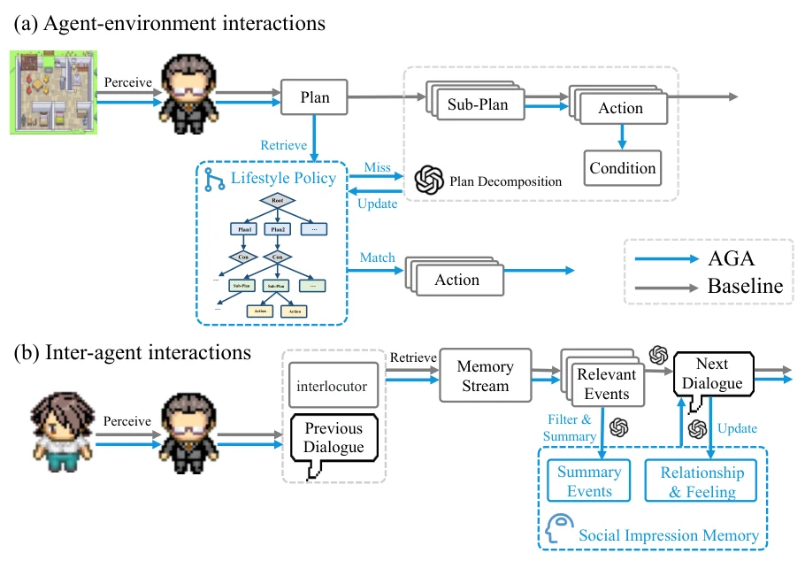
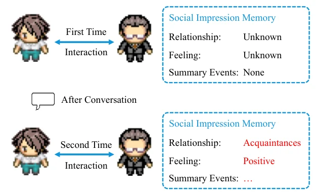
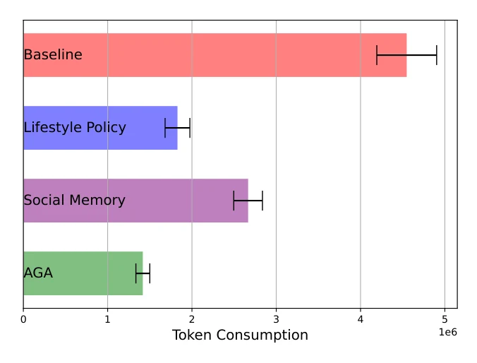
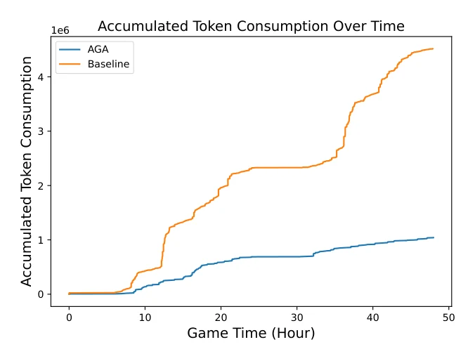
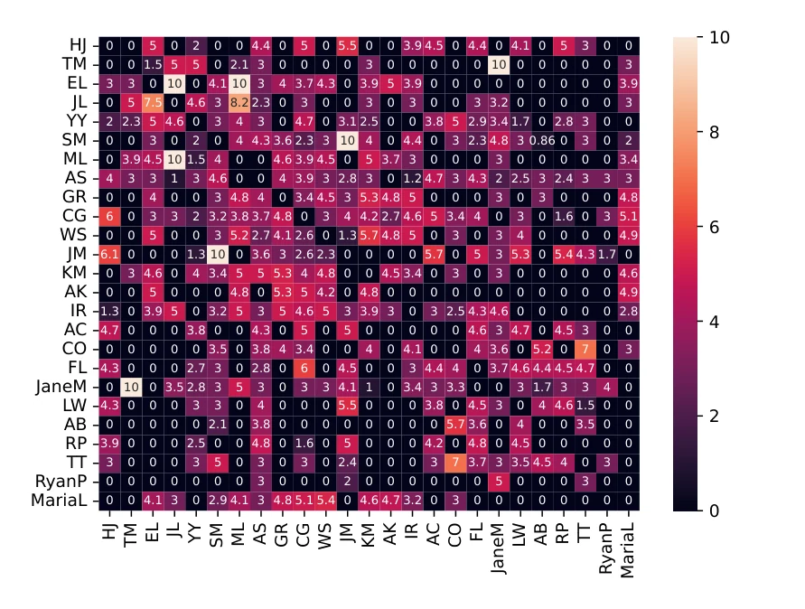
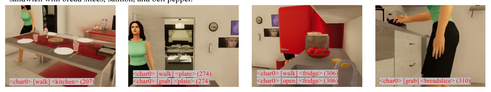
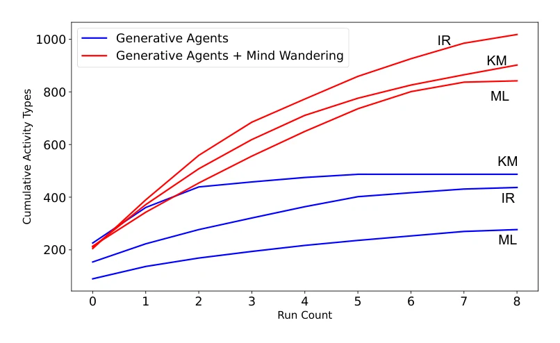
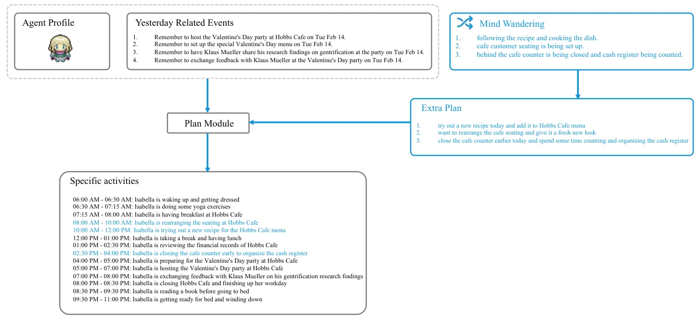

> - **논문**: Affordable Generative Agents
> - **저자**: Yangbin Yu, Qin Zhang, Junyou Li, Qiang Fu, Deheng Ye (Tencent)
> - **학회**: TMLR 2024 · [arXiv:2402.02053](https://arxiv.org/abs/2402.02053) · [Code](https://github.com/AffordableGenerativeAgents/Affordable-Generative-Agents)
{: .prompt-tip }

> [Generative Agents]()는 25명의 LLM 에이전트가 마을에서 이틀을 살게 했지만, 그 연구 전체에 수천 달러가 들었다. 에이전트는 매일 아침 "일어나서 씻고 준비한다"는 계획을 세우고, 그때마다 LLM에게 그것을 세부 행동으로 쪼개 달라고 다시 묻는다. **Affordable Generative Agents(AGA)**는 한 번 쪼갠 계획을 저장해 두었다가 비슷한 계획이 오면 재사용하고, 대화에 넣는 기억 2,000토큰을 100토큰짜리 요약과 관계 키워드로 바꾼다. 3인 마을을 게임 시간 이틀 동안 돌리면 토큰이 454.8만 개에서 141.7만 개로, 원래의 31.1%로 줄어든다.

## 1. 문제: 믿을 만한 에이전트는 오래 돌릴수록 비싸다

Generative Agents 같은 believable agent는 time step마다 지각, 계획, 반응, 대화를 위해 LLM을 부른다. 저자들은 LLM 비용이 호출 횟수, 프롬프트 길이, 모델 성능에 비례한다고 정리한다. 에이전트 시뮬레이션은 세 가지가 모두 크다.

- **연구 한 번에 수천 달러가 든다.** 논문은 Stanford Town 실험 전체 비용을 "수천 달러"로, 2~3명짜리 Humanoid Agents 시뮬레이션을 "시간당 몇 달러"로 인용한다. 정책의 장기 효과나 사회 현상을 시뮬레이션하거나, 게임 NPC로 쓰기에는 너무 비싸다.
- **기존 비용 절감 연구는 QA용이다.** LLM cascade, 요약, 배치 같은 방법은 COQA, QQP, RTE처럼 정답이 있고 문제끼리 독립인 단일턴 데이터셋에서 검증됐다. 에이전트는 정답이 없고, 장기 기억과 여러 모듈의 조율이 필요하다.
- **같은 결정을 매일 다시 내린다.** 에이전트는 매일 이를 닦고 세수를 하는데, Generative Agents는 이런 사소하고 반복되는 결정마다 LLM을 부른다.
- **대화 프롬프트가 기억 조각으로 부푼다.** baseline은 대화 한 턴마다 관련 기억 30~45개, 약 2,000토큰을 프롬프트에 붙인다. 비용이 늘 뿐 아니라 LLM이 핵심을 놓치기 쉽다.

논문은 에이전트의 상호작용을 둘로 나누고 각각에 모듈 하나씩을 붙인다. 에이전트-환경 상호작용에는 **Lifestyle Policy**, 에이전트끼리의 상호작용에는 **Social Memory**이다.

## 2. 구조: 두 종류의 상호작용을 따로 줄인다

AGA는 Generative Agents 코드 위에 얹는 구조이다. 학습은 없고, 바뀌는 것은 LLM을 언제 부르고 프롬프트에 무엇을 넣느냐이다.

1. 에이전트가 계획(plan)을 세운다. 이 단계는 baseline과 같다.
2. **Lifestyle Policy**에서 비슷한 계획을 찾는다. 찾았고 현재 환경이 실행 조건을 만족하면 저장된 행동을 그대로 실행한다. 못 찾으면 LLM이 계획을 쪼개고, 성공한 결과를 정책에 추가한다.
3. 다른 에이전트와 대화할 때는 관련 기억을 통째로 넣는 대신 **Social Memory**의 요약 사건(Summary Events)과 관계·감정 키워드를 넣는다.
4. 대화가 끝나면 관계와 감정을 LLM으로 갱신한다.


_Figure 1. (a) 에이전트-환경 상호작용과 (b) 에이전트 간 상호작용에서 AGA가 바꾼 부분이다. 회색 화살표는 baseline(Generative Agents), 파란 화살표는 AGA의 경로이다. (출처: Yu et al., 2024)_

reaction과 reflection 모듈은 일부러 건드리지 않았다. 저자들은 LLM의 유연성을 지키려고 이 둘을 그대로 두었고, 이것이 25인 마을에서 절감률이 낮아지는 이유가 된다(4장).

### Lifestyle Policy: 한 번 쪼갠 계획을 재사용하기

Lifestyle Policy는 사례 기반 추론(Case-Based Reasoning, CBR)에서 착안했다. 비슷한 문제를 예전에 풀었다면 그 풀이를 고쳐 쓴다는 생각이다. 동작은 두 단계이다.

**Plan Decomposition**은 처음 보는 상황에서 실행된다.

1. LLM이 환경 설명과 에이전트 정보로 대략적인 계획을 만든다.
2. 계획을 sub-plan으로 쪼개고, sub-plan을 구체적인 행동으로 바꾼다.
3. 행동 순서로부터 **실행 조건(condition)**을 만든다. 조건은 환경에 따라 다르다. 가정용 로봇이라면 관련 물건이 있는지, 상태가 맞는지가 조건이다.
4. 실행에 성공하면 계획 → sub-plan → 행동 → 조건으로 이어진 그래프 전체를 Lifestyle Policy에 저장한다.

**Policy Reuse**는 본 적 있는 상황에서 실행된다. 새 계획 설명을 임베딩해 저장된 계획들과 cosine 유사도를 비교한다.

$$
\text{match}(p_{\text{new}}, p_{\text{stored}}) \iff \cos\big(e(p_{\text{new}}),\, e(p_{\text{stored}})\big) > 0.97
$$

여기서 $$e$$는 Generative Agents와 같은 text-embedding-ada-002이다. 일치하는 계획이 있으면, 저장된 조건들을 하나씩 확인해 현재 환경이 만족하는 조건을 찾는다. 한 계획에 상황별로 여러 조건이 붙을 수 있다. 조건이 맞으면 LLM을 부르지 않고 저장된 행동을 실행한다.

논문의 예는 Klaus이다. Klaus가 "Klaus is waking up and completing his morning routine"이라는 활동을 만들면, 정책에 있는 "Klaus is waking up and getting ready for the day"와 일치한다. 그러면 저장된 세부 활동인 "stretching and getting out of bed", "washing his face and brushing his teeth", "heading out the door to go to the library"를 그대로 실행한다.

임계값 0.97은 꽤 높다. 너무 낮으면 다른 계획을 같은 것으로 보고 엉뚱한 행동을 하고, 너무 높으면 거의 같은 계획이 중복 저장된다. 부록에 실린 예시를 보면 이 경계가 어디쯤인지 감이 온다.

| 활동 1 | 활동 2 | 유사도 |
|---|---|---|
| Isabella is having breakfast and checking her emails | Isabella is having breakfast and checking emails | 0.99 |
| Isabella is heading home | Isabella is commuting back home | 0.96 |
| Isabella is preparing for the Valentine's Day party tomorrow | Isabella is preparing the cafe for the Valentine's Day party | 0.94 |
| Isabella is arriving at Hobbs Cafe and opening for business | Isabella is closing Hobbs Cafe and cleaning up | 0.93 |
| Isabella is preparing coffee and drinks for the customers | Isabella is managing inventory and restocking supplies at Hobbs Cafe | 0.90 |

0.97을 넘는 것은 첫 행뿐이다. "집에 간다"와 "퇴근해 집으로 간다"(0.96)도 다른 계획으로 친다. 반대로 "가게 문을 연다"와 "가게 문을 닫는다"가 0.93이나 된다는 점은, 임계값을 조금만 내려도 뜻이 반대인 계획이 섞일 수 있음을 보여 준다.

### Social Memory: 기억 조각 대신 요약과 관계

baseline의 대화는 이렇게 진행된다. 직전 대화를 질의로 memory stream에서 관련 사건을 모두 꺼내고, 그것을 직전 대화와 함께 프롬프트에 넣어 다음 말을 만든다. 사소하고 반복되는 사건이 많이 섞여서 프롬프트가 LLM의 토큰 한도를 넘기도 한다.

Social Memory는 대화 상대마다 두 가지를 저장한다.

| 구성요소 | 내용 |
|---|---|
| Summary Events | 상대와 관련된 사건들의 요약. 새로 꺼낸 사건 중 새 정보만 골라 요약에 합친다 |
| Relationship & Feeling | 상대와의 관계와 느낌을 키워드로 저장한다. 예: "Relationship: acquaintances, Feeling: friendly" |

Summary Events를 갱신하는 프롬프트는 다음과 같다.

> This is the summary of thoughts in &lt;agent's name&gt;'s Head: &lt;Summary Events&gt;
> The following sentence are new thoughts in &lt;agent's name&gt;'s Head: &lt;Newly retrieved events&gt;
> Considering the summary of the preceding thoughts, do these new statements contribute any additional information? If yes, please update the summary in a brief and precise way else just repeat the summary.

다음 말을 만들 때는 에이전트 정보, Summary Events, 현재 관계와 느낌, 지금까지의 대화를 넣고, 응답을 `conversation`과 `end`(대화를 끝낼지) 두 필드의 JSON으로 받는다. 대화가 끝나면 대화 요약, 현재 관계, 현재 느낌을 LLM에 다시 주고 관계와 느낌을 갱신한다. 모든 관계는 "Unknown"에서 시작한다.


_Figure 2. Social Memory가 대화 뒤에 갱신되며 관계가 바뀌는 예이다. 첫 만남에서 관계와 느낌은 Unknown이고, 대화 뒤 두 번째 만남에서는 Acquaintances, Positive가 된다. (출처: Yu et al., 2024)_

효과는 두 가지이다. 첫째, 대화 한 턴에 들어가던 관련 사건 30~45개(약 2,000토큰)가 약 100토큰 요약으로 줄어든다. 둘째, 관계가 명시되어 대화가 덜 엇나간다. 논문은 baseline에서 학생 Klaus가 카페 주인 Isabella를 같은 학생으로 착각하는 일이 있었는데, AGA에서는 관계를 갱신하는 장치 덕분에 이런 혼동이 줄었다고 쓴다.

## 3. 실험 설정: Smallville과 VirtualHome

### 환경

- **Generative Agents(Smallville)**: 원 논문이 공개한 3인 마을과 25인 마을에 AGA를 구현했다. 3인 마을에는 카페 주인 Isabella Rodriguez, 대학생 Klaus Mueller와 Maria Lopez가 산다.
- **VirtualHome**: 3D 가정 환경이다. 접시, 책상, 전자레인지 등 115종의 물건이 있고, 각 물건은 GRABBABLE, LIEABLE 같은 속성과 OPEN, CLOSED 같은 상태를 가진다. 저자들이 "집에서 알찬 하루 보내기"를 목표로 하는 LLM 에이전트 프레임워크를 따로 만들고 거기에 AGA를 붙였다. 행동은 "&lt;char0&gt; [walk] &lt;curtains&gt; (32)"처럼 에이전트, 동작, 물건 종류, 물건 ID로 된 명령이다.

### 모델과 지표

모델은 Generative Agents와 같은 GPT-3.5-Turbo를 기본으로 쓰고, GPT-4로도 시험했다. 비용은 **달러가 아니라 토큰 수**로 잰다. 지역과 시점에 따라 가격이 달라서, 같은 모델과 같은 과제에서 소비한 토큰을 비교한다. 그래서 논문에는 AGA로 몇 달러를 아꼈는지, LLM 호출이 몇 번 줄었는지는 나오지 않는다.

성능은 네 가지로 본다.

- **인터뷰**: Generative Agents의 25개 질문(self-knowledge, memory, plans, reactions, reflections)을 그대로 쓴다. 다만 원 논문의 사람 평가는 빼고 사례로만 보인다.
- **정보 확산**: Sam의 출마와 Isabella의 파티 소식을 아는 에이전트 수
- **관계 변화(Relationship Evolution)**: Social Memory의 관계 키워드를 GPT-4가 0~10점으로 매긴 지도
- **행동 평가(Behavioral Assessment)**: GPT-4가 활동 기록과 대화가 사람이 쓴 것인지 AI가 쓴 것인지 5점 Likert 척도로 판정한다. 5점이 가장 사람 같다.

VirtualHome에서는 계획 실행 성공률을 LLM과 사람이 각각 판정한다.

## 4. 평가 1: 토큰은 얼마나 줄었나

### 결과: 모듈별 기여

3인 마을을 GPT-3.5-Turbo로 게임 시간 이틀 동안 여러 번 돌려 평균을 냈다. baseline 대비 토큰 비율은 Lifestyle Policy만 쓰면 40.2%, Social Memory만 쓰면 58.6%, 둘 다 쓰면 31.1%이다.


_Figure 3. 3인 마을 이틀 시뮬레이션의 토큰 소비 ablation이다. Baseline은 Generative Agents, Lifestyle Policy와 Social Memory는 해당 모듈만 쓴 경우이다. (출처: Yu et al., 2024)_

이 숫자에는 조건이 붙는다. Lifestyle Policy는 이미 쌓인 정책을 재사용해야 효과가 나므로, Lifestyle Policy와 AGA는 **여러 번 미리 돌려 정책을 저장한 뒤** 측정했다. 정책을 쌓는 데 쓴 토큰은 이 비교에 들어가지 않는다.

### 결과: 인구와 모델에 따른 차이

마을 크기를 바꾸면 절감률이 달라진다(논문 Table 1).

| 마을 | Baseline | AGA | 비율 |
|---|---|---|---|
| 3인 | 4.548M ± 0.36M | 1.417M ± 0.08M | **31.1%** |
| 25인 | 25.41M ± 0.96M | 10.86M ± 0.13M | 42.7% |

25인 마을에서 절감률이 낮은 이유를 저자들은 이렇게 설명한다. 인구 밀도가 높으면 에이전트끼리 마주칠 확률이 커진다. 대화가 시작되면 계획을 고치느라 reaction 모듈이 불리고, 사건이 많아지면 reflection도 자주 돈다. AGA는 이 두 모듈을 바꾸지 않았으므로 그만큼의 비용이 그대로 남는다.

모델을 바꿔도 절감 비율은 비슷하다(논문 Table 2, 3인 마을, 단위 M = 100만 토큰, 표준편차 생략).

| 방법 | 모델 | 입력 토큰 | 출력 토큰 | 전체 토큰 |
|---|---|---|---|---|
| Baseline | GPT-3.5-Turbo | 4.212M | 0.313M | 4.525M |
| Baseline | GPT-4 | 4.682M | 0.398M | 5.069M |
| AGA | GPT-3.5-Turbo | **1.329M** | **0.092M** | **1.420M** |
| AGA | GPT-4 | 1.467M | 0.130M | 1.597M |

GPT-4는 계획을 더 자세히, 답을 더 길게 써서 토큰을 조금 더 쓴다. 표에서 계산하면 GPT-4에서도 AGA는 baseline의 약 31.5%(1.597M / 5.069M)이다. baseline 토큰의 약 93%(4.212M / 4.525M)는 입력 토큰이다. 관련 기억, 제약 조건, one-shot 예시를 프롬프트에 넣어야 하기 때문이고, AGA가 줄이는 것도 주로 이 입력 쪽이다.


_Figure 4. 3인 마을에서 게임 시간에 따른 누적 토큰 소비이다. baseline은 몇몇 시간대에 계단처럼 크게 뛰어 48시간에 약 4.5M에 이르고, AGA는 완만하게 오른다. (출처: Yu et al., 2024)_

### 비판적으로 읽기

- **정책을 쌓는 비용이 빠져 있다.** 31.1%는 "정책이 충분히 쌓인 뒤" 이틀의 비용이다. 처음 돌리는 마을에서는 Lifestyle Policy가 비어 있으므로 Social Memory만 쓴 58.6%에 가까울 것으로 보인다. 저자들도 한계에서 AGA의 이득이 단일 추론 최적화가 아니라 여러 번 실행하는 배치에서 나온다고 인정한다.
- **그림과 표의 숫자가 조금 다르다.** Figure 4의 AGA 곡선은 48시간에 약 1.0M에서 끝나지만 Table 2의 평균은 1.420M이다. 그림은 한 번의 실행으로 보이고, 실행마다 편차가 꽤 있다는 뜻으로 읽어야 한다.
- **25인 마을이 실제 용도에 더 가깝다.** 사회 시뮬레이션이나 NPC는 인구가 많고, 인구가 늘수록 절감률은 31.1%에서 42.7%로 나빠졌다. 수백 명 규모에서 어떻게 될지는 실험하지 않았다.

## 5. 평가 2: 줄인 만큼 무엇을 잃었나

### 인터뷰와 정보 확산

Klaus Mueller의 인터뷰 답변이 부록에 실려 있다. 자기소개("Oak Hill College에서 사회학을 공부하는 20살 학생이고, 젠트리피케이션이 저소득층 지역에 미치는 영향을 연구한다"), 다른 에이전트 설명, Sam의 출마와 Isabella의 발렌타인데이 파티를 모두 맞게 답한다. 저자들은 이것을 AGA가 baseline의 성능을 해치지 않는다는 근거로 든다.

25인 마을의 정보 확산은 다음과 같다.

| 소식 | Baseline(원 논문) | AGA(여러 번 실행) |
|---|---|---|
| Sam의 시장 출마를 아는 에이전트 | 8명 | 4~12명 |
| Isabella의 파티를 아는 에이전트 | 13명 | 12~17명 |

### 관계 변화

Social Memory의 관계 키워드를 GPT-4에게 0~10점(0: 모르는 사이, 3: 아는 사이, 5: 동료, 10: 부부)으로 매기게 해 25명 사이의 지도를 그렸다.


_Figure 5. 25명 에이전트 사이의 평균 관계 점수 지도이다. 축은 에이전트 이름의 머리글자이다. 같은 가족인 JL, ML, EL 사이는 10점이고, 처음에 서로 몰랐던 TM과 YY는 5점이 되었다. (출처: Yu et al., 2024)_

프로필에서 아내 Mei Lin(ML), 아들 Eddy Lin(EL)과 함께 산다고 설정된 John Lin(JL)은 두 사람과의 점수가 모두 10이다. 서로 몰랐던 Tom Moreno(TM)와 Yuriko Yamamoto(YY)는 5점이 되었다. 3인 마을에서는 카페에서 연구 이야기를 나눈 Klaus와 Maria가 동료(colleague)가 되고, 둘에게 커피를 내주며 이야기한 Isabella는 아는 사이(acquaintance)가 된다. 저자들은 여러 번 실행한 평균에서 마을이 "아는 사이 중심의 공동체"로 변해 간다고 해석한다.

### GPT-4가 매긴 사람다움

활동 기록과 대화를 GPT-4에게 보여 주고 사람이 쓴 것 같은지 1~5점으로 물었다(논문 Table 3).

| 방법 | 활동 | 대화 |
|---|---|---|
| Baseline | 3.13 ± 0.19 | 3.97 ± 0.02 |
| AGA | **3.21 ± 0.29** | **4.01 ± 0.01** |

두 방법 모두 대화는 4점 근처로 사람에 가깝다고 평가받았고, 활동은 3점 근처로 판단이 갈렸다. GPT-4가 활동을 AI로 의심한 주된 이유는 Generative Agents가 만드는 분 단위의 지나치게 자세한 활동이다. 부록의 실제 판정 하나는 Isabella의 하루 기록에 1점을 주며 "사람의 행동이라기엔 너무 자세하고 정확하다"고 썼다. 이 기록에는 "Isabella is commuting to Hobbs Cafe" 아래에 옷 입기, 이 닦기, 휴대폰 확인, 가방 싸기, 가족에게 인사, 차에 타기, 온도 조절, 운전, 주차가 줄줄이 붙어 있다.

### VirtualHome

VirtualHome 에이전트는 하루 동안 집안일 활동을 만들고, 각 활동을 행동 명령으로 쪼개 실행한다. 실패한 명령은 금지 목록에 넣고 다시 생성하며, critic 모듈이 활동이 끝났는지 판정한다.


_Figure 6. VirtualHome에서 AGA가 만든 활동의 일부이다. "접시를 들고 냉장고를 열어 피망을 꺼내 썰고, 빵·연어·피망으로 샌드위치를 만들어 점심을 먹는다"는 활동이 부엌으로 걷기, 접시 집기, 냉장고 열기, 빵 집기 같은 명령으로 실행된다. (출처: Yu et al., 2024)_

이 점심 활동은 정책에 있던 아침 활동 "I want to stand up and go to the kitchen to grab a plate and prepare a healthy breakfast with scrambled eggs, salmon, and bell peppers"와 일치해서, LLM에게 명령을 다시 쪼개 달라고 묻지 않고 저장된 명령을 실행했다. 결과는 논문 Table 4와 같다.

| 방법 | 하루 토큰 | 성공률(LLM 판정) | 성공률(사람 판정) |
|---|---|---|---|
| Baseline | 34,327 ± 4,210 | **87.0% ± 3.7%** | 42.6% ± 4.9% |
| AGA | **1,189 ± 313** | 85.0% ± 4.6% | **53.3% ± 6.9%** |

AGA의 토큰은 baseline의 3.4%이다. VirtualHome은 에이전트가 한 명뿐이라 절감은 대부분 Lifestyle Policy에서 나온다. 성공률은 LLM 판정으로 2%p 낮고 사람 판정으로 10.7%p 높다. 두 판정이 크게 어긋나는 것은 LLM이 정밀한 과제에서 일을 끝냈다고 일찍 판정하는 경향 때문이라고 저자들은 설명한다.

### 비판적으로 읽기

- **"성능이 같다"의 근거가 약하다.** 원 논문은 사람 평가자 100명의 순위로 TrueSkill을 냈지만, AGA는 사람 평가를 빼고 인터뷰 사례 하나와 GPT-4 점수로 대신했다. Table 3의 차이(3.13 대 3.21)는 표준편차(0.19, 0.29)보다 작아서 "비슷하다"까지만 말할 수 있다.
- **정보 확산 범위가 넓다.** Sam의 출마는 AGA에서 4~12명이다. 아래쪽 4명은 baseline 8명의 절반이다. baseline 숫자는 원 논문의 한 번 실행 값이어서 분산을 비교할 수 없다.
- **VirtualHome 사람 판정 성공률은 둘 다 절반 안팎이다.** AGA가 높게 나온 이유는 논문에 없다. 성공한 행동 순서만 정책에 저장되니, 재사용되는 계획이 이미 검증된 것이라는 선택 효과일 수 있다. 글쓴이의 추측이다.

### 실패 유형

- **임계값 근처의 오매칭**: 논문은 임계값이 낮으면 "부적절한 행동"이 나온다고만 쓰고 사례를 싣지 않았다. Table 5에서 "문을 연다"와 "문을 닫는다"가 0.93인 것이 그 위험을 보여 준다.
- **방에 없는 물건으로 세운 계획**: VirtualHome 실패의 주된 원인은 현재 방에 있는 물건이나 가능한 동작으로 생성된 계획을 실행할 수 없는 경우였다.
- **LLM 판정의 낙관**: 정밀한 과제에서 LLM이 완료를 일찍 선언해 LLM 성공률(85~87%)이 사람 성공률(43~53%)보다 훨씬 높다.

## 6. 분석: 에이전트의 행동은 유한하다

### 반복하면 새 활동이 바닥난다

AGA가 왜 통하는지 보려고, 저자들은 Generative Agents 3인 마을을 여러 번 돌리며 에이전트가 만든 서로 다른 활동 수를 누적했다. 몇 번 돌리고 나면 새 활동이 거의 나오지 않는다.


_Figure 7. 실행 횟수에 따른 누적 활동 종류 수이다. 파란 선(Generative Agents)은 5회 무렵부터 거의 평평해지고, 빨간 선(mind wandering 추가)은 8회까지 계속 오른다. ML, IR, KM은 Maria Lopez, Isabella Rodriguez, Klaus Mueller이다. (출처: Yu et al., 2024)_

그림에서 읽으면 Generative Agents의 누적 활동 종류는 8회 실행 뒤 Klaus 약 490개, Isabella 약 440개, Maria 약 275개에서 거의 멈춘다. 저자들은 다음 토큰 샘플링의 무작위성이 행동의 다양성보다 문장 표현의 변화를 만든다고 해석한다. 에이전트는 프로필이 정한 범위 안에서만 행동하고, 그렇다면 Lifestyle Policy를 충분히 돌리면 그 범위 전체를 덮어 계획 분해 비용을 없앨 수 있다는 것이다.

부록의 분석이 이것을 숫자로 보여 준다. 한 실행에서 Isabella의 기억 사건 가운데 idle 사건을 빼면 740개가 남는데, 그중 506개가 프로필 설정과 관련 있었다. DBSCAN으로 사건을 묶었을 때 가장 큰 클러스터는 "Hobbs Cafe 발렌타인데이 파티에 관한 대화"로 78개였다. "재고 확인", "커피 한 잔 하며 쉬기" 같은 사건은 한 번씩만 나왔다.

### Mind wandering: 무관한 기억을 일부러 섞기

행동이 유한하다는 것은 비용에는 좋지만 believable agent로서는 약점이다. 게임 AI가 예측 가능해서 사람 같지 않은 것과 같은 문제이다. 저자들은 인지과학의 mind wandering(과제와 무관한 생각이 떠오르는 현상)을 빌려, 매 상호작용마다 기억에서 무작위로 사건을 뽑아 보조 정보로 넣는다.

그냥 무작위로 뽑으면 파티 대화처럼 이미 많은 사건이 또 뽑힌다. 그래서 기억 사건의 임베딩을 DBSCAN으로 $$k$$개 클러스터 $$C_1, \dots, C_k$$로 묶고, 클러스터 $$C_i$$에 속한 사건의 샘플링 확률을 다음처럼 둔다.

$$
p_i = \frac{1}{k \cdot |C_i|}
$$

클러스터 하나에 속한 사건 확률의 합은 $$\vert C_i \vert \cdot p_i = 1/k$$이다. 즉 사건 수와 관계없이 모든 클러스터가 같은 확률로 뽑힌다. 아래 코드는 이 성질을 가상의 클러스터 크기로 확인한다. 가장 큰 다섯 클러스터 크기만 논문 Table 6에서 빌렸다.

```python
import numpy as np

rng = np.random.default_rng(0)

# 기억 사건의 클러스터 크기(가상). 앞 다섯 개는 논문 Table 6의 최빈 클러스터 크기를 빌렸다.
sizes = np.array([78, 11, 11, 10, 9] + [3] * 20 + [1] * 40)
k = len(sizes)
cluster_of = np.repeat(np.arange(k), sizes)      # 사건마다 속한 클러스터 번호
n = len(cluster_of)

p_uniform = np.full(n, 1 / n)                    # 사건을 똑같은 확률로 뽑기
p_mw = 1 / (k * sizes[cluster_of])               # 논문 식: p_i = 1 / (k |C_i|)

for name, p in [("uniform", p_uniform), ("mind wandering", p_mw)]:
    party = p[cluster_of == 0].sum()             # 가장 큰 클러스터(파티 대화)가 뽑힐 확률
    single = p[sizes[cluster_of] == 1].sum()     # 한 번뿐인 사건이 뽑힐 확률
    # 하루에 3개씩 30일 뽑을 때 한 번이라도 나온 클러스터 수(200번 반복 평균)
    seen = [len(set(cluster_of[rng.choice(n, size=90, p=p)])) for _ in range(200)]
    print(f"{name:15s} 파티 클러스터 {party:.3f} | 단발 사건 {single:.3f} | 30일 동안 본 클러스터 {np.mean(seen):.1f}/{k}")
print(f"사건 수 {n}, 클러스터 수 {k}")
```

```text
uniform         파티 클러스터 0.356 | 단발 사건 0.183 | 30일 동안 본 클러스터 32.8/65
mind wandering  파티 클러스터 0.015 | 단발 사건 0.615 | 30일 동안 본 클러스터 49.0/65
사건 수 219, 클러스터 수 65
```

균등하게 뽑으면 한 번 뽑을 때마다 35.6% 확률로 파티 대화 클러스터가 나온다. 프롬프트에 이미 있는 이야기를 한 번 더 넣는 셈이다. 논문 식으로 뽑으면 파티 클러스터는 1/65(0.015)로 줄고, 한 번뿐인 사건이 61.5%를 차지한다. 30일 동안 마주치는 서로 다른 클러스터도 32.8개에서 49.0개로 는다. 다만 이 코드는 "무엇이 뽑히는가"만 보여 준다. 뽑힌 사건이 LLM의 계획을 실제로 바꾸는지는 프롬프트와 모델에 달렸고, 토이로는 알 수 없다. 또 DBSCAN은 어느 클러스터에도 들지 않는 noise 점을 따로 두는데, 논문은 이 점들을 어떻게 다뤘는지 밝히지 않는다.

논문의 실제 예는 이렇다. 무작위로 뽑힌 "toilet is idle"이라는 사건을 받은 Isabella는 손님을 맞기 전에 화장실을 청소하고 싶다는 생각을 하고, 파티 전에 화장실 청소를 하루 계획에 넣는다. Figure 11은 다음 날 계획에 세 사건이 섞이는 과정을 보여 준다.


_Figure 11. Mind wandering이 Isabella의 하루 계획을 바꾸는 예이다. "레시피대로 요리한다", "카페 좌석을 배치한다", "카운터를 닫고 계산대를 정산한다"는 무작위 사건이 새 레시피 시도, 좌석 재배치, 카운터 일찍 닫기라는 추가 계획이 되고, 파란 글씨의 세부 활동으로 이어진다. (출처: Yu et al., 2024)_

mind wandering을 넣으면 Figure 7의 빨간 선처럼 활동 종류가 계속 늘어, 8회 실행 뒤 Isabella 약 1,020개, Klaus 약 900개, Maria 약 840개에 이른다(그림에서 읽은 값). 토큰 소비는 3인 마을 이틀에 1.478M ± 0.166M으로, mind wandering 없는 AGA(1.420M)와 크게 다르지 않았다.

## 7. 해석: Affordable Generative Agents가 남긴 것과 남긴 숙제

**남긴 것: Generative Agents의 "숙제 1: 비용과 속도"에 대한 첫 정량적 답.** [Generative Agents]() 리뷰에서 첫 숙제로 꼽은 것이 토큰 비용 수천 달러였다. AGA는 같은 코드, 같은 모델(GPT-3.5-Turbo)에서 토큰을 3인 마을 31.1%, 25인 마을 42.7%, VirtualHome 3.4%로 줄였다. 원리는 단순하다. 같은 질문을 두 번 하지 않고(Lifestyle Policy), 같은 기억을 길게 다시 보내지 않는다(Social Memory). 원 논문의 숫자가 "연구 전체 비용"이라 둘을 달러로 바로 맞대 볼 수는 없지만, 비용의 대부분이 입력 토큰(약 93%)이라는 사실과 그것을 줄이는 두 방향을 분명히 보였다.

**남긴 것: 성공한 행동을 저장해 재사용한다는 설계.** Lifestyle Policy는 [Voyager]()의 skill library와 같은 계열의 생각이다. Voyager는 검증된 코드를 설명 임베딩으로 저장해 비슷한 과제에 꺼내 쓰고, AGA는 실행에 성공한 계획 그래프를 조건과 함께 저장해 비슷한 계획에 꺼내 쓴다. Voyager에서는 그것이 능력의 축적이었다면, AGA에서는 비용 절감이다. Social Memory의 요약 갱신은 [MemGPT]()가 context 밖으로 밀려나는 대화를 요약으로 남기는 방식과 닮았다. 다만 MemGPT가 context 한도 문제를 풀려고 요약을 쓴다면, AGA는 같은 요약으로 토큰 비용과 관계 혼동을 함께 줄인다.

**남긴 것: "에이전트의 행동은 유한하다"는 관찰.** 고정된 환경과 프로필에서는 반복 실행할수록 새 활동이 바닥난다는 Figure 7은 비용 문제와 believability 문제를 한 그림에 묶는다. 행동이 유한하니 캐시할 수 있고, 캐시할 수 있을 만큼 유한하다는 것은 사람 같지 않다는 뜻이기도 하다.

**숙제 1: 잃는 것은 다양성과 반응성이다.** Lifestyle Policy는 0.97 이상 비슷한 계획에 저장된 행동을 그대로 다시 실행한다. Generative Agents가 매번 LLM에게 물어서 얻던 작은 변주, 예를 들어 오늘은 아침에 무엇을 먹을지가 사라진다. Figure 7의 포화는 원래 구조에도 있던 문제지만, AGA는 포화된 행동을 아예 고정한다. 또 Generative Agents의 강점은 "가스레인지가 탄다" 같은 상황 변화에 반응하는 것이었다. AGA에서 이 반응성은 조건 검사(물건이 있고 상태가 맞는가)와, 건드리지 않은 reaction 모듈에 맡겨진다. 조건에 적히지 않은 변화, 예를 들어 친구가 아프다는 소식은 저장된 아침 일과를 바꾸지 못한다. Social Memory의 요약도 마찬가지이다. 2,000토큰을 100토큰으로 줄이면 원 논문의 인터뷰에서 보인 "기억을 덜 꺼내는" 실패가 늘 수 있는데, AGA는 사람 평가를 하지 않아 이것을 확인하지 못했다.

**숙제 2: 절감의 바닥은 reaction과 reflection이다.** 25인 마을에서 절감률이 42.7%로 나빠진 이유는 손대지 않은 reaction과 reflection이다. 인구가 늘수록 대화와 사건이 늘어 이 두 모듈의 비중이 커진다. 수백 명 규모 시뮬레이션에서 비용이 정말 줄려면 이 두 모듈도 캐시하거나 작은 모델로 돌려야 하는데, 그러면 숙제 1의 반응성 손실이 더 커진다.

**숙제 3: 비용을 달러·호출 수·시간으로 재야 한다.** 논문은 토큰 수만 보고한다. 입력 토큰을 줄이는 Social Memory와 호출 자체를 없애는 Lifestyle Policy는 달러와 지연 시간에 미치는 영향이 다르다. 그런데 호출 횟수도, 실제 시간(latency)도 보고하지 않았다. 저자들도 latency를 향후 과제로 남겼다. 정책을 쌓는 데 든 초기 비용을 포함한 총비용도 없다.

**숙제 4: 평가를 다시 사람에게.** "같은 성능"의 근거가 인터뷰 사례, 정보 확산 범위, GPT-4의 5점 척도이다. 부록에서 GPT-4는 정수 점수를 요구받고도 4.5점을 내기도 했다. 원 논문처럼 사람 평가자가 같은 질문에서 baseline과 AGA의 답을 순위로 매겨야 무엇을 잃었는지 숫자로 말할 수 있다.

## 8. 정리

| 항목 | 내용 |
|---|---|
| 핵심 아이디어 | Generative Agents의 반복 결정과 긴 대화 프롬프트를 캐시·압축해 토큰 비용을 줄이는 프레임워크 |
| Lifestyle Policy | 성공한 계획 → sub-plan → 행동 → 조건 그래프를 저장하고, 임베딩 cosine 0.97 이상이고 조건이 맞으면 재사용 |
| Social Memory | 대화 상대별 Summary Events와 Relationship & Feeling. 관련 사건 30~45개(약 2,000토큰)를 약 100토큰으로 압축 |
| 토큰 절감 | 3인 마을 31.1%(4.548M → 1.417M), 25인 마을 42.7%, VirtualHome 3.4%(34,327 → 1,189) |
| 성능 | GPT-4 사람다움 점수 활동 3.13 → 3.21, 대화 3.97 → 4.01. 파티 소식 확산 12~17명(baseline 13명) |
| 분석 | 반복 실행하면 새 활동이 포화. 클러스터 크기에 반비례해 기억을 뽑는 mind wandering으로 다양성 확대 |
| 한계 | 정책 축적 비용 제외, 토큰만 보고(달러·호출 수·latency 없음), 사람 평가 없음, reaction·reflection은 그대로 |

## References

- Yu et al., "Affordable Generative Agents," TMLR 2024. [arXiv:2402.02053](https://arxiv.org/abs/2402.02053)
- Park et al., "Generative Agents: Interactive Simulacra of Human Behavior," UIST 2023. [arXiv:2304.03442](https://arxiv.org/abs/2304.03442)
- Wang, Chiu, and Chiu, "Humanoid Agents: Platform for Simulating Human-like Generative Agents," arXiv 2023. [arXiv:2310.05418](https://arxiv.org/abs/2310.05418)
- Puig et al., "VirtualHome: Simulating Household Activities via Programs," CVPR 2018.
- Wang et al., "Voyager: An Open-Ended Embodied Agent with Large Language Models," arXiv 2023. [arXiv:2305.16291](https://arxiv.org/abs/2305.16291)
- Packer et al., "MemGPT: Towards LLMs as Operating Systems," arXiv 2023. [arXiv:2310.08560](https://arxiv.org/abs/2310.08560)
- Chiang and Lee, "Can Large Language Models Be an Alternative to Human Evaluations?," ACL 2023. [arXiv:2305.01937](https://arxiv.org/abs/2305.01937)
- Slade, "Case-Based Reasoning: A Research Paradigm," AI Magazine 1991.
