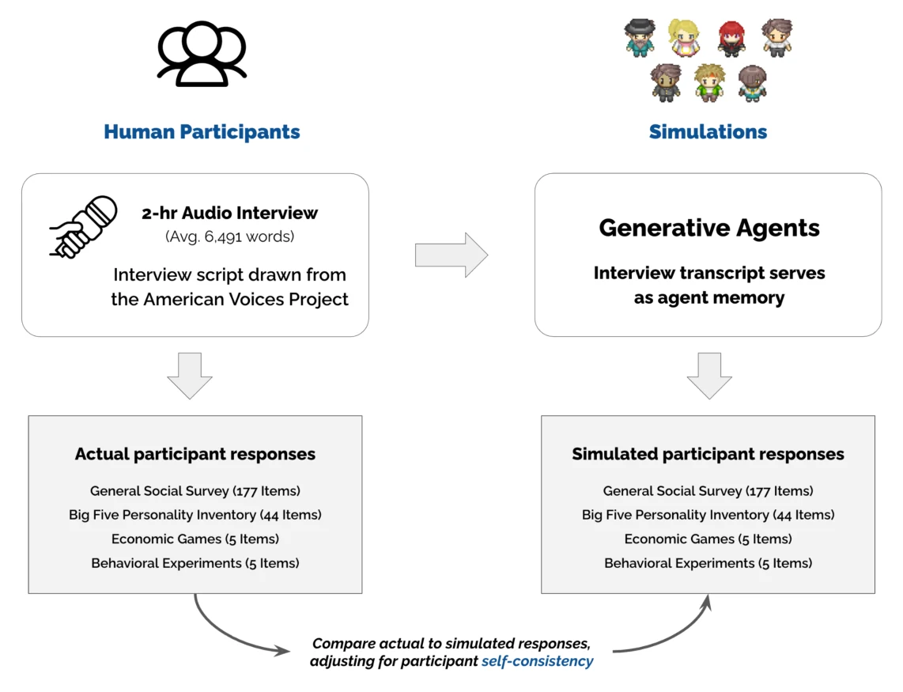
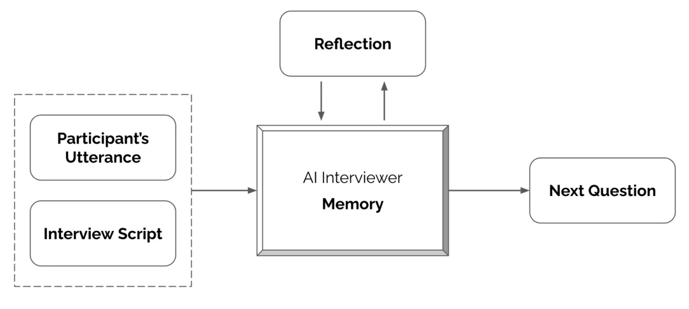
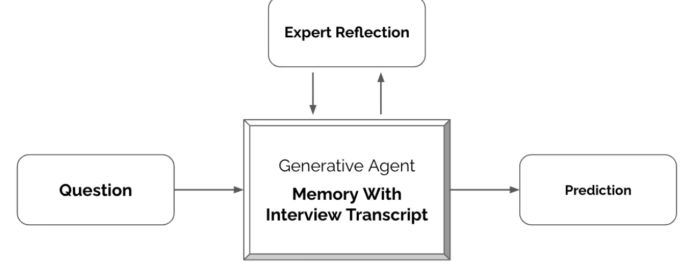
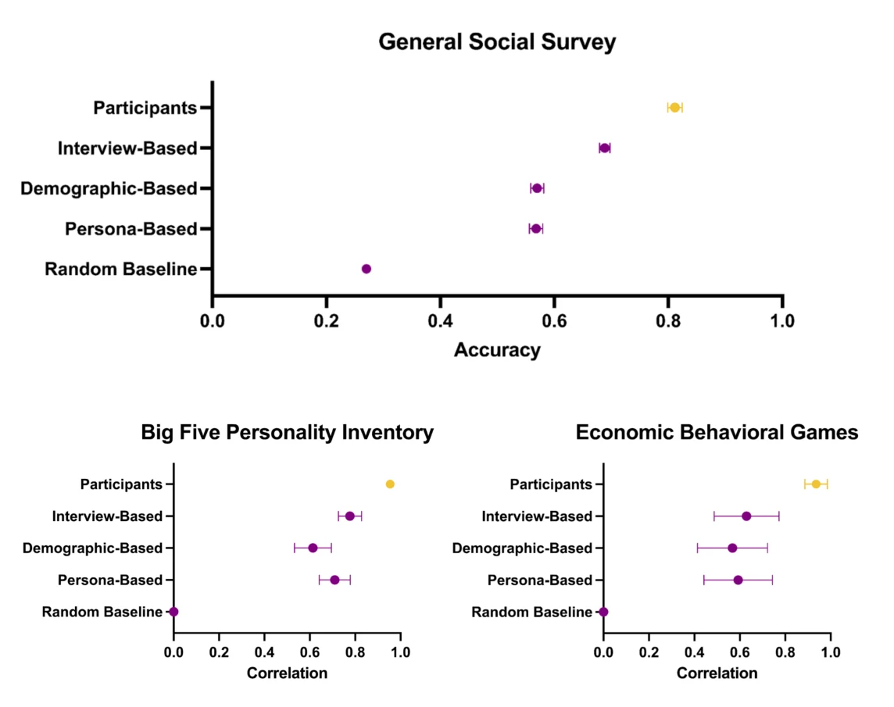
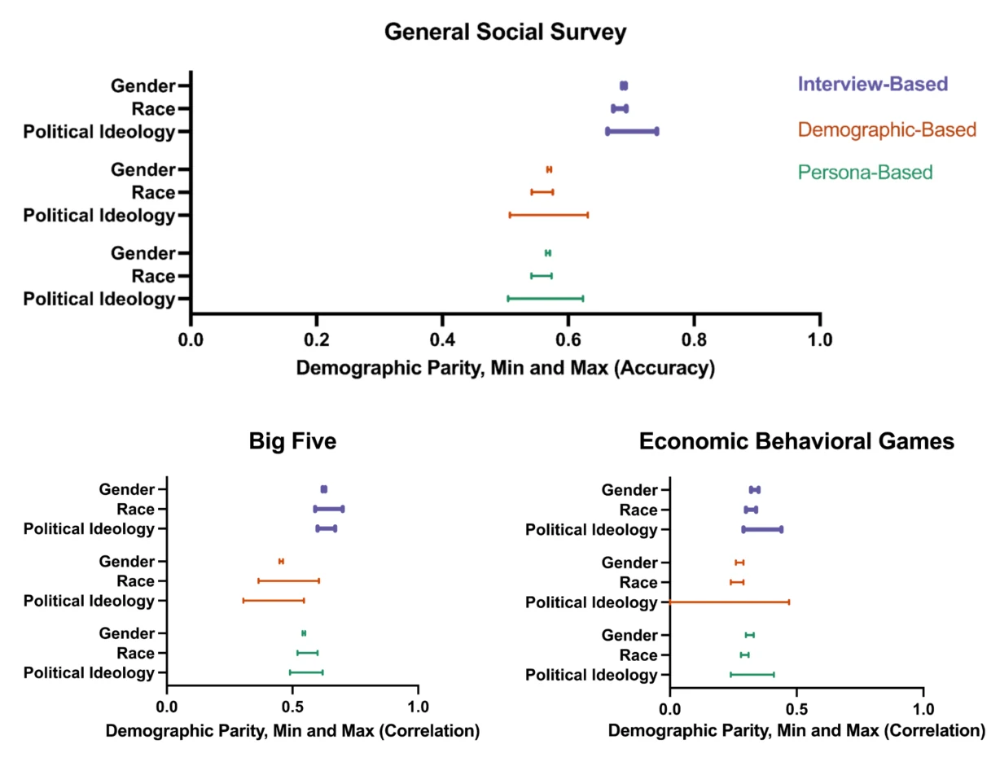

> - **논문**: Generative Agent Simulations of 1,000 People
> - **저자**: Joon Sung Park, Carolyn Q. Zou, Aaron Shaw, Benjamin Mako Hill, Carrie Cai, Meredith Ringel Morris 외 (Stanford University, Northwestern University, University of Washington, Google DeepMind)
> - **공개**: arXiv 2024 (v1) · [arXiv:2411.10109](https://arxiv.org/abs/2411.10109) · [Code](https://github.com/joonspk-research/generative_agent)
{: .prompt-tip }

> [Generative Agents]()의 Smallville 주민 25명은 한 문단짜리 가상 인물 설명에서 시작했다. 그래서 "믿을 만한가"는 사람이 순위로 매길 수밖에 없었고, "맞는가"는 물을 수 없었다. 정답이 있는 사람이 없었기 때문이다. **Generative Agent Simulations of 1,000 People**은 실제 미국인 1,052명을 AI 인터뷰어로 2시간씩 인터뷰하고, 그 전사본을 기억으로 삼아 한 사람마다 에이전트를 하나씩 만든다. 그러고 나서 에이전트가 자기 원본 사람의 설문 답을 맞히는지 잰다. General Social Survey에서 에이전트는 68.85%를 맞힌다. 같은 사람이 2주 뒤 자기 답을 다시 맞히는 비율(81.25%)의 85% 수준이다.

## 1. 문제: 인구통계 몇 줄로는 한 사람을 흉내 낼 수 없다

사회과학은 오래전부터 개인을 모형으로 만든 에이전트로 정책이나 이론을 시험해 왔다. 행위자 기반 모형(agent-based model), 게임 이론, 이산 선택 모형이 대표적이다. 이 모형들은 사람이 행동 규칙을 직접 정해 주기 때문에 해석은 쉽지만, 정해 준 좁은 맥락 밖에서는 쓸 수 없다.

LLM은 사람 행동에 관한 지식을 넓게 갖고 있어서 이 한계를 넘을 후보가 됐다. 그런데 LLM에게 "누구를 흉내 내라"고 할 때 무엇을 주느냐가 문제였다.

- **인구통계 프롬프트는 고정관념을 만든다.** 선행 연구(Argyle et al., 2023)의 방식은 "나는 보수적이고, 강한 공화당 지지자이며, 백인 남성이고, 50세이다" 같은 몇 줄을 주는 것이다. 같은 칸에 들어가는 사람은 모두 같은 사람이 된다. 논문은 이것을 "flattening agents into demographic stereotypes"라고 부른다.
- **가상 인물은 정답이 없다.** Generative Agents나 Social Simulacra처럼 가상 인물로 만든 에이전트는 그럴듯한지만 평가할 수 있다. 실제로 그 사람이 그렇게 답하는지는 확인할 방법이 없다.
- **평균 효과만으로는 부족하다.** LLM으로 사회과학 실험을 재현한 연구들은 대부분 처치 효과의 방향과 유의성이 맞는지만 봤다. 개인 수준에서 얼마나 맞는지는 측정하지 않았다.

논문의 답은 세 부분이다. 사람을 깊이 알기 위한 **AI 인터뷰어**, 그 인터뷰 전사본 전체와 **expert reflection**을 기억으로 쓰는 에이전트, 그리고 사람 자신의 일관성으로 나눈 **정규화 정확도(normalized accuracy)**이다.

## 2. 데이터: 1,052명, 2시간 인터뷰, 2주 뒤 재응답


_Figure 1. 데이터 수집과 에이전트 생성 과정. 층화 표본으로 모은 참가자가 AI 인터뷰어와 2시간 음성 인터뷰를 하고 설문과 실험에 답한다. 인터뷰 전사본으로 참가자마다 에이전트를 만들고, 에이전트에게 같은 설문과 실험을 풀게 한다. 참가자는 2주 뒤 같은 설문과 실험을 다시 풀고, 그 일관성으로 에이전트 정확도를 정규화한다. (출처: Park et al., 2024)_

참가자는 조사 회사 Bovitz에 맡겨 모았다. 연령, census division, 교육, 인종, 성별, 소득, 거주지 유형, 정치 성향, 성적 지향으로 층화한 미국 표본이다. 2단계 재참여에서 20% 정도 빠질 것으로 보고 1단계에 1,300명을 모았는데, 재참여율이 예상보다 높아서 대표성을 맞추려고 최종 1,052명을 남겼다.

| 항목 | 값 |
|---|---|
| 참가자 | 1,052명 (여성 593, 남성 459) |
| 나이 | 평균 47.55세 (std 15.93), 18~84세 |
| 보상 | 1단계 $60, 2단계 $30, 경제 게임 보너스 $0~10 |
| 인터뷰 길이 | 약 2시간, 참가자 발화 평균 6,491단어 (std 2,541) |
| 재응답 | 2주 뒤 같은 설문·실험을 인터뷰 없이 다시 응답 |

인터뷰 스크립트는 저자들이 직접 만들지 않았다. 스탠퍼드 불평등 연구 센터의 **American Voices Project**가 미국인 대표 표본을 약 3시간씩 인터뷰할 때 쓴 스크립트를 2시간 분량으로 줄였다. 소비 습관을 세세하게 묻는 질문, 코로나 시기 생활 변화 질문 등이 빠졌다. 평가에 쓸 설문을 염두에 두고 인터뷰 질문을 고르면 결과가 부풀려지기 때문이다. 스크립트에는 GSS와 주제가 겹치는 질문도 있지만, GSS 문항 자체나 성격 검사, 경제 게임에 해당하는 질문은 없다.

스크립트는 이렇게 시작한다.

> To start, I would like to begin with a big question: tell me the story of your life. Start from the beginning -- from your childhood, to education, to family and relationships, and to any major life events you may have had.

이 첫 질문에는 625초가 배정되어 있다. 스크립트의 질문마다 이런 시간 제한이 붙어 있고, 뒤로 가면 "최근 인종과 치안 문제에 관심이 커진 것에 어떻게 반응해 왔나요?" 같은 사회 이슈 질문, 부모의 학력과 직업, 앞으로 바라는 삶, "삶에서 가장 소중하게 여기는 것은?"이 이어진다.

동의 절차에도 공을 들였다. 저자들은 IRB와 6개월 넘게 협의했다. 전사본의 이름은 프로그램으로 가명으로 바꾸지만, 인생사와 정치적 견해 때문에 신원이 드러날 수 있다는 점을 참가자에게 알렸다. 데이터 삭제 요청은 연구 종료 뒤 25년 동안 받는다.

## 3. 구조: 인터뷰어와 에이전트

전체 흐름은 다음과 같다.

1. **인터뷰**: AI 인터뷰어가 스크립트 질문을 읽고, 답을 들으며 follow-up 질문을 할지 다음 질문으로 넘어갈지 정한다.
2. **Expert reflection**: 완성된 전사본을 GPT-4o에 주고, 네 분야 전문가의 눈으로 참가자에 대한 관찰을 미리 만들어 둔다.
3. **예측**: 질문이 들어오면 맞는 전문가를 고르고, 전사본 전체와 그 전문가의 reflection을 프롬프트에 넣어 답을 예측한다.

학습은 없다. 인터뷰어와 에이전트 모두 GPT-4o를 프롬프트로만 쓴다. 음성은 OpenAI의 TTS 모델로 읽고, 참가자 답은 Whisper로 받아 적는다.

### AI 인터뷰어: 스크립트를 지키면서 더 묻기

사람 인터뷰어 수백 명을 쓰면 인터뷰 품질이 사람마다 달라지고 규모를 키우기도 어렵다. 그래서 저자들은 Generative Agents 구조를 변형해 인터뷰어 에이전트를 만들었다. 이름은 Isabella이고, 프롬프트에는 "friendly and curious"라고 적혀 있다.

인터뷰어가 하는 일은 매 턴 두 가지 중 하나를 고르는 것이다.

| 행동 | 예시 |
|---|---|
| follow-up 질문 | "뉴햄프셔에서 태어났고… 거기서 자연을 정말 좋아했다"는 답에 "어릴 때 좋아했거나 기억에 남는 뉴햄프셔의 산길이나 야외 장소가 있었나요?"라고 묻는다 |
| 다음 질문으로 이동 | 직업을 묻는 질문에 "치과 의사이다"라고 답하면 충분히 답했다고 보고 넘어간다 |

문제는 인터뷰가 길어지면 지금까지의 대화를 다 넣을 수 없다는 것이다. 긴 프롬프트의 중간 정보를 LLM이 놓치는 현상(lost in the middle)도 있다. 그래서 인터뷰어에는 **reflection 모듈**이 있다. 대화가 진행되는 동안 참가자에 대한 짧은 노트를 계속 만든다. 위 참가자라면 다음과 같다.

> { "place of birth": "New Hampshire", "outdoorsy vs. indoorsy": "outdoorsy with potentially a lot of time spent outdoors" }

다음 발화를 만들 때는 전사본 전체 대신 이 reflection 노트와 최근 5,000자의 전사본만 넣는다. 질문 생성 프롬프트는 먼저 "지금까지 무슨 말을 했고, 무엇이 인터뷰 목표 달성인지"를 3~4문장으로 평가하게 하고, 그다음 follow-up 질문을 쓰게 한다. 참가자가 사생활을 이유로 명시적으로 답을 거부하면 다른 주제로 돌려 억지로 답을 끌어내지 말라는 safety note도 들어 있다.


_Supplementary Figure 2. AI 인터뷰어 구조. 참가자 발화와 인터뷰 스크립트를 받아 follow-up 질문을 할지 다음 질문으로 넘어갈지 정한다. reflection 모듈이 진행 중인 인터뷰를 짧게 요약하고 참가자에 대한 추론을 쌓아, 더 나은 follow-up 질문을 만들게 한다. (출처: Park et al., 2024)_

실제 인터뷰에서 인터뷰어는 스크립트 질문 99개에 더해 follow-up 질문을 평균 81.71개(std 54.39) 했다. 인터뷰어 발화는 평균 5,372.59단어, 참가자 발화는 평균 6,491.19단어이다. 참가자가 4초 넘게 말이 없으면 녹음을 끝내고, 인터뷰어는 대체로 4초 안에 다음 말을 시작한다.

논문이 보여 주는 인터뷰 일부에서, 첫 질문만 스크립트이고 나머지는 생성된 것이다. 참가자가 "어린 시절이 별로 좋지 않아서 고등학교로 넘어가는 게 정말 기뻤다"고 하자, 인터뷰어는 "어린 시절이 좋지 않았다니 안타깝네요. 고등학교 시절 이야기를 더 들려주실 수 있을까요?"라고 이어 간다. 참가자는 머리 부상, 고등학교 내내 겪은 우울, Pink Floyd의 The Wall 앨범에서 위로받은 이야기까지 꺼낸다.

파일럿은 2023년 8월부터 11월까지 했다. 사람 인터뷰어가 10건, AI 인터뷰어가 25건을 진행했고, AI 인터뷰어의 전사본으로 만든 에이전트가 사람 인터뷰어의 전사본으로 만든 에이전트와 GSS 예측에서 비슷한 성능을 냈다고 한다. 다만 이 비교의 수치는 논문에 없다.

### Expert reflection: 네 전문가의 눈으로 미리 읽어 두기

전사본만 주고 한 번의 chain of thought로 답을 예측하게 하면, 인터뷰에서 직접 말하지 않은 정보를 놓칠 수 있다. Generative Agents의 reflection은 "최근 기억에서 상위 수준의 통찰을 뽑으라"는 하나의 질문이었다. 이 논문은 이것을 **expert reflection**으로 바꾼다. 같은 전사본을 네 사회과학 분야 전문가의 페르소나로 각각 읽게 한다.

| 전문가 | 실제로 생성된 reflection (논문 예시, 이름은 가림) |
|---|---|
| Psychologist | 독립성을 중시하고 자율을 분명히 선호한다. 출장을 즐기고, 어머니의 과보호에 답답해한다 |
| Behavioral Economist | 편안한 휴가를 위해 저축하고 관리자 승진을 바라는 것은, 현실적인 재무 목표와 여가 욕구를 함께 갖고 있음을 보여 준다 |
| Political Scientist | 공화당 지지자이고 이민·마약 정책에서 당의 입장을 강하게 지지한다. 하지만 낙태권, 마리화나 합법화처럼 전통적으로 민주당 쪽인 입장도 지지한다 |
| Demographer | 재고 담당자로 월 $3,000~5,000을 벌고, 가구 소득은 월 $7,000 정도이다 |

전문가마다 프롬프트가 조금씩 다르다. 인구통계학자의 프롬프트는 다음과 같다.

> Imagine you are an expert demographer (with a PhD) taking notes while observing this interview. Write observations/reflections about the interviewee's demographic traits and social status. (You should make more than 5 observations and fewer than 20. Choose the number that makes sense given the depth of the interview content above.)

reflection은 참가자마다 한 번만 만들어 기억에 저장한다. 질문이 들어오면 먼저 LLM에게 "이 질문에는 네 전문가 중 누가 가장 잘 답하겠는가"를 분류하게 하고, 그 전문가의 reflection 전부를 전사본 뒤에 붙인다. Generative Agents처럼 recency·importance·relevance 점수로 기억을 고르지 않는다. 전사본은 통째로 넣는다. 한 사람의 기억이 2시간 인터뷰 하나뿐이라 GPT-4o의 context에 다 들어가기 때문이다.

### 예측: 선택지마다 어떤 사람이 고를지 먼저 묻기

예측 프롬프트는 4단계 chain of thought이다.

1. **Option Interpretation**: 각 선택지를 고를 만한 사람이 어떤 사람인지 몇 문장으로 쓴다.
2. **Option Choice**: 선택지마다 이 참가자가 그것을 고를 이유를 따진다.
3. **Reasoning**: 어느 선택지가 가장 잘 맞는지 몇 문장으로 추론한다.
4. **Response**: 인터뷰와 위 생각을 바탕으로 실제 답을 예측한다.

수치형 응답이면 1단계가 "범위의 양 끝을 고를 사람이 어떤 사람인지"(Range Interpretation)로 바뀌고, 2단계가 빠진 3단계가 된다. 경제 게임이나 실험처럼 여러 단계에 걸친 과제에서는, 앞에서 받은 자극과 자기가 한 행동을 자연어로 전사본 뒤에 덧붙인다.


_Supplementary Figure 4. 에이전트 구조. 질문을 받아 원본 참가자가 어떻게 답할지 예측한다. 기억은 인터뷰 전사본과 그 전사본에 대한 expert reflection으로 이루어진다. reflection은 심리학자, 행동경제학자 같은 전문가 페르소나로 생성한 짧은 종합이다. (출처: Park et al., 2024)_

### 정규화 정확도: 사람 자신을 기준선으로

사람은 같은 질문에 늘 같은 답을 하지 않는다. 오늘 "정부가 환경에 돈을 너무 적게 쓴다"고 답한 사람이 2주 뒤에는 "적당하다"고 답할 수 있다. 그러면 원본 사람의 답을 100% 맞히는 에이전트는 있을 수 없고, 맞힐 수 있는 상한도 사람마다 다르다. 그래서 논문은 참가자에게 2주 간격으로 같은 설문과 실험을 두 번 풀게 하고, 에이전트의 정확도를 참가자 자신의 재현율로 나눈다.

$$
\text{normalized accuracy} = \frac{\text{에이전트가 1차 응답을 맞힌 비율}}{\text{참가자가 2주 뒤 자기 1차 응답을 다시 고른 비율}}
$$

1.0이면 에이전트가 그 사람을 그 사람 자신만큼 잘 맞힌다는 뜻이다. 사람마다 계산한 뒤 평균한다. 과제별 지표는 다음과 같다.

| 과제 | 응답 형태 | 원래 지표 | 정규화 지표 |
|---|---|---|---|
| GSS | 범주형 177문항 | 정확도 (정확히 같은 선택지) | 정규화 정확도 |
| Big Five | 1~5 척도 5차원 | MAE, 상관 | 정규화 상관 |
| 경제 게임 | 0~1로 정규화한 금액·선택 | MAE, 상관 | 정규화 상관 |

MAE는 정규화하지 않는다. 두 번 똑같이 답한 참가자는 재응답 MAE가 0이라 분모가 0이 되기 때문이다. 상관계수를 평균할 때는 Fisher z 변환을 쓴다. 지표와 핵심 분석은 OSF에 사전 등록했다.

## 4. 평가 1: 한 사람의 태도와 행동을 맞히는가

### 설정

평가 과제는 셋이다.

- **General Social Survey(GSS)**: 1972년부터 이어진 미국 사회 조사의 core 모듈이다. 조건부 문항, 선택지가 25개를 넘는 문항, 자유 응답 문항을 빼고 범주형 177문항(그리고 수치형 6문항)을 썼다. 문항당 선택지는 평균 3.70개라 무작위로 고르면 27.03%를 맞힌다.
- **Big Five(BFI-44)**: 44문항으로 개방성, 성실성, 외향성, 우호성, 신경성을 잰다. 에이전트는 문항 하나하나에 답하고, 그 답으로 차원 점수를 계산한다.
- **경제 게임 5개**: 실제 돈이 걸린다. Dictator Game($5를 상대와 나누기), Trust Game 1번 플레이어($3 중 보낼 돈, 보낸 돈은 3배가 됨)와 2번 플레이어(돌려줄 돈), Public Goods Game(4명이 각자 $4 중 공동 계정에 낼 돈, 공동 계정은 2배로 불려 똑같이 나눔), Prisoner's Dilemma(둘 다 협력 $6씩, 한쪽만 배신하면 $8과 $2, 둘 다 배신 $4씩)이다. 참가자에게는 다섯 중 하나를 골라 보너스를 준다고만 알렸고, 실제로는 미리 무작위로 정해 둔 Dictator Game으로 보너스를 계산했다.

비교 대상은 프롬프트에 인터뷰 대신 다른 설명을 넣은 에이전트 둘이다.

- **Demographic-based**: 참가자의 GSS 응답으로 Argyle et al. 방식의 설명을 만든다. "Ideologically, I describe myself as conservative. Politically, I am a strong Republican. Racially, I am white. I am male. In terms of age, I am 50 years old."
- **Persona-based**: 참가자가 1단계 끝에 "처음 보는 사람에게 자신을 소개하듯" 직접 쓴 짧은 문단이다. "뉴욕 출신 20살이다. 노동자 중산층 가정 출신이고, 스포츠와 자연을 아주 좋아한다. …"

### 결과

논문 Table 8을 옮긴다. 정확도와 MAE는 원래 값, 괄호는 표준편차이다.

| 과제 | 조건 | 원래 지표 | 상관 | 정규화 |
|---|---|---|---|---|
| GSS | 참가자 2주 뒤 재응답 | 81.25% (8.11) | 0.83 | 1.00 |
| | Interview | **68.85%** (6.01) | **0.66** | **0.85** (0.11) |
| | Demographic | 57.00% (7.45) | 0.51 | 0.71 (0.11) |
| | Persona | 56.79% (7.76) | 0.50 | 0.70 (0.11) |
| Big Five | 참가자 2주 뒤 재응답 | MAE 0.30 | 0.95 | 1.00 |
| | Interview | MAE **0.67** | **0.78** | **0.80** (1.88) |
| | Demographic | MAE 0.76 | 0.61 | 0.55 (2.25) |
| | Persona | MAE 0.74 | 0.71 | 0.75 (2.59) |
| 경제 게임 | 참가자 2주 뒤 재응답 | MAE 0.25 | 0.99 | 1.00 |
| | Interview | MAE **0.32** | **0.66** | **0.66** (2.83) |
| | Demographic | MAE 0.34 | 0.57 | 0.48 (2.90) |
| | Persona | MAE 0.33 | 0.60 | 0.57 (2.84) |


_Figure 2. 에이전트의 예측 성능과 95% 신뢰구간. GSS는 정확도, Big Five와 경제 게임은 상관으로 나타냈다. 노란 점은 참가자가 2주 뒤 자기 답을 재현한 정도이다. 인터뷰 기반 에이전트가 GSS와 Big Five에서 인구통계·페르소나 기반 에이전트보다 높다. (출처: Park et al., 2024)_

GSS에서 인터뷰 기반 에이전트는 정규화 정확도 0.85로, 인구통계(0.71)와 페르소나(0.70)보다 14~15포인트 높다. 세 조건의 정확도 차이는 ANOVA에서 F(2, 3153) = 989.62, p < 0.001이었고, Tukey 사후검정에서 인터뷰 조건이 나머지 둘보다 유의하게 높았다. 인구통계와 페르소나 사이의 차이(0.21%p)는 유의하지 않았다(p = 0.785). 참가자가 직접 쓴 자기소개 문단이 인구통계 네 줄보다 나을 게 없었다는 뜻이다.

Big Five에서도 인터뷰 조건이 가장 높았다(정규화 상관 0.80, 인구통계 0.55, 페르소나 0.75). MAE 차이도 유의했다(F(2, 3153) = 25.96, p < 0.001). 경제 게임은 다르다. 상관은 인터뷰 조건이 0.66으로 가장 높지만, MAE 차이는 유의하지 않았다(F(2, 3153) = 0.12, p = 0.89). 상관 기준 ANOVA도 F = 2.12, p = 0.120으로 유의하지 않다. 돈이 걸린 선택에서는 2시간 인터뷰가 인구통계보다 낫다고 말할 근거가 없다.

GSS 수치형 6문항에서는 상관 0.97, MAE 0.14였다.

### 인터뷰의 무엇이 효과를 내는가

100명을 무작위로 뽑아 탐색 분석을 했다(논문 Table 6 일부, GSS 정규화 정확도 기준).

| 에이전트 | 기억에 넣은 것 | GSS 정확도 | 정규화 정확도 | Big Five 정규화 상관 |
|---|---|---|---|---|
| Interview | 인터뷰 전사본 | 67.96% | **0.85** | **0.77** |
| Maximal | 전사본 + GSS·Big Five·경제 게임 응답 | **68.0%** | **0.85** | 0.72 |
| Summary | 전사본을 GPT-4o로 요약한 사실 목록 | 66.8% | 0.83 | 0.70 |
| Survey + Experiments | GSS·Big Five·경제 게임 응답만 | 61.08% | 0.76 | 0.64 |
| Lesion 20% | 질문-응답 쌍 20% 무작위 제거 | 67.3% | 0.84 | 0.75 |
| Lesion 40% | 40% 제거 | 66.5% | 0.83 | 0.75 |
| Lesion 60% | 60% 제거 | 66.44% | 0.83 | 0.73 |
| Lesion 80% | 80% 제거 | 63.7% | 0.79 | 0.73 |

Survey + Experiments 에이전트는 예측할 문항과 같은 범주의 응답을 빼고 만들었다. 정답을 그대로 찾아 쓰는 것을 막기 위해서이다. 이렇게 빠지는 응답은 문항당 평균 4.00%이다. 나머지 설문 응답을 다 보여 줘도 GSS 정규화 정확도는 0.76에 그쳤다.

여기서 세 가지가 읽힌다.

- **인터뷰가 설문보다 정보가 많다.** 의미상 평가와 가장 가까운 설문 응답(0.76)보다 인터뷰(0.85)가 높다. 설문을 인터뷰에 더해도(Maximal) 0.85 그대로이다.
- **말투보다 내용이다.** 전사본을 "childhood_town: Small town, siblings: Only child, marital_history: Married twice" 같은 사실 목록으로 바꿔도 0.83으로 조금만 떨어진다.
- **짧아도 된다.** 전사본의 80%를 지워도, 즉 120분 중 96분 분량을 버려도 0.79이다. 남은 24분짜리 인터뷰가 설문 전체(0.76)보다 낫다.

### 비판적으로 읽기

**정규화 정확도 0.85는 "85% 정확하다"가 아니다.** 원래 정확도는 68.85%이고, 무작위는 27.03%, 인구통계 프롬프트만 줘도 57.00%이다. 인터뷰가 더해 준 것은 인구통계 대비 11.85%p이다. 0.85라는 숫자는 분모인 사람의 재응답률 81.25%가 낮아서 커 보이는 면이 있다.

**경제 게임의 정규화 상관은 해석하기 어렵다.** 정규화 상관 0.66의 표준편차가 2.83이다. 사람마다 재응답 상관이 0에 가까우면 비율이 크게 튄다. Table 3의 게임별(모집단 수준) 상관을 보면 Dictator Game 0.11, Trust Game 1번 0.08, 2번 0.03, Public Goods Game −0.05, Prisoner's Dilemma 0.10이다. 게임 하나만 놓고 보면 에이전트는 사람 사이의 차이를 거의 맞히지 못한다. 개인 단위 상관 0.66은 다섯 게임에 걸친 응답 패턴을 한 사람 안에서 맞힌 것이라, 게임마다 누가 더 주고 덜 주는지를 맞힌 것과는 다르다.

**문항마다 편차가 크다.** GSS 항목 단위 정확도(Table 3)를 보면 결혼 상태(marital) 0.97, 성별(sex) 0.99처럼 인터뷰에서 직접 말한 사실은 거의 다 맞힌다. 반면 우주 탐사 지출(natspac), 여성 우대 채용(fehire), 부자가 되어도 일을 계속할지(richwork)는 0.33이다. 평균 68.85%에는 인터뷰에서 그대로 읽어 낼 수 있는 사실 문항이 섞여 있다.

## 5. 평가 2: 실험의 처치 효과를 재현하는가

### 설정

개인 예측과 별도로, 에이전트 집단이 사회과학 실험의 결과를 재현하는지 봤다. Camerer et al.의 대규모 재현 프로젝트가 다시 실험한 PNAS 논문 41편 가운데 두 조건을 만족하는 5편을 골랐다. 텍스트(필요하면 그림)로 설명할 수 있어야 하고, 재현 프로젝트의 검정력 분석에서 1,000명 이하로 효과를 볼 수 있어야 한다. 저자들이 에이전트에 유리한 실험을 고르지 않도록 이미 정해진 목록에서 뽑은 것이다.

| 연구 | 무엇을 보는가 | 처치 |
|---|---|---|
| Ames & Fiske 2015 | 의도가 해악 평가를 키우는가 | 요양원 직원이 환자의 약을 바꾼 일이 고의였다고 / 실수였다고 알려 줌 |
| Cooney et al. 2016 | 공정성이 감정에 영향을 주는가 | 보너스를 못 받은 결정이 동전 던지기였다고 / 상대의 선택이었다고 상상하게 함 |
| Halevy & Halali 2015 | 갈등 개입의 이득을 어떻게 보는가 | 친구 사이 갈등에 개입했던 / 개입하지 않았던 경험을 떠올리게 함 |
| Rai et al. 2017 | 비인간화가 해칠 의향을 키우는가 | 그냥 "남자" / "John은 갈색 머리의 29세 남자이고, 주변에서는 야심 있고 상상력이 풍부하다고 한다" |
| Schilke et al. 2015 | 권력이 신뢰를 줄이는가 | 타이피스트로서 고객에게 꼭 필요한 서비스를 용돈벌이로 / 필수가 아닌 서비스를 생계를 위해 제공 |

중요한 설계는 사람 참가자로도 직접 재현했다는 점이다. 원 논문의 결과와 비교하면, 에이전트가 재현에 실패했을 때 그것이 에이전트 탓인지 원래 효과가 재현되지 않는 것인지 구분할 수 없다. 효과 크기는 모두 Cohen's d로 계산하고, 유의성은 원 논문과 같은 검정(카이제곱, 2×2 ANOVA의 상호작용 F검정, 독립표본 t검정)으로 판단했다.

### 결과

| 연구 | 사람 d | Interview d | Demographic d | Persona d |
|---|---|---|---|---|
| Ames & Fiske 2015 | 9.45*** | 12.59*** | 13.43*** | 10.03*** |
| Cooney et al. 2016 | 0.40*** | 1.48*** | 1.39*** | 1.37*** |
| Halevy & Halali 2015 | 0.90*** | 2.98*** | 4.22*** | 3.35*** |
| Rai et al. 2017 | 0.040 | 0.094 | 0.21*** | 0.078 |
| Schilke et al. 2015 | 0.33*** | 2.97*** | 5.52*** | 3.74*** |
| 사람 d와의 상관 | | **r = 0.98** [0.74, 0.99] | r = 0.93 [0.24, 0.99] | r = 0.94 [0.33, 0.99] |

***는 p < 0.001이다(논문 Table 1).

사람 참가자는 5편 중 4편을 재현했고 Rai et al.은 재현하지 못했다. 인터뷰 기반 에이전트도 같은 4편을 재현하고 Rai et al.에서 실패했다. 사람과 에이전트의 효과 크기 상관은 0.98이고, 참가자 자신의 일관성 상관 0.99로 나누면 정규화 상관은 0.99이다. 인구통계 기반 에이전트는 사람이 재현하지 못한 Rai et al.까지 유의하게 "재현"했다.

### 비판적으로 읽기: 효과 크기가 사람보다 크다

상관 0.98은 다섯 연구의 효과 크기 순서와 비율이 비슷하다는 뜻이지, 크기가 맞는다는 뜻은 아니다. 표를 다시 보면 인터뷰 기반 에이전트의 d가 다섯 연구 모두에서 사람보다 크다. Ames & Fiske는 9.45 대 12.59로 1.3배이지만, Halevy & Halali는 0.90 대 2.98로 약 3.3배, Cooney et al.은 0.40 대 1.48로 약 3.7배, Schilke et al.은 0.33 대 2.97로 9배이다. 신뢰구간도 넓다. 점이 5개뿐이라 r = 0.98의 95% 구간 하한이 0.74이다.

d가 커지는 이유 가운데 하나는 분모이다. Cohen's d는 평균 차이를 표준편차로 나눈 값이라, 에이전트 응답이 사람보다 덜 흩어지면 평균이 똑같이 움직여도 d가 커진다. 합성 데이터로 확인하면 다음과 같다.

```python
import numpy as np

rng = np.random.default_rng(0)
N = 500  # 조건마다 응답자 수

def cohens_d(a, b):
    pooled = np.sqrt((a.var(ddof=1) + b.var(ddof=1)) / 2)
    return (a.mean() - b.mean()) / pooled

# 사람: 처치 효과 0.3, 개인차와 그날그날의 잡음이 큼 (sd 1.0)
# 에이전트: 같은 0.3만큼 움직이지만 응답 분산이 사람의 1/3, 1/6로 줄어듦
for label, sd in [("사람", 1.0), ("에이전트(sd 1/3)", 1/3), ("에이전트(sd 1/6)", 1/6)]:
    ctrl = rng.normal(0.0, sd, N)
    treat = rng.normal(0.3, sd, N)
    diff = treat.mean() - ctrl.mean()
    print(f"평균 차이 {diff:4.2f}  sd {sd:4.2f}  Cohen's d {cohens_d(treat, ctrl):4.2f}  {label}")
```

```text
평균 차이 0.26  sd 1.00  Cohen's d 0.26  사람
평균 차이 0.26  sd 0.33  Cohen's d 0.77  에이전트(sd 1/3)
평균 차이 0.30  sd 0.17  Cohen's d 1.80  에이전트(sd 1/6)
```

평균은 세 경우 모두 0.26~0.30만큼 움직였는데, 응답이 덜 흩어질수록 d는 0.26에서 1.80까지 커진다. 같은 조건의 에이전트들이 서로 비슷한 답을 내면 실험 효과가 실제보다 강하게 보인다. 이 토이는 메커니즘의 가능성만 보여 준다. 논문 v1은 에이전트 응답의 분산을 따로 보고하지 않으므로, 실제 d가 커진 이유가 분산 축소인지 평균 차이 확대인지는 이 표만으로 가를 수 없다. 저자들도 이후 개정판(v4)에서 "compressed variance"와 "amplified experimental effects"를 따로 측정하는 쪽으로 평가를 바꿨다.

## 6. 인구 집단별 편향: 인터뷰가 격차를 줄이는가

### 설정

LLM은 소수 집단을 덜 정확하게, 또는 고정관념대로 흉내 낸다는 우려가 있다. 논문은 정치 성향, 인종, 성별 세 축에서 집단 간 성능 격차를 **Demographic Parity Difference(DPD)**로 쟀다. 가장 잘 맞히는 집단과 가장 못 맞히는 집단의 성능 차이이다. GSS는 정확도 %p, Big Five와 경제 게임은 상관계수 차이로 나타낸다. 작을수록 공평하다.

### 결과

| 축 | 과제 | Demographic | Persona | Interview |
|---|---|---|---|---|
| 정치 성향 | GSS (%p) | 12.35 | 11.91 | **7.85** |
| | Big Five | 0.165 | 0.14 | **0.063** |
| | 경제 게임 | 0.50 | — | **0.19** |
| 인종 | GSS (%p) | 3.33 | 3.19 | **2.08** |
| | Big Five | 0.17 | **0.08** | 0.11 |
| | 경제 게임 | 0.043 | — | **0.040** |
| 성별 | GSS (%p) | 0.56 | 0.61 | **0.54** |

Demographic과 Interview 열은 본문 수치, Persona 열과 성별 행은 부록 Table 5 수치이다. 부록 표에서는 GSS 정치 성향의 Interview DPD가 7.86으로 본문(7.85)과 반올림이 다르고, Big Five는 소수 둘째 자리까지만 적혀 있다. 경제 게임의 Persona 칸은 비웠다. Table 5에는 정치 성향 0.53(0.37~0.91), 인종 0.42(0.37~0.79)로 적혀 있지만, 아래 Figure 3의 초록 막대는 정치 성향이 약 0.24~0.41, 인종이 약 0.28~0.31이라 두 값이 맞지 않는다.


_Figure 3. 정치 성향, 인종, 성별 하위 집단에서 최저·최고 성능의 범위. 막대가 짧을수록 집단 간 격차가 작다. 인터뷰 기반 에이전트(보라)가 인구통계(주황)·페르소나(초록) 기반보다 대체로 막대가 짧고, 성별 격차는 세 조건 모두 작다. (출처: Park et al., 2024)_

정치 성향에서 줄어든 폭이 가장 크다. GSS에서 인구통계 기반 에이전트는 보수(conservative) 응답자를 50.74%, 매우 진보(extremely liberal) 응답자를 63.09% 맞혔다. 인터뷰 기반은 각각 66.22%, 74.07%이다. 격차는 12.35%p에서 7.85%p로 줄었지만, 여전히 진보 쪽을 더 잘 맞힌다. 인종은 원래 격차가 작았다. GSS에서 흑인 응답자 정확도는 54.19%(인구통계)에서 67.13%(인터뷰)로, 백인은 57.52%에서 69.22%로 올랐다. 성별 격차는 세 조건 모두 0.6%p 안팎이다.

### 비판적으로 읽기

**격차가 남는 방향이 일정하다.** 회귀 분석(Table 4)에서 유의한 차이는 드물었지만, GSS에서는 예외가 셋 있었다. 강한 진보, 강한 민주당 지지자, 비이성애자 참가자를 더 잘 맞혔고, 보수, 공화당 지지자, 이성애자 참가자를 덜 맞혔다. 정당 기준 GSS DPD는 인터뷰 조건에서도 5.98%p이고 최저 집단이 강한 공화당 지지자(65.89%)이다. 인터뷰를 넣어도 LLM 자체의 정치적 기울기가 다 사라지지는 않는다.

**인종 Big Five는 오히려 페르소나가 낫다.** 위 표에서 인종 축 Big Five DPD는 페르소나 0.08, 인터뷰 0.11이다. 본문은 인터뷰가 "모든 과제에서" 편향을 줄인다고 쓰지만, 비교 대상을 인구통계 조건으로 한정해야 맞는 말이다.

**DPD는 최고·최저 두 집단만 본다.** 집단이 잘게 나뉠수록 표본이 작은 집단이 최저나 최고가 되기 쉽다. 부록의 민족(ethnicity) 축에서 Native Hawaiian or Pacific Islander는 전체의 0.48%(약 5명)인데, 경제 게임에서는 세 조건 모두 이 집단이 최고 집단이고 Table 5에는 상관 1.66이라는 범위를 벗어난 값까지 적혀 있다. 작은 집단의 DPD는 크기보다 방향만 참고하는 편이 낫다.

## 7. 해석: Generative Agents와 비교해 남긴 것과 숙제

**남긴 것: "믿을 만한가"에서 "맞는가"로.** [Generative Agents]()는 가상 인물 25명을 만들고, 사람 평가자 100명이 답의 그럴듯함을 순위로 매겨 TrueSkill로 비교했다. 정답이 없으니 그 이상은 할 수 없었다. 이 논문은 같은 제1저자가 정답이 있는 실제 사람을 데려와 문제를 바꾼다. 원본 사람의 실제 응답이 정답이고, 그 사람의 2주 뒤 재응답이 상한이다. 개인 단위로 맞는지를 재는 이 평가 틀이 이 논문의 가장 큰 기여로 보인다.

**남긴 것: 기억 구조는 단순해지고, 기억의 재료가 무거워졌다.** 두 논문의 에이전트를 나란히 놓으면 차이가 분명하다.

| | Generative Agents (2023) | 1,000 People (2024) |
|---|---|---|
| 에이전트 수 | 25명, 가상 인물 | 1,052명, 실제 사람 |
| 초기 기억 | 한 문단 설명을 세미콜론 단위로 자름 | 2시간 인터뷰 전사본 (평균 6,491단어) |
| 기억 검색 | recency + importance + relevance 점수로 일부만 | 전사본 전체 + 고른 전문가의 reflection 전부 |
| Reflection | importance 합이 150을 넘으면 질문 3개 → 통찰 5개 | 네 전문가 페르소나로 한 번에 최대 20개씩 |
| Planning | 하루 → 1시간 → 5~15분 | 없음. 질문 하나에 답 하나 |
| 평가 | 사람 평가자의 순위 (TrueSkill) | 원본 사람의 응답과 일치율, 2주 재응답으로 정규화 |
| LLM | gpt-3.5-turbo | GPT-4o |

Smallville 주민은 시간 속에서 살아가야 했기 때문에 retrieval과 planning이 필요했다. 이 논문의 에이전트는 설문 한 문항에 답하기만 하면 되고, GPT-4o의 context에는 인터뷰 전체가 들어간다. 그래서 retrieval을 빼고 전사본을 통째로 넣었다. reflection은 남았지만 "무엇이 중요한가"를 묻는 대신 "심리학자라면 무엇을 적어 둘까"를 묻는 식으로 바뀌었다. 인터뷰어 Isabella는 GA의 구조(reflection 노트 + 최근 대화)를 물려받았고, 이름도 Smallville의 카페 주인과 같다. [MemGPT]()가 context 밖의 기억을 다루는 방법을 고민한 것과 달리, 이 논문은 한 사람의 기억을 context 안에 다 들어갈 만큼만 모으는 쪽을 택한 셈이다. 그리고 그 2시간 중 24분만 남겨도 설문 전체보다 낫다는 결과는, 에이전트를 만들 때 구조보다 기억의 재료가 더 중요할 수 있음을 보여 준다.

**남긴 것: Agent bank와 접근 설계.** 저자들은 1,000명분 에이전트를 연구용으로 연다. 다만 원 인터뷰는 공개하지 않고 API로만 제공한다. 고정 과제(GSS 같은 설문)의 집계 응답은 이용 약관에 동의한 연구자에게 열고, 자유 질문에 대한 개인별 응답은 연구 목적과 참가자에게 미칠 위험을 심사한 뒤에만 연다. 감사 로그, 참가자 철회, 비상업 이용 계약이 붙는다. 실제 사람을 흉내 내는 에이전트를 어떻게 공유할지에 대한 구체적인 설계안이다.

**숙제 1: 경제 행동은 여전히 못 맞힌다.** GSS와 Big Five에서는 인터뷰가 분명히 도움이 됐지만, 돈이 걸린 경제 게임에서는 세 조건의 MAE 차이가 유의하지 않았다(p = 0.89). 게임별 상관은 0.11 이하이다. 삶의 이야기를 아무리 들어도 그 사람이 $5 중 얼마를 남에게 줄지는 잘 예측하지 못한다. 2026년 개정판(v4)도 인터뷰와 설문이 "incentivized economic choices" 예측은 개선하지 못했고, 경제 게임의 hyper-rationality는 어떤 방법으로도 줄지 않았다고 쓴다.

**숙제 2: 개인 정확도와 집단 분포는 다른 문제이다.** 실험 재현에서 효과 크기가 최대 9배 커진 것처럼, 개인마다 그럴듯한 답이 모이면 집단 수준에서는 분산이 줄고 효과가 과장될 수 있다. v4는 제목을 "AI Simulations Grounded in Rich Self-Reports Increase Accuracy and Reduce Distortion"으로 바꾸고, 이 문제를 여덟 가지 왜곡(평균 편향, 분산 축소, 문항 간 과도한 상관, 이념적 정렬, 실험 효과 증폭, 과잉 합리성 등)으로 나눠 잰다. v4 초록에 따르면 GSS 정확도는 인구통계 60.4%, 인터뷰 69.4%, 설문 69.3%, 둘을 합치면 72.8%이고, 결합 시뮬레이션은 인구통계 시뮬레이션과 실제 응답 사이 왜곡 격차의 중앙값 53.5%를 줄였다. 다른 참가자들의 자기보고로 fine-tuning한 open-weight 모델은 GSS 75.2%에 격차를 69.3% 줄였다. v4 수치는 초록 기준이고, v1과는 평가 설계가 달라 그대로 비교할 수 없다. 탐색 분석에서 설문이 인터뷰보다 약했던 v1과 달리, v4 초록에서는 설문(69.3%)과 인터뷰(69.4%)가 거의 같다는 점도 눈에 띈다.

**숙제 3: 평가가 인터뷰 내용과 겹친다.** 스크립트를 외부에서 가져왔다고 해도, 인터뷰에는 가족, 직업, 학력, 정치 성향, 종교를 묻는 질문이 들어 있다. GSS 항목 가운데 결혼 상태(0.97), 본인 학력(0.94), 어머니 학력(0.91)처럼 인터뷰에서 그대로 읽을 수 있는 문항은 정확도가 높다. 반대로 스크립트가 묻지 않는 정부 지출 의견 문항(우주 탐사, 도로, 과학 등 nat로 시작하는 항목)은 0.33~0.70이다. "한 사람을 이해한다"는 주장과 "말한 사실을 찾아 쓴다"를 나눠 보려면, 인터뷰에서 다루지 않은 영역의 새 과제로 평가해야 한다.

**숙제 4: 동의와 신원.** 2시간짜리 인생사는 이름을 가명으로 바꿔도 사람을 알아볼 수 있다. 저자들도 "achieving complete anonymity remains challenging"이라고 참가자에게 알렸고, 최악의 경우 누군가 에이전트 응답을 조작해 실제 사람이 하지 않은 발언을 한 것처럼 만들 수 있다고 쓴다. 모델이 강해질수록 같은 전사본에서 더 많은 것을 추론할 수 있다는 점도 동의서에 적혀 있다. 25년 동안 삭제 요청을 받겠다는 약속은, 이 데이터가 한 번 쓰고 끝나는 자원이 아니라는 뜻이기도 하다.

## 8. 정리

| 항목 | 내용 |
|---|---|
| 핵심 아이디어 | 실제 사람 1,052명을 2시간씩 인터뷰하고, 전사본을 기억으로 한 사람마다 에이전트를 만들어 원본 사람의 응답과 직접 비교 |
| AI 인터뷰어 | American Voices Project 스크립트 99문항 + follow-up 평균 81.71개, reflection 노트와 최근 5,000자로 다음 행동 결정 |
| 에이전트 | 전사본 전체 + 네 전문가 페르소나의 expert reflection, GPT-4o, 4단계 chain of thought 예측 |
| 지표 | 정규화 정확도 = 에이전트 정확도 ÷ 참가자 2주 뒤 재응답률 |
| 개인 예측 | GSS 68.85% (정규화 0.85, 인구통계 0.71), Big Five 정규화 상관 0.80, 경제 게임 0.66 (조건 간 차이 유의하지 않음) |
| 실험 재현 | 사람과 같은 4/5편 재현, 효과 크기 상관 0.98, 다만 d가 다섯 편 모두 사람보다 크고 최대 9배 |
| 편향 | 정치 성향 GSS DPD 12.35%p → 7.85%p, 진보·민주당 쪽을 더 잘 맞히는 경향은 남음 |
| 한계 | 경제 행동 예측 실패, 집단 수준 왜곡, 인터뷰와 겹치는 평가 문항, 신원 노출 위험 |

## References

- Park et al., "Generative Agent Simulations of 1,000 People," arXiv 2024. [arXiv:2411.10109](https://arxiv.org/abs/2411.10109)
- Park et al., "Generative Agents: Interactive Simulacra of Human Behavior," UIST 2023. [arXiv:2304.03442](https://arxiv.org/abs/2304.03442)
- Park et al., "Social Simulacra: Creating Populated Prototypes for Social Computing Systems," UIST 2022.
- Argyle et al., "Out of One, Many: Using Language Models to Simulate Human Samples," Political Analysis 2023.
- Liu et al., "Lost in the Middle: How Language Models Use Long Contexts," TACL 2024.
- Camerer et al., "Mechanical Turk Replication Project," 2024.
- Ames & Fiske, "Perceived Intent Motivates People to Magnify Observed Harms," PNAS 2015.
- Cooney, Gilbert & Wilson, "When Fairness Matters Less than We Expect," PNAS 2016.
- Halevy & Halali, "Selfish Third Parties Act as Peacemakers by Transforming Conflicts and Promoting Cooperation," PNAS 2015.
- Rai, Valdesolo & Graham, "Dehumanization Increases Instrumental Violence, but Not Moral Violence," PNAS 2017.
- Schilke, Reimann & Cook, "Power Decreases Trust in Social Exchange," PNAS 2015.
- Hardt, Price & Srebro, "Equality of Opportunity in Supervised Learning," NeurIPS 2016.
- Packer et al., "MemGPT: Towards LLMs as Operating Systems," arXiv 2023. [arXiv:2310.08560](https://arxiv.org/abs/2310.08560)
