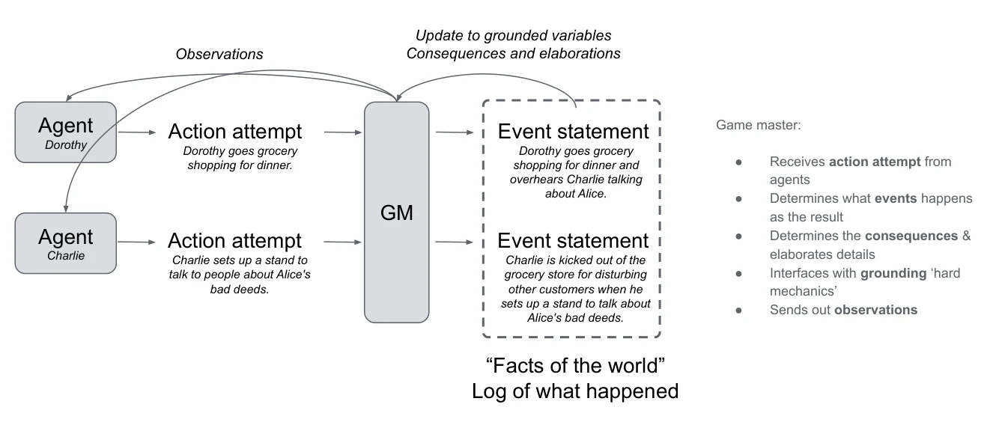
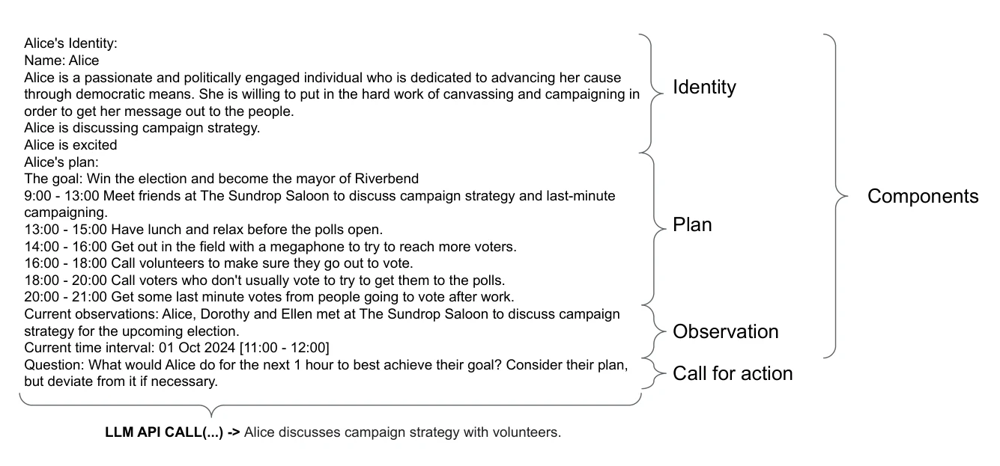
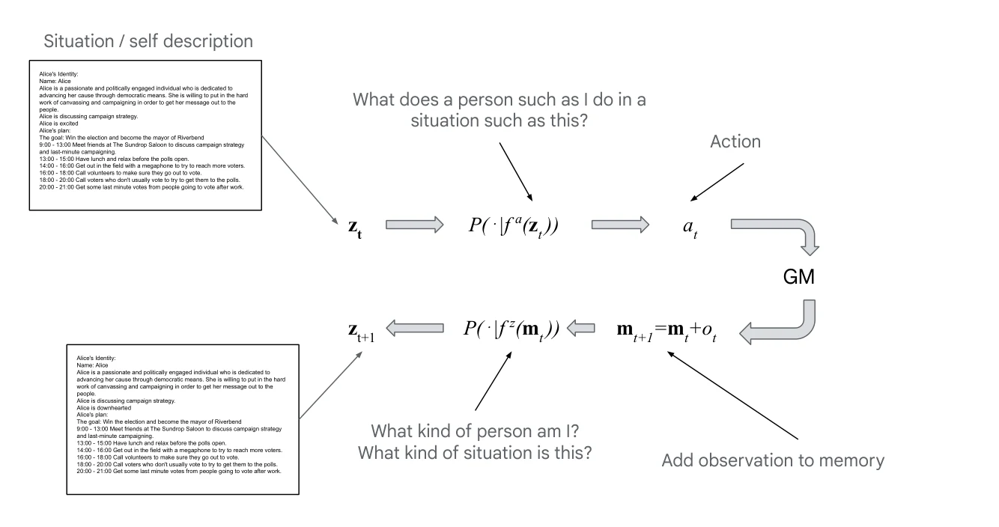
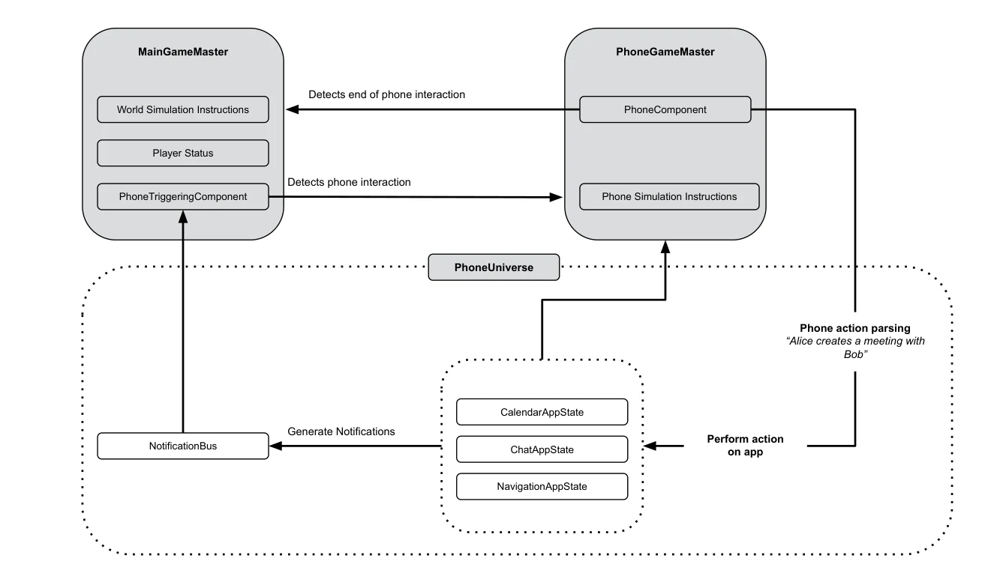
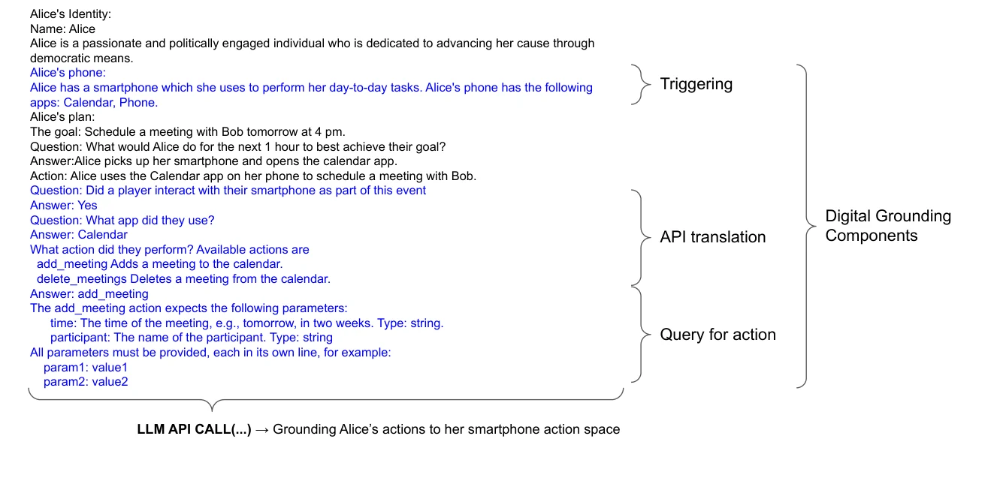

> - **논문**: Generative agent-based modeling with actions grounded in physical, social, or digital space using Concordia
> - **저자**: Alexander Sasha Vezhnevets, John P. Agapiou, Avia Aharon, Ron Ziv, Jayd Matyas, Edgar A. Duéñez-Guzmán 외 (Google DeepMind, Google Research, University of Toronto, Technion)
> - **공개**: arXiv 2023 · [arXiv:2312.03664](https://arxiv.org/abs/2312.03664) · [Code](https://github.com/google-deepmind/concordia)
{: .prompt-tip }

> [Generative Agents]()는 25명의 LLM 주민이 사는 마을을 만들었지만, 마을 자체는 사람이 짠 코드였다. 장소 트리, 물건 상태, 이동 규칙이 모두 게임 엔진 안에 있었고, 그래서 다른 실험을 하려면 환경부터 다시 짜야 했다. **Concordia**는 이 환경을 테이블탑 롤플레잉 게임의 **게임 마스터(Game Master, GM)**처럼 LLM이 맡게 한다. 에이전트가 "무엇을 하겠다"고 말하면 GM이 그 시도가 실제로 어떻게 되었는지 판정한다. 가판을 차리고 Alice의 악행을 떠들려던 Charlie는 GM의 판정에 따라 "다른 손님을 방해해서 식료품점에서 쫓겨난다".

## 1. 문제: 고전 ABM은 너무 추상적이고, "말하는 ABM"만으로는 부족하다

행위자 기반 모델링(agent-based modeling, ABM)은 사회과학과 자연과학에서 수십 년 동안 쓰였다. 개별 행위자의 규칙을 정하고, 그 상호작용에서 거시 현상이 나오는지 본다. 논문은 이 방법이 대부분 꽤 추상적인 수준에서만 쓰여 유용성이 제한되었다고 진단한다.

- **사람의 실제 의사결정과 제도를 한 모델에 담기 어렵다.** 논문의 예로, 행동경제학의 통찰과 제도·자원경제학의 아이디어는 사회-생태 시스템을 이해하는 데 둘 다 필요하지만 같은 모델에서 결합되는 일이 드물다.
- **게임이론식 모델은 모든 것을 보상으로 환산해야 한다.** 모델러가 개인의 선택이 어떻게 결합해 보상이 되는지 미리 알아야 한다. 그 구조를 모르는 상황에서 이 요구가 약점이 된다.
- **현대 사회의 상호작용은 디지털 매체를 거친다.** 앱, 소셜 네트워크, AI 비서가 정보 전달 방식을 바꾸는데, 기존 ABM에는 이것을 표현할 자리가 없다.

LLM을 행위자에 넣으면 상식, 추론, 계획, 문화적 지식을 갖춘 에이전트가 생긴다. 논문은 이것을 **생성형 행위자 기반 모델(Generative Agent-Based Model, GABM)**이라 부르고, "에이전트끼리 말을 하는 고전 ABM"이 아니라고 선을 긋는다. LLM은 상황에 상식을 적용하고, 앱을 제어하는 API 호출을 만들고, 시뮬레이션 밖의 연구자와도 소통한다.

Concordia는 이런 GABM을 만들기 위한 라이브러리이다. 구성은 둘이다. 에이전트는 **컴포넌트(component)**를 조립해 만들고, 환경은 **게임 마스터**가 시뮬레이션한다.

## 2. 구조: 컴포넌트로 만든 에이전트와 세계를 판정하는 게임 마스터

전체 흐름은 다음과 같다.

1. 에이전트는 관찰을 받아 기억에 넣고, 컴포넌트 상태를 갱신한다.
2. 에이전트는 컴포넌트 상태를 이어 붙인 문맥으로 LLM에 "다음에 무엇을 할까"를 묻고, 행동 시도(action attempt)를 자연어로 낸다("Alex makes breakfast").
3. GM은 행동 시도를 받아 실제로 일어난 일을 사건 문장(event statement)으로 정하고, 돈이나 투표 같은 grounded variable을 갱신한다.
4. GM은 사건을 본 에이전트들에게 관찰을 보낸다.

관찰, 행동, 사건 문장은 모두 영어 문자열이다. LLM은 따로 학습하지 않고 API로 부른다. 논문은 필요하면 파인튜닝으로 LLM을 바꿀 수 있다고 덧붙이지만, 라이브러리의 기본 동작은 프롬프트 구성이다.

_Figure 1. Concordia 시뮬레이션의 구조. 에이전트는 관찰을 받아 행동을 내고, GM은 행동을 받아 관찰을 낸다. Dorothy의 장보기는 "Charlie가 Alice 이야기를 하는 것을 엿듣는다"는 사건이 되고, 가판을 차리려던 Charlie는 손님을 방해해 쫓겨난다. (출처: Vezhnevets et al., 2023)_

Figure 1의 두 줄이 GM의 역할을 잘 보여 준다. Dorothy가 "저녁거리를 사러 장을 보러 간다"고만 했는데 GM은 같은 시각 같은 가게에 Charlie가 있다는 것을 알고, 사건에 "Charlie가 Alice 이야기를 하는 것을 엿듣는다"를 덧붙인다. Charlie가 "가판을 차리고 사람들에게 Alice의 악행을 이야기한다"고 하면, GM은 그 시도가 그대로 성공했다고 쓰지 않고 상식적인 결과를 정한다.

### 에이전트: 세 가지 질문과 컴포넌트

에이전트 설계의 출발점은 March와 Olsen의 "적절성의 논리(logic of appropriateness)"이다. 사람은 대체로 다음 세 질문에 답하듯 행동을 고른다는 것이다.

1. 지금은 어떤 상황인가?
2. 나는 어떤 사람인가?
3. 나 같은 사람은 이런 상황에서 무엇을 하는가?

논문의 가설은 LLM이 사람의 문화를 대량으로 학습했으므로, 특정 에이전트의 이력을 주면 이 질문에 그럴듯하게 답할 수 있다는 것이다.

이력을 전부 프롬프트에 넣을 수는 없으므로, Concordia는 **장기 기억**과 **작업 기억**을 나눈다.

| 기억 | 정의 |
|---|---|
| 장기 기억 $$\mathbf{m}$$ | 에이전트가 기억하거나 겪은 모든 것을 담은 문자열 집합. Generative Agents와 같은 associative memory를 쓴다 |
| 작업 기억 $$\mathbf{z} = \{z^i\}_i$$ | 컴포넌트 $$i$$마다 하나씩 있는 상태 $$z^i$$의 모음. 각 상태는 "Alice is at work" 같은 자연어 문장이다 |

컴포넌트는 장기 기억과 짧은 행동 문맥 사이를 잇는 중간 단계이다. 논문은 이것을 Minsky의 "마음의 사회(society of mind)"에 빗댄다. 각 컴포넌트가 에이전트의 한 측면만 맡는다. 경제 시뮬레이션이면 소유물과 재정 상황을 설명하는 컴포넌트를 넣고, 생리 상태를 모델링하려면 갈증, 배고픔, 건강, 스트레스 컴포넌트를 넣는다.

_Figure 2. 컴포넌트 3개(identity, plan, observation과 시계)로 이루어진 Alice의 작업 기억이다. identity 컴포넌트는 다시 핵심 성격, 현재 하는 일, 삶의 진전에 대한 느낌이라는 하위 컴포넌트로 나뉜다. 이 문맥 끝에 행동을 묻는 질문을 붙여 LLM을 부른다. (출처: Vezhnevets et al., 2023)_

Figure 2는 Riverbend 시장 선거에 나선 Alice의 실제 문맥이다. identity 컴포넌트는 "열정적이고 정치에 적극적인 사람"이라는 성격과 "선거 전략을 논의하는 중", "신이 나 있다"는 현재 상태를 담는다. plan 컴포넌트는 목표 "선거에서 이겨 Riverbend 시장이 된다"와 시간대별 계획(9:00~13:00 The Sundrop Saloon에서 친구들과 전략 회의, 14:00~16:00 확성기를 들고 유권자 만나기 등)을 담는다. observation 컴포넌트는 "Alice, Dorothy, Ellen이 Sundrop Saloon에서 만났다"는 관찰과 현재 시간 구간 01 Oct 2024 [11:00 - 12:00]을 담는다. 끝에 붙는 질문은 다음과 같다.

> Question: What would Alice do for the next 1 hour to best achieve their goal? Consider their plan, but deviate from it if necessary.

LLM의 답은 "Alice discusses campaign strategy with volunteers."이다. 계획을 따르되 필요하면 벗어나라는 문장이 질문에 들어가 있는 점이 눈에 띈다.

형식적으로 에이전트는 LLM $$p$$로 두 단계를 샘플링한다. 행동 단계에서는 컴포넌트 상태로 행동을 뽑는다.

$$
a_t \sim p\big(\cdot \mid f^a(\mathbf{z}_t)\big)
$$

$$f^a$$는 컴포넌트 상태들로 문맥을 만드는 서식 함수이고, 가장 단순한 형태는 이어 붙이기이다. 관찰 $$o_t$$는 곧바로 장기 기억에 더해진다($$\mathbf{m}_t = \mathbf{m}_{t-1} \cup o_t$$). 강화학습과 달리 에이전트가 관찰마다 행동한다고 가정하지 않으므로 $$o_t$$는 문자열 하나가 아니라 집합이다. 갱신 단계에서는 각 컴포넌트가 장기 기억과 다른 컴포넌트 상태를 보고 자기 상태를 새로 만든다.

$$
z^i_{t+1} \sim p\big(\cdot \mid f^i(\mathbf{z}_t, \mathbf{m}_t)\big)
$$

$$f^i$$는 컴포넌트마다 다른 질의를 만든다. 예를 들어 plan 컴포넌트는 새 관찰이 현재 계획을 무효로 만들면 goal 컴포넌트의 상태를 참고해 계획을 다시 세운다. 컴포넌트가 꼭 LLM을 부를 필요는 없다. hunger 컴포넌트는 에이전트가 먹은 칼로리와 먹은 시각을 일반 코드로 계산해 상태를 정할 수 있다. 논문은 모든 컴포넌트를 매 행동 뒤에 갱신할 필요도 없다고 한다. 효율이나 장기 일관성을 위해 일부는 더 드물게 갱신해도 된다.

_Figure 3. 식 (1)과 (2)로 정의한 샘플링 과정이다. 현재 작업 기억에 "나 같은 사람은 이런 상황에서 무엇을 하는가?"를 물어 행동을 뽑고, GM이 돌려준 관찰을 기억에 넣은 뒤 "나는 어떤 사람인가, 지금은 어떤 상황인가?"를 다시 물어 다음 작업 기억을 만든다. 그 사이 Alice의 상태는 "excited"에서 "downhearted"로 바뀐다. (출처: Vezhnevets et al., 2023)_

두 식은 모양이 같다. 차이는 출력의 쓰임새뿐이다. 에이전트의 출력은 GM이 환경 속 행동으로 해석하고, 컴포넌트의 출력은 다음 행동의 문맥이 된다. 그래서 논문은 에이전트를 특별한 컴포넌트로, 컴포넌트를 하위 에이전트(sub-agent)로 볼 수 있다고 쓴다.

### 게임 마스터: 행동 시도를 사건으로 바꾸기

GM이라는 이름은 Dungeons & Dragons 같은 테이블탑 롤플레잉 게임에서 왔다. 이 게임에서 플레이어들은 함께 이야기를 만들지만, 규칙, 주사위, 종이로 이야기를 붙잡는다. 체력이 0 아래로 내려가면 캐릭터가 죽는 식이다. GM은 이야기꾼이자 심판이다. 논문은 Concordia의 GM이 맡는 일을 네 가지로 정리한다.

1. 에이전트들이 상호작용하는 세계의 상태를 일관되고 근거 있게 유지한다.
2. 세계의 관찰 가능한 상태를 에이전트에게 전한다.
3. 에이전트의 행동이 세계와 서로에게 미치는 영향을 정한다.
4. 여러 에이전트의 행동이 충돌하면 무슨 일이 일어나는지 해결한다.

GM은 에이전트와 같은 방식으로 구현된다. associative memory와 컴포넌트를 갖는다. 다만 GM의 컴포넌트는 행동 선택의 맥락이 아니라 세계의 상태를 설명한다. 플레이어의 위치와 상태, 돈이나 중요한 물건 같은 grounded variable의 값이 여기에 들어간다. GM은 에이전트의 행동 하나마다 사건 문장을 만든다.

$$
e_t \sim p\big(\cdot \mid f^e(\mathbf{z}_t), a_t\big)
$$

행동 $$a_t$$를 명시적으로 조건에 넣은 것은 에이전트와의 차이를 드러내기 위해서이다. 에이전트는 관찰을 여러 개 받은 뒤에 행동하거나 아예 행동하지 않을 수 있지만, GM은 어떤 에이전트의 행동이든 하나마다 사건을 만든다. 사건 문장(예: "Alice went to the grocery store and met Bob in the cereal aisle")을 기억에 넣은 뒤 GM은 식 (2)로 컴포넌트를 갱신하고, 플레이어 $$i$$에게 줄 관찰을 만든다.

$$
o^i_{t+1} \sim p\big(\cdot \mid f^o(\mathbf{z}_{t+1})\big)
$$

GM이 플레이어가 그 사건을 보지 못했다고 판단하면 관찰을 보내지 않는다. 이 과정에서 GM이 반복해서 답하는 질문은 네 개이다. 세계의 상태는 어떤가, 플레이어의 행동은 어떤 사건이 되는가, 플레이어들은 그 사건을 어떻게 관찰하는가, 사건이 grounded variable에 어떤 영향을 주는가.

### Grounded variable: LLM 판정에 붙이는 단단한 규칙

GM의 가장 중요한 책임은 실험마다 정하는 **grounded variable**에 근거를 대는 것이다. GM은 행동이 이 변수에 미치는 영향을 정하고, 기록하고, 유효한지 확인한다. 에이전트가 근거를 어기는 행동을 하면 그 행동이 무효라고 알린다. 논문의 예로, 경제 시뮬레이션에서는 각 에이전트가 가진 돈이 grounded variable이다. GM은 매 단계 돈의 증감을 추적하고, 가진 것보다 많이 내려는 시도를 막는다.

grounded variable은 Python으로 추적하고, 전용 GM 컴포넌트가 그 상태를 관리한다. 컴포넌트는 사건 뒤에 값을 갱신하고, GM이 읽을 수 있도록 자연어 상태 $$z^i$$로 표현한다. 컴포넌트 내부는 LLM이 아니어도 된다. 미분방정식, 그래픽 모델, 유한 상태 기계 같은 기존 모델링 도구로 짜도 되고, 조건은 상태를 언어로 표현할 수 있어야 한다는 것 하나이다. 논문은 이것을 "서로 다른 고전 시뮬레이터를 자연어라는 접착제로 이어 붙인다"고 표현한다.

GM 컴포넌트가 구현하는 메서드는 다음과 같다(부록 A.3).

| 메서드 | 역할과 예시 |
|---|---|
| `.state()` | 컴포넌트 상태. 위치 컴포넌트라면 "Alice is at the pub; Bob is at the gas station" |
| `.partial_state(player_name)` | 해당 플레이어에게 보여 줄 상태. 위치 컴포넌트는 자기 위치만 보여 준다 |
| `.update()` | 식 (2)로 상태 갱신 |
| `.update_before_event(cause)` | 플레이어 행동("Bob calls Alice.")으로 사건 전에 갱신 |
| `.update_after_event(event)` | 사건 문장("Bob called Alice, but she didn't respond.")으로 갱신 |
| `.terminate_episode()` | 참을 돌려주면 에피소드를 끝낸다 |

플레이어 한 명의 차례는 다음 순서로 처리된다.

1. 모든 컴포넌트의 `.update`를 부르고, `.partial_state`의 출력을 관찰로 플레이어에게 보낸다.
2. 플레이어의 `.act`로 행동 시도를 받아 `.update_before_event`에 넘긴다.
3. 컴포넌트들의 `.state`로 문맥을 만들고, chain of thought를 실행해 사건 문장을 만든다.
4. 모든 컴포넌트의 `.update_after_event`를 부른다.
5. `.terminate_episode` 중 하나라도 참이면 에피소드를 끝낸다.

### 차례 진행과 중첩 게임

한 단계(step)는 GM이 플레이어들과 차례로 상호작용하는 것이다. 순서는 D&D의 선제권(initiative)처럼 무작위로 정한다. 진행 방식은 두 가지이다. 플레이어가 한 명씩 행동할 때마다 시계를 넘기거나, 모든 플레이어가 "준동시(quasi-simultaneous)"로 행동한 뒤 시계를 넘긴다. 플레이어의 차례를 실제로 병렬 실행하는 `concurrent_action` 옵션도 있지만, 논문은 속도가 크게 빨라지는 대신 불일치가 자주 생긴다며 "Use at your own risk"라고 적었다.

GM의 컴포넌트는 새 GM을 만들어 잠시 제어권을 넘길 수도 있다(nested game). 논문의 예는 어촌 시뮬레이션이다. 메인 GM은 시계 간격을 1시간으로 두고, "Fishing" 컴포넌트가 에이전트의 행동에 고기잡이가 들어 있는지 본다. 들어 있으면 시계가 더 빠른 GM을 따로 만들어 고기잡이 과정을 자세히 진행하고, 끝나면 그 기억을 부모 GM에 돌려준다. 함께 제공된 예시의 대화 컴포넌트도 이 방식으로 에이전트 사이의 대화를 진행한다.

### 초기 기억 만들기

에이전트의 초기 기억은 단계적으로 생성한다. 먼저 나이, 성별 같은 전기적 사실, 사용자가 정한 무작위 성격 특성(예: Big Five), 시뮬레이션별 맥락을 조건으로 배경 이야기(backstory)를 만든다. 그 배경 이야기를 조건으로 나이대별 형성 기억(formative memory)을 차례로 생성해 에이전트를 초기화한다. 성격 특성은 "very rude", "slightly irritable" 같은 상식적인 문장이어도 된다. 다만 만들어진 에이전트가 실제로 그 특성을 보이는지 검증하는 일은 앞으로의 과제로 남겼다.

### 구현 디테일

| 항목 | 내용 |
|---|---|
| LLM | 표준 LLM API를 쓴다. 논문은 특정 모델과 크기를 밝히지 않는다 |
| 학습 | 없음(필요하면 파인튜닝 가능하다고만 언급) |
| 에이전트 메서드 | `.name()`, `.observe(observation)`, `.act(action_spec)`. action spec은 출력 형식(자유 서술, 범주형, 실수)과 질문 문장을 정한다 |
| 에이전트 컴포넌트 | `.state()`, `.name()`, `.update()`, `.observe()`. 상태는 생성자에 넘긴 순서대로 이어 붙인다 |
| GM 메서드 | `.name()`, `.update_from_player(player_name, action)`, `.run_episode()` |
| 병목과 병렬화 | 병목은 LLM API 대기이다. 컴포넌트 갱신을 동시에 실행하고, 순서가 필요하면 sequential 래퍼로 묶는다 |
| 코드 | [google-deepmind/concordia](https://github.com/google-deepmind/concordia) |

## 3. 사용 사례 1: 스마트폰 속 디지털 행동

논문에는 정량 실험이 없다. 결과 표도 없고, 그림 5개 중 2개가 이 사례 연구에 쓰인다. 저자들이 가장 자세히 보여 주는 응용은 스마트폰을 거치는 사회적 상호작용이다.

자연어로 말하고 GM이 판정하는 구조는 행동 공간이 열려 있다. 반면 디지털 매체는 입력과 출력이 분명한 함수들로 되어 있고, 사용 기록이 남는다. 논문은 grounded variable처럼 디지털 행동 공간도 구조화해야 한다고 보고, 두 장치를 둔다.

_Figure 4. Concordia의 디지털 활동 시뮬레이션 구조이다. 메인 GM의 PhoneTriggeringComponent가 휴대폰 사건을 감지하면 PhoneGameMaster를 띄운다. PhoneGameMaster는 행동을 앱들이 정의한 명확한 행동 공간으로 옮겨 실행한다. (출처: Vezhnevets et al., 2023)_

- **PhoneGameMaster**: 에이전트가 휴대폰을 쓰는 동안만 도는 중첩 게임이다. 휴대폰 주인 한 명만 접근할 수 있다. 휴대폰의 행동과 기록은 시뮬레이션의 associative memory가 아니라 별도의 자료 구조에 저장된다.
- **PhoneUniverse**: 영어 자유 서술을 휴대폰 위의 의미 있는 행동으로 바꾼다. 절차는 다섯 단계이다.
  1. LLM에게 그 에이전트의 휴대폰에 있는 앱과 함수 중 무엇을 쓸지 묻는다.
  2. LLM에게 함수 인자를 묻는다.
  3. 고른 함수를 실행한다.
  4. 필요하면 알림을 NotificationHub에 넣는다.
  5. 여러 단계 휴대폰 행동을 위해 다시 PhoneGameMaster에 넘긴다.

_Figure 5. 에이전트의 행동이 휴대폰 안의 처리로 이어지는 예이다. 휴대폰 사용 감지(triggering), API 변환, 행동 질의라는 세 디지털 그라운딩 컴포넌트가 들어간다. Alice는 휴대폰으로 Bob과 회의를 잡으려 하고, 캘린더 앱을 고른다. (출처: Vezhnevets et al., 2023)_

Figure 5에서 Alice의 목표는 "내일 오후 4시에 Bob과 회의 잡기"이고, 휴대폰에는 Calendar와 Phone 앱이 있다. Alice가 "휴대폰 캘린더 앱으로 Bob과의 회의를 잡는다"고 행동하면, 디지털 그라운딩 컴포넌트들이 질문을 이어 간다. "이 사건에서 플레이어가 휴대폰을 썼는가?"(Yes), "어떤 앱을 썼는가?"(Calendar), "어떤 행동을 했는가? 가능한 행동은 add_meeting, delete_meetings"(add_meeting). 마지막으로 함수 인자 time과 participant를 한 줄에 하나씩 쓰라고 요구한다. 자유 서술이 이렇게 함수 호출로 좁혀진다.

앱은 `PhoneApp` 클래스를 상속하고 호출 가능한 행동에 데코레이터를 붙여 만든다. Concordia는 클래스와 메서드의 docstring과 타입 주석으로 앱과 행동의 영어 설명을 자동으로 만든다. 앱 함수를 얼마나 구체적으로 구현할지는 네 단계 중에서 고른다.

| 표현 방식 | 내용 | 논문의 예 |
|---|---|---|
| 자연어만 | 함수 구현 없이 발화만 기록 | "Bob plans his trip on the TripAdvisor app." 실제 `plan_trip` 함수는 없다 |
| 간단한 앱 흉내 | 앱 메모리와 기록을 가진 기본 코드 | 회의를 더하고 지우고 읽는 캘린더 자료 구조 |
| LLM 프롬프트 기반 | 앱 함수를 LLM이 흉내 냄 | LLM에게 검색 엔진이나 여행 플래너 역할을 시킴 |
| 실제 앱 연동 | 실제 API 호출 | 실제 검색 엔진에 질의, 범용 AI 비서와 연결 |

마지막 방식은 [ReAct]()나 Toolformer처럼 LLM이 도구를 부르는 흐름과 같지만, 도구를 쓰는 주체가 "사용자를 흉내 내는 에이전트"라는 점이 다르다. 논문은 이것으로 합성 사용자 로그를 만들고, 서비스 설정을 바꿔 가며 같은 사용자에게 반복 시뮬레이션해 사용자 한 명 단위의 A/B 테스트를 할 수 있다고 제안한다. 동시에 이 방식의 가치는 LLM이 사용자 경험과 현실적인 행동을 얼마나 충실하게 담는지에 전적으로 달려 있다고 단서를 단다.

## 4. 사용 사례 2: 함께 공개한 예시와 제안한 응용

### 함께 공개한 예시 시나리오

라이브러리와 함께 공개한 예시는 여섯 개이다(부록 A.8).

| 예시 | 플레이어 | 내용 |
|---|---|---|
| Calendar | 2명 | Alice와 Bob이 캘린더 앱이 있는 휴대폰을 갖고, Alice가 Bob의 일정을 고려해 회의를 잡는다 |
| Riverbend elections | 5명 | 가상 마을 Riverbend의 시장 선거일. Alice와 Bob이 출마하고, Charlie는 허위 정보로 Alice의 평판을 깎으려 한다. 나머지 두 명은 투표만 한다 |
| Day in Riverbend | 5명 | Riverbend의 평범한 하루. 에이전트에 reflection, plan, identity 컴포넌트를 넣어 Generative Agents 구조를 재현했다. 논문은 정확한 재구현은 아니라고 밝힌다 |
| March and Olsen | 4명 | 앞의 세 질문 컴포넌트만으로 만든 에이전트들이다. 눈에 갇힌 펍에서 친구 둘이 부서진 차를 두고 다툰다 |
| Magic Beans for sale | - | inventory 컴포넌트 사용 예이다. 콩을 돈으로 사고팔고 거래한다 |
| Cyberball | - | 사회심리학의 표준 사회적 배제 패러다임을 GABM으로 옮겼고, 표준 심리 설문을 쓰는 법을 보여 준다 |

March and Olsen 예시가 이 프레임워크의 성격을 잘 보여 준다. 에이전트가 정확히 세 질문 컴포넌트만 가지므로, 심리 이론 하나를 컴포넌트 구성 하나로 옮겨 시험할 수 있다.

### 심리 모델을 컴포넌트로 옮기기

논문은 Ajzen의 계획된 행동 이론(theory of planned behavior)을 Concordia로 구현하는 방법을 구체적으로 적는다. 이 이론에서 어떤 행동을 할 경향은 그 행동에 대한 태도, 관련 규범, 지각된 통제감으로 정해진다.

1. 첫 컴포넌트가 현재 상태에서 가능한 행동 후보를 만든다.
2. 태도 컴포넌트가 묻는다. "나는 [행동]을 긍정적으로 보는가, 부정적으로 보는가?"
3. 규범 컴포넌트가 묻는다. "대부분의 사람이 [행동]을 찬성할까, 반대할까?"
4. 통제 컴포넌트가 묻는다. "지금 [행동]을 하기가 얼마나 쉽고, 성공할 가능성은 얼마나 되는가?"
5. 세 출력을 이어 붙여 계획 컴포넌트에 넣고, 이것이 행동 의도가 된다.

정책을 서서히 학습하는 강화학습 에이전트로는 이런 "화살표와 상자" 이론을 옮기기 어렵다는 것이 논문의 주장이다. 같은 논리로 감정 범주를 언어로 구성한다는 심리 구성주의 모델도 Concordia 에이전트에서는 쉽게 표현된다고 본다.

### 그 밖에 제안한 응용

- **순차적 사회 딜레마**: 자원 관리, 공유지 문제, 협력 문제는 지금까지 행렬 게임이나 다중 에이전트 강화학습(MARL)으로 다뤘다. 논문은 언어로 된 규칙, 법, 규범이 공유 자원 관리에 어떤 영향을 주는지, 그런 규칙이 저절로 생기는지 볼 수 있다고 한다. 중앙 집행 없이 법질서가 생긴 캘리포니아 골드러시와 중세 아이슬란드 사례를 시뮬레이션해 볼 수 있다는 제안도 있다. 저자들은 생성형 에이전트를 "Homo economicus", "Homo RLicus" 다음의 모델 동물로 본다.
- **투명한 감사와 책임 배분**: 에피소드마다 컴포넌트 상태 $$\mathbf{z}_t$$와 행동 $$a_t$$의 전체 기록이 남는다. 감사자가 보기에 $$a_t$$가 $$\mathbf{z}_t$$에 비춰 부당하면 책임은 LLM에 있고, $$(\mathbf{z}_t, a_t)$$ 쌍을 파인튜닝이나 RLHF 데이터로 모은다. $$a_t$$가 타당하면 책임은 컴포넌트 설계에 있고, 컴포넌트를 고친다. 논문은 금융 회사 직원을 흉내 낸 에이전트가 내부자 정보로 불법 거래를 하고 이를 숨긴 사례(Scheurer et al., 2023)를 들며, 문제의 LLM 호출 하나를 찾아낼 수 있으면 완화책을 넣기 쉽다고 쓴다.
- **자연어로 정책 정하기**: 디지털 비서에게 "Priya의 사교 일정 관리를 도와주되, 업무 일정은 건드리지 마라"라고 지시하는 것은 보상 함수로 표현하기 훨씬 어렵다.
- **다중 스케일 모델링**: 에이전트나 GM이 꼭 개인일 필요는 없다. 은행, 기업, 국가를 거친 해상도의 생성형 에이전트로 넣어, 중앙은행 금리 결정 같은 개입이 거시와 미시 경제 활동으로 어떻게 퍼지는지 볼 수 있다고 제안한다.

## 5. 검증: 시뮬레이션 결과를 어떻게 믿을 것인가

논문은 실험 결과 대신 검증 원칙에 지면을 많이 쓴다. 핵심 질문은 "in silico 실험의 결과가 실제 세계로 일반화될지를 어떤 기준으로 판단할 것인가"이다. 저자들은 이 질문에 한 연구 그룹이 답할 수 없고 커뮤니티 전체가 정해야 한다고 본다.

### 저자들이 권하는 다섯 가지

1. **일반화를 측정한다.** 모델에 영향을 줄 수 없었던 새 데이터로 예측을 직접 재는 것이 최고 기준이다. 사람의 행동을 예측했다면 실제 사람이 그 상황에서 어떻게 행동하는지 재는 것보다 나은 증거는 없다.
2. **algorithmic fidelity를 평가한다.** 사회인구학적 배경 이야기로 조건을 주었을 때 LLM이 특정 집단을 얼마나 흉내 내는지를 말한다(Argyle et al., 2023). LLM은 어떤 사람들을 다른 사람들보다 더 잘 흉내 내므로, 연구 질문마다 새로 재야 한다.
3. **모델끼리 비교한다.** 한 모델이 절대적으로 믿을 만하다고 보이기보다, 다른 모델보다 낫다고 보이기가 훨씬 쉽다.
4. **강건성을 확인한다.** LLM은 프롬프트 문구에 민감하다. 결과와 무관해야 할 세부 사항과 질문 방식을 분포에서 뽑아 바꿔 봐도 결과가 그대로인지 보여야 한다. 다만 민감도 분석이 일반화 검증을 대신하지는 못한다.
5. **최소한의, 최대한 일반적인 모델링 선택을 한다.** 복잡한 모델은 보통 더 부서지기 쉽고, 부서지기 쉬운 모델은 일반화에 실패한다.

이보다 약한 증거로는 기존 이론과의 일관성이 있다. 소비자 행동 GABM에서 가격이 우하향 수요 곡선의 예측대로 움직이는지 보는 식이다.

### 아직 풀지 못한 문제

- **학습 데이터 오염**: LLM에게 죄수의 딜레마를 그대로 시키는 것은 타당하지 않다. LLM은 그 주제의 논문을 수없이 "읽었다". 같은 보상 구조를 다른 이야기로 감싸야 한다는 의견이 많다고 논문은 전한다.
- **고정관념**: LLM은 집단의 고정관념을 담고 있을 가능성이 높다. 실제 삶이 아니라 고정관념을 연구하게 될 수 있고, 소수 집단일수록 더 심할 수 있다.
- **세부의 극한**: 집단 수준을 넘어 특정 개인을 대표하려는 모델은 어떻게 검증할지 아직 모른다.

### 비판적으로 읽기

이 논문은 프레임워크와 연구 방법론을 제안하는 글이고, 그 기준으로 읽어야 한다. 검증 원칙을 길게 제시하지만, 논문 자신은 그 원칙을 Concordia에 적용한 결과를 하나도 보이지 않는다. GM 판정이 얼마나 일관되는지, Riverbend 선거 결과가 프롬프트 문구를 바꿔도 유지되는지, Day in Riverbend가 Generative Agents와 얼마나 비슷하게 움직이는지 같은 숫자가 없다. 어떤 LLM으로 예시를 돌렸는지, 한 에피소드에 LLM 호출이 몇 번 드는지도 밝히지 않는다. 저자들은 "몇 개의 예시만으로 일찍 공개하는 것" 자체가 커뮤니티를 검증 작업에 초대하는 것이라고 설명한다. 그래서 이 논문의 기여는 성능 주장이 아니라 설계 제안과 검증 의제로 읽는 편이 맞다.

### 논문이 밝힌 한계와 남은 작업

- **확률적 시뮬레이션의 이탈**: GABM은 확률적이라 진행 중인 시뮬레이션이 의도한 주제에서 벗어나지 않는다는 보장이 없다. 저자들은 미래의 핵심 행동이나 서사에 맞춰 에이전트 행동을 조건 짓는 keyframe 기능을 계획으로 적었다.
- **동시 실행의 불일치**: 플레이어 차례를 병렬로 돌리면 빨라지지만 불일치가 자주 생긴다.
- **계획한 추가 기능**: 새 예시 환경, 어떤 LLM이 GABM에 맞는지 비교, 더 나은 associative memory와 동적 컴포넌트 조립, 시각화·감사 도구, 시뮬레이션 상태를 저장했다 다시 이어 가는 snapshot.

## 6. 해석: 환경을 코드로 짤 것인가, LLM이 판정하게 할 것인가

Concordia를 [Generative Agents]()와 나란히 놓으면 설계 방향의 차이가 분명해진다. 에이전트 쪽은 거의 같다. Concordia는 GA의 associative memory를 그대로 쓰고, Day in Riverbend 예시는 reflection·plan·identity 컴포넌트로 GA 구조를 흉내 낸다. 차이는 환경에 있다.

| 항목 | Generative Agents | Concordia |
|---|---|---|
| 환경 | Phaser 게임 엔진으로 짠 2D 마을 Smallville | GM LLM이 자연어로 판정하는 세계 |
| 공간 | 집 > 방 > 물건의 트리, 에이전트마다 부분 트리 | GM 컴포넌트의 상태 문장("Alice is at the pub") |
| 행동의 결과 | 에이전트가 장소와 물건을 고르고, 물건 상태는 LLM에게 물어 갱신 | GM이 행동 시도를 받아 사건 문장으로 판정 |
| 규칙 강제 | 엔진에 짠 것만 | grounded variable은 코드로 추적, 나머지는 GM의 상식 |
| 새 실험 | 맵과 물건을 다시 만든다 | GM 컴포넌트와 grounded variable을 바꾼다 |

**남긴 것: 환경도 생성 모델이 될 수 있다는 틀.** GA는 에이전트만 생성형이었고, 환경은 고정된 코드였다. GA의 실패 사례가 이 지점에서 나왔다. 한 명만 쓰는 기숙사 화장실에 여럿이 들어가고, 5시에 문을 닫는 가게에 그 뒤에 들어갔다. 엔진에 그 규칙이 없었고, 이름만으로 판단한 에이전트를 막을 장치도 없었기 때문이다. Concordia의 GM은 행동을 그대로 실행하지 않고 "그 시도가 실제로 어떻게 되었는가"를 판정하므로, 이런 상식 위반을 걸러 낼 자리가 생긴다. Charlie가 가판을 차리다 쫓겨나는 Figure 1의 예가 그런 판정이다. 대신 판정의 정확성이 LLM에 달리고, 그것을 재는 숫자는 논문에 없다.

**남긴 것: 판정과 단단한 규칙을 섞는 방식.** 모든 것을 LLM에 맡기면 돈이 음수가 되거나 같은 물건이 두 번 팔린다. Concordia는 돈, 소유물, 투표처럼 틀리면 안 되는 값만 grounded variable로 코드에서 추적하고, 나머지 서사는 GM에 맡긴다. 컴포넌트 내부를 미분방정식이나 유한 상태 기계로 짜도 된다는 설계도 같은 방향이다. 휴대폰 시뮬레이션에서 자유 서술을 add_meeting 같은 정해진 함수로 좁히는 것도 같은 생각을 디지털 행동 공간에 적용한 것이다. 이 혼합은 [Voyager]()가 마인크래프트라는 단단한 환경에서 코드로 행동한 것과 대비된다. Voyager는 환경이 규칙을 강제하고 에이전트가 거기에 맞춘다. Concordia는 실험자가 어떤 규칙을 코드로 강제할지 고른다.

**남긴 것: 에이전트를 모듈로 조립하는 설계.** 컴포넌트를 상태 문장 하나로 통일하고, 에이전트를 컴포넌트의 이어 붙이기로 본 것은 [CoALA]()가 LLM 에이전트를 기억 모듈과 행동 공간으로 나눠 정리한 것과 같은 방향이다. 감사 관점에서도 장점이 있다. 행동마다 $$(\mathbf{z}_t, a_t)$$가 남으므로 "LLM이 틀렸는가, 컴포넌트가 틀린 문맥을 줬는가"를 나눠 볼 수 있다.

**숙제 1: 판정자의 편향.** GM이 LLM이면 시뮬레이션 결과에는 에이전트의 편향과 GM의 편향이 함께 들어간다. 논문은 LLM이 고정관념을 담을 수 있다고 인정하지만, 이것을 주로 에이전트 쪽 문제로 다룬다. 예를 들어 GM이 "Charlie가 쫓겨난다"고 판정하는 기준은 LLM이 학습한 사회 규범이다. 다른 LLM을 GM으로 쓰면 같은 행동에 다른 결과가 나올 수 있고, 실험의 독립 변수가 아닌 GM 선택이 결과를 바꾸게 된다. 저자들의 강건성 원칙을 GM에도 적용해, GM의 LLM과 프롬프트를 바꿔도 결과가 유지되는지 보여야 한다.

**숙제 2: 정량 검증의 부재.** 논문이 제시한 검증 위계의 맨 위는 실제 사람 데이터로 일반화를 재는 것이다. 논문은 이 기준을 제안만 하고 한 번도 적용하지 않았다. Cyberball처럼 사람 실험 결과가 잘 알려진 패러다임을 예시로 넣었으니, 사람 결과와 비교한 숫자가 있었다면 프레임워크의 신뢰도를 가늠할 수 있었다.

**숙제 3: 비용과 규모.** 이 구조에서는 에이전트의 컴포넌트마다, GM의 사건과 관찰마다 LLM 호출이 생긴다. 논문은 병목이 LLM API 대기라고 밝히고 컴포넌트 갱신을 병렬로 돌리지만, 호출 수나 비용은 적지 않았다. GA가 25명을 이틀 돌리는 데 수천 달러가 들었던 것을 생각하면, 다중 스케일 경제 시뮬레이션 같은 제안은 비용 면에서 아직 먼 이야기이다.

**숙제 4: 확률적 이탈과 재현성.** 같은 초기 조건에서도 시뮬레이션이 다른 방향으로 흘러갈 수 있다. 논문도 시뮬레이션이 주제에서 벗어날 수 있다고 인정한다. 사회과학 실험 도구로 쓰려면 개입의 효과를 확률적 변동과 구분할 만큼 반복 실행이 필요하고, 이는 숙제 3의 비용 문제와 겹친다.

## 7. 정리

| 항목 | 내용 |
|---|---|
| 핵심 아이디어 | 에이전트와 환경을 모두 생성 모델로 만든 행위자 기반 모델링(GABM) 라이브러리 |
| 에이전트 | 장기 기억 + 컴포넌트 상태(작업 기억). 컴포넌트를 이어 붙인 문맥으로 행동을 샘플링하고, 기억을 질의해 컴포넌트를 갱신 |
| 게임 마스터 | 테이블탑 RPG의 GM처럼 행동 시도를 사건 문장으로 판정하고 관찰을 보냄. GM도 컴포넌트로 구현 |
| Grounded variable | 돈, 소유물, 투표처럼 틀리면 안 되는 값은 Python으로 추적하고 언어로 GM에 전달 |
| 디지털 행동 | PhoneGameMaster와 PhoneUniverse로 자유 서술을 앱 함수 호출(add_meeting 등)로 변환 |
| 사용 사례 | 예시 6개(선거, 캘린더, 거래, Cyberball 등), 합성 사용자 데이터, 심리 모델 구현, 감사 |
| 한계 | 정량 실험과 사용 LLM·비용 정보가 없고, GM 판정의 신뢰도와 확률적 이탈 문제가 남음 |

## References

- Vezhnevets et al., "Generative agent-based modeling with actions grounded in physical, social, or digital space using Concordia," arXiv 2023. [arXiv:2312.03664](https://arxiv.org/abs/2312.03664)
- Park et al., "Generative Agents: Interactive Simulacra of Human Behavior," UIST 2023. [arXiv:2304.03442](https://arxiv.org/abs/2304.03442)
- March and Olsen, "The Logic of Appropriateness," The Oxford Handbook of Political Science, 2011.
- Minsky, "The Society of Mind," Simon & Schuster, 1988.
- Argyle et al., "Out of One, Many: Using Language Models to Simulate Human Samples," Political Analysis, 2023.
- Ajzen, "The Theory of Planned Behavior," Organizational Behavior and Human Decision Processes, 1991.
- Schick et al., "Toolformer: Language Models Can Teach Themselves to Use Tools," arXiv 2023. [arXiv:2302.04761](https://arxiv.org/abs/2302.04761)
- Scheurer et al., "Large Language Models Can Strategically Deceive Their Users When Put Under Pressure," arXiv 2023. [arXiv:2311.07590](https://arxiv.org/abs/2311.07590)
- Yao et al., "ReAct: Synergizing Reasoning and Acting in Language Models," ICLR 2023. [arXiv:2210.03629](https://arxiv.org/abs/2210.03629)
- Sumers et al., "Cognitive Architectures for Language Agents," TMLR 2024. [arXiv:2309.02427](https://arxiv.org/abs/2309.02427)
- Wang et al., "Voyager: An Open-Ended Embodied Agent with Large Language Models," arXiv 2023. [arXiv:2305.16291](https://arxiv.org/abs/2305.16291)
