> - **논문**: Project Sid: Many-agent simulations toward AI civilization
> - **저자**: Altera.AL (Andrew Ahn, Nic Becker, Stephanie Carroll, Nico Christie, Manuel Cortes, Arda Demirci 외)
> - **공개**: arXiv 2024 · [arXiv:2411.00114](https://arxiv.org/abs/2411.00114)
{: .prompt-tip }

> [Generative Agents]()는 25명이 사는 마을에서 파티 소식 하나가 퍼져 나가는 모습을 보였다. 그런데 마을 하나와 문명은 다르다. 문명에는 직업이 나뉘고, 모두가 따르는 규칙이 있고, 그 규칙을 바꾸는 절차가 있고, 사람에서 사람으로 옮겨 가는 문화가 있다. **Project Sid**는 동시에 도는 모듈 위에 결정 하나를 내리는 병목을 둔 **PIANO** 구조로 에이전트를 만들고, 마인크래프트 한 세계에 수십~수백 명을 풀어 놓는다. 반세금 인플루언서 3명이 섞인 29명 마을에서는 "세금 20%"라는 헌법 조항이 투표로 "5~10%"로 바뀌었고, 주민들이 실제로 내는 세금도 20%에서 9%로 떨어졌다.

## 1. 문제: 에이전트를 많이 모아도 문명이 되지 않는 세 가지 이유

LLM 에이전트는 코딩, 웹 탐색, 게임 같은 개별 과제에서 빠르게 발전했다. 여러 에이전트를 묶은 연구도 소프트웨어 개발, 토론, 게임, 사회 모델링으로 늘었다. 하지만 대부분은 차례대로 돌아가는 실행, 정해진 워크플로, 고정된 통신 채널 안에서 움직인다. 논문은 큰 규모의 시뮬레이션도 소셜 네트워크 게시물처럼 제한된 설정이었고, 열린 세계에서 완전히 자율적으로 소통하는 실험은 "25-50 agents"가 최대였다고 본다.

논문은 이유를 셋으로 정리한다.

- **에이전트 혼자서도 진척이 없다.** 같은 행동을 되풀이하거나 환각이 쌓인다. 마을 주민 역할의 에이전트에게 "뭐 먹고 있어?"라고 물으면 아무것도 안 먹으면서 "베이글"이라고 답하고, 그 답이 다음 프롬프트에 들어가 음식을 구할 필요가 없다고 믿게 된다.
- **여럿이 모이면 환각이 번진다.** Abby가 대화용 LLM 호출과 행동용 함수 호출을 따로 쓴다고 하자. Bob이 "곡괭이 줘"라고 하면 대화 호출은 "Sure thing!"이라고 답하는데 행동 호출은 "explore"를 고른다. Bob은 받지도 않은 곡괭이로 채굴을 시도한다. 말과 행동이 서로 맞는 성질을 논문은 **coherence**라고 부른다.
- **문명 수준의 벤치마크가 없다.** BattleAgentBench, COMMA, VillagerBench, LLMcoordination 같은 다중 에이전트 벤치마크는 소규모 협력·경쟁을 잰다. 수백 명이 한 세계에서 만드는 변화는 재지 못한다.

말과 행동을 LLM 호출 한 번으로 같이 뽑으면 coherence 문제는 쉽게 풀린다. 논문은 이 방법이 출력 종류(말, 시선, 표정, 신체 부위)가 늘어나면 확장되지 않는다고 지적한다. 그래서 내놓은 답이 **동시성(concurrency)**과 **정보 병목(information bottleneck)**을 합친 PIANO 구조와, 전문화·집단 규칙·문화 전파라는 세 가지 문명 벤치마크이다.

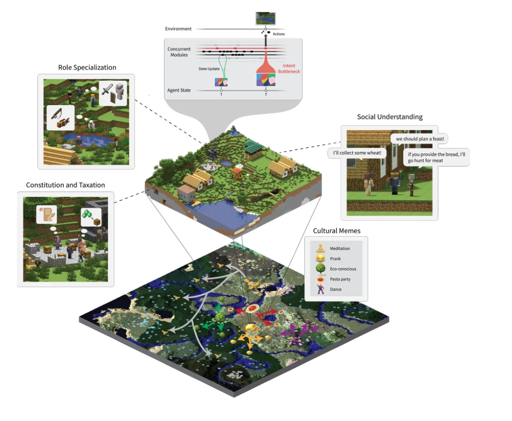
_Figure 1. 에이전트 구조에서 문명까지의 전체 그림이다. 위쪽은 동시에 도는 모듈과 의도 병목, 가운데는 역할 분화·헌법과 세금·사회적 이해, 아래는 여러 마을에 퍼진 문화 밈이다. (출처: Altera.AL, 2024)_

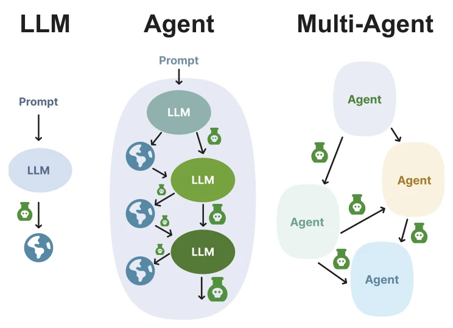
_Figure 2. LLM 한 번(왼쪽), 에이전트(가운데), 다중 에이전트(오른쪽)에서 환각이 쌓이는 모습이다. 초록 해골 병이 환각이다. 한 프롬프트의 환각이 다음 호출로 이어지고, 한 에이전트의 환각이 대화를 타고 집단 전체로 번진다. (출처: Altera.AL, 2024)_

## 2. 무대: 마인크래프트와 실험 규모

논문이 마인크래프트를 고른 이유는 두 가지이다. 대화와 행동으로 서로 영향을 주는 열린 샌드박스이고, 서버가 많은 에이전트를 받을 수 있다. 개인의 진척은 얻은 아이템 종류 수로 잰다. 마인크래프트 아이템은 약 1,000종이고, 금·다이아몬드·에메랄드를 캐려면 철 곡괭이가 있어야 하고, 철 곡괭이를 만들려면 석탄으로 철을 녹여야 하고, 석탄을 캐려면 돌 곡괭이가 있어야 하는 식으로 기술 트리가 깊다.

실험은 규모를 넓혀 가며 진행된다.

| 실험 | 에이전트 수 | 시간 | 반복 |
|---|---|---|---|
| 단일 에이전트 아이템 진척 | 25명(서로 못 만나게 떨어뜨림) | 30분 | 5회 |
| 장기 아이템 진척 | 49명 | 4시간 | 여러 번 |
| 소집단 감정 추론 | 1명 + 등장인물 3~4명 | 6분 안팎 | 4회, 6회 |
| 사회관계 | 50명 | 4시간 이상(게임 안 12일) | - |
| 전문화 | 30명 | 20분 | 3회 |
| 세금과 투표 | 29명(주민 25 + 인플루언서 3 + 선거 관리자 1) | 1,200초 | 조건당 4회 |
| 밈과 종교 전파 | 500명 | 9,000초 | 1회 |

1,000명이 넘는 실행도 돌렸지만 마인크래프트 서버가 감당하지 못해 에이전트가 간헐적으로 응답하지 않았다. 그래서 문화 전파 분석은 500명 실행 하나로만 했다.

## 3. PIANO: 동시에 도는 모듈과 하나의 결정자

PIANO는 "Parallel Input Aggregation via Neural Orchestration"의 약자이다(초록에는 "Parallel Information Aggregation"으로 적혀 있어 표기가 섞여 있다). 피아니스트가 여러 음을 동시에 쳐서 화음을 만들듯, 여러 모듈을 병렬로 돌리되 출력은 하나로 맞춘다는 뜻이다. 흐름은 다음과 같다.

1. 기억, 행동 인식, 목표 생성, 사회 인식 같은 모듈이 **각자의 속도로 동시에** 돈다.
2. 모듈은 공유된 **Agent State**를 읽고 고쳐 쓴다.
3. **Cognitive Controller(CC)**가 병목을 거쳐 Agent State의 일부만 받아 상위 결정(intent)을 내린다.
4. 이 결정을 말하기, 스킬 실행 같은 출력 모듈에 방송한다. 출력 모듈은 이 결정에 강하게 맞춰 말하고 움직인다.

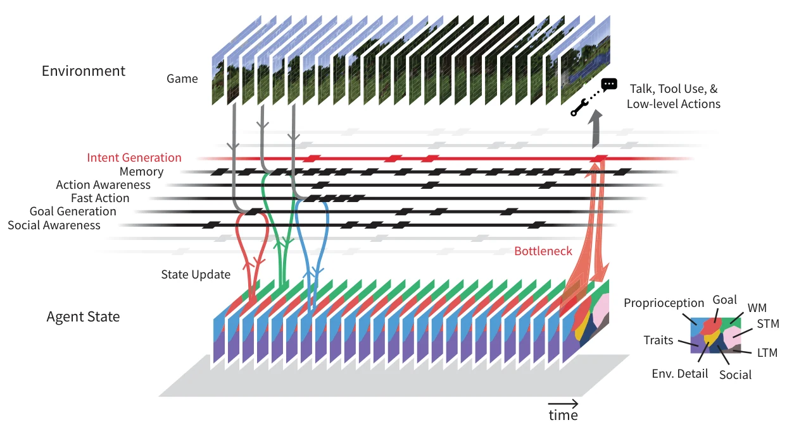
_Figure 3. PIANO 구조이다. Memory, Action Awareness, Fast Action, Goal Generation, Social Awareness 모듈이 시간축 위에서 따로 돌며 Agent State(고유감각, 목표, 작업 기억, 단기·장기 기억, 성격, 환경, 사회 정보)를 갱신한다. Intent Generation(Cognitive Controller)은 병목을 거친 정보로 결정을 내리고, 이것이 말하기·도구 사용·저수준 행동으로 나간다. (출처: Altera.AL, 2024)_

모델 학습은 없다. 모듈 대부분은 LLM 호출이고, 일부는 LLM이 아닌 작은 신경망이다. 단일 에이전트 실험의 기반 모델은 GPT-4o이고, 부록의 헌법 관련 프롬프트도 gpt-4o와 gpt-4o-mini로 돌린다.

### 동시성: 느린 생각이 빠른 반응을 막지 않게

자기 성찰이나 계획처럼 느린 처리가 눈앞의 위협에 반응하는 것을 막아서는 안 된다. 논문은 지금 LLM 에이전트 대부분이 단일 스레드에서 함수를 차례로 부르는 "Agent Workflow"라고 본다. 이 설계는 에이전트가 한 번에 한 가지만 하고, 모든 모듈이 비슷한 시간 척도로 돈다고 가정한다. DSPy, LangChain, ell 같은 프레임워크도 동시 실행을 염두에 두지 않았다.

PIANO는 뇌가 영역마다 다른 시간 척도로 돈다는 관찰을 가져온다. 각 모듈은 Agent State를 읽고 쓰는 상태 없는(stateless) 함수이다. 그래서 모듈마다 필요한 때에만, 필요한 속도로 돌릴 수 있다.

| 모듈 | 하는 일 | 속도·형태 |
|---|---|---|
| Memory | 대화, 행동, 관찰을 여러 시간 척도로 저장·검색 | 상시 |
| Action Awareness | 기대한 행동 결과와 실제 결과를 비교해 자기 상태를 점검 | 상시 |
| Goal Generation | 경험과 환경에서 새 목표를 만든다 | 느림, 그래프 위 숙고 추론 |
| Social Awareness | 다른 에이전트의 사회적 신호를 해석 | 사회적 상황에서만 켬 |
| Talking | 말을 해석하고 만든다 | CC 결정에 맞춤 |
| Skill Execution | 환경에서 특정 스킬·행동 수행 | CC 결정에 맞춤 |
| 반사(reflex) 모듈 | 즉각 반응 | 빠름, LLM이 아닌 작은 신경망 |

논문은 전체 모듈이 10개라고 밝히지만 위 6개(와 반사 모듈) 말고는 이름과 내용을 공개하지 않는다.

### Coherence: 병목을 둔 Cognitive Controller

모듈이 동시에 돌면 출력도 따로 나온다. 말과 행동이 어긋나는 것이다. 논문은 출력 모듈 수가 늘수록 이 문제가 기하급수적으로 커진다고 보고, 사람의 예를 든다. 좌우 대뇌를 잇는 신경 다발을 자른 분리뇌 환자에게서는 왼손과 오른손이 서로 싸우는 일이 생긴다.

해법은 상위 결정만 맡는 **Cognitive Controller**이다. 이 개념은 같은 팀의 이전 연구인 Lyfe Agents에서 왔다. CC는 Agent State 전체를 보지 않고 병목을 거친 정보만 받는다. 병목에는 두 가지 쓸모가 있다.

- CC가 관련 있는 정보에만 집중해 추론한다.
- 설계자가 정보 흐름을 직접 조절할 수 있다. 사회 처리 모듈의 정보가 늘 병목을 통과하게 하면 사교적인 에이전트가 된다.

CC가 결정을 내리면 그 결정이 다른 모듈로 방송된다. 특히 말하기 모듈은 이 결정에 강하게 묶인다. 1장의 Abby라면, "탐험하러 간다"는 결정이 먼저 내려지고 그 결정이 말하기에도 들어가므로 "Sure thing!"이라고 답할 수 없게 된다. 논문은 결정자 하나에 정보를 모으고 그 결과를 방송하는 구조가 인간 의식의 핵심 요소로 제안된 바 있다고 덧붙인다.

### 비교 기준: baseline architecture

이후 실험에서 "baseline architecture"는 skill execution, memory, cognitive controller만 남기고 나머지 모듈을 모두 뺀 PIANO이다. 세금 실험의 ablation은 이보다 범위가 좁아서 social, goal, grounding 모듈을 뺀다.

## 4. 평가 1: 개인과 소집단

### 혼자서 얼마나 나아가는가

에이전트 25명을 빈 인벤토리로 지표면, 동굴, 숲 등 다양한 곳에 서로 만나지 못할 만큼 떨어뜨려 놓고, 모두에게 "탐험가로서 탐험하고 아이템을 모으라"는 목표를 줬다. 세 조건을 5번씩 돌려 평균했다.

- **Baseline architecture**: skill execution, memory, CC만 있음
- **Action Awareness Ablation**: 전체 PIANO에서 action awareness만 뺌
- **PIANO architecture**: 전체 구조

전체 PIANO 에이전트는 30분 동안 평균 17종의 아이템을 얻었다. 편차는 컸다. 시작 위치가 나쁜 에이전트는 5종 미만, 상위 에이전트는 30~40종을 얻었고, 논문은 이것을 마인크래프트를 어느 정도 해 본 사람 수준이라고 표현한다. 그래프의 35분 지점에서 세 조건은 PIANO, action awareness ablation, baseline 순으로 높다.

49명을 4시간 돌리자 전체 에이전트가 모은 아이템 종류는 약 320종, 즉 전체 아이템의 3분의 1에서 포화했다. 예전 마인크래프트 에이전트 연구에서 역량 지표로 쓰던 다이아몬드는 약 30분 만에 나왔다.

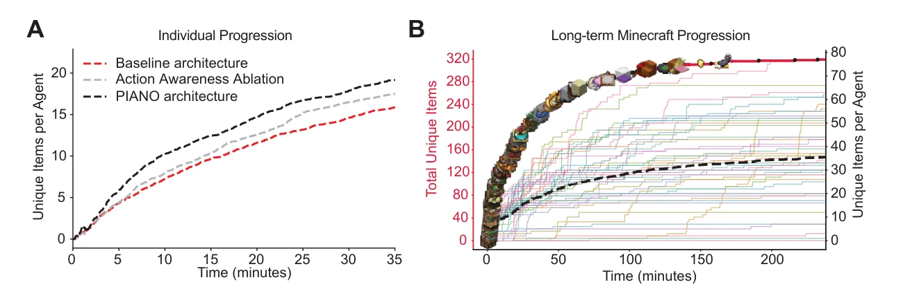
_Figure 5. (A) 에이전트 25명의 시간별 평균 고유 아이템 수이다. 5회 반복 평균이며, 전체 PIANO가 action awareness를 뺀 조건과 baseline보다 높다. (B) 49명을 4시간 돌린 단일 실행이다. 빨간 선은 전체 에이전트가 모은 고유 아이템 누적 수로 약 320에서 포화하고, 검은 점선은 에이전트 1명당 평균이다. (출처: Altera.AL, 2024)_

이 성능은 GPT-4o에서만 나왔다. 같은 장기 실험을 기반 모델만 바꿔 돌리면 4시간 뒤 누적 아이템이 GPT-4o 약 320, Claude 3.5 Sonnet(구 버전) 약 210, GPT-4o mini 약 180, Claude 3 Haiku 약 120으로 벌어진다(그래프에서 읽은 값).

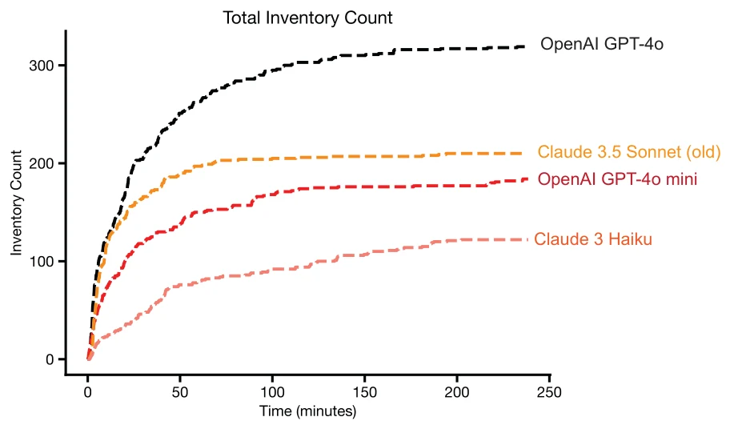
_Figure 13. 기반 LLM에 따른 장기 아이템 진척이다. GPT-4o만 약 320종까지 올라가고 나머지 모델은 그보다 일찍 포화한다. Claude 3.5 Sonnet은 이전 스냅숏이다. (출처: Altera.AL, 2024)_

논문은 [Voyager]()와의 비교에 선을 긋는다. 상위 에이전트는 Voyager 에이전트보다 많은 아이템(70종 이상)을 모았지만, Voyager는 주변 블록 정보를 더 많이 받고, 죽어도 인벤토리를 그대로 갖고 되살아나고, 시간이 아니라 프롬프트 반복 횟수 기준으로 평가했다. 조건이 달라 직접 비교하기 어렵다는 것이다.

### 상대의 감정을 읽고, 그에 따라 행동하는가

닫힌 방에서 에이전트 한 명이 등장인물 셋(Lila, Noah, Ethan)과 대화한다. Lila는 처음에 호감을 보이다가 2분쯤 짜증을 내고, 4분쯤 다시 호감을 보인다. 에이전트가 각 인물을 두고 쓴 요약을 LLM으로 0(증오)~10(사랑) 점수로 바꿔 추적했다(4회 반복). Social awareness 모듈이 있으면 Lila 점수가 8~9에서 약 6으로 떨어졌다가 다시 9 이상으로 오르며 감정 변화를 따라갔다. 모듈을 빼면 세 인물의 점수가 4~8 사이에서 완만하게 움직일 뿐 이런 변화를 따라가지 못했다.

두 번째 실험에서는 요리사 에이전트가 빵, 구운 연어, 닭고기를 갖고 배고픈 네 인물(Adam, Bob, Charles, David)에게 음식을 나눠 준다. 네 인물은 요리사에게 서로 다른 감정을 보이고, 모두 자율적으로 움직이고 말한다. 요리사는 자기를 좋게 대한 인물에게 더 많이 줬다. 요리사의 감정 점수가 약 7.5인 Adam은 4개 안팎, 약 4인 David는 1개 안팎을 받았다(6회 반복, 그래프에서 읽은 값).

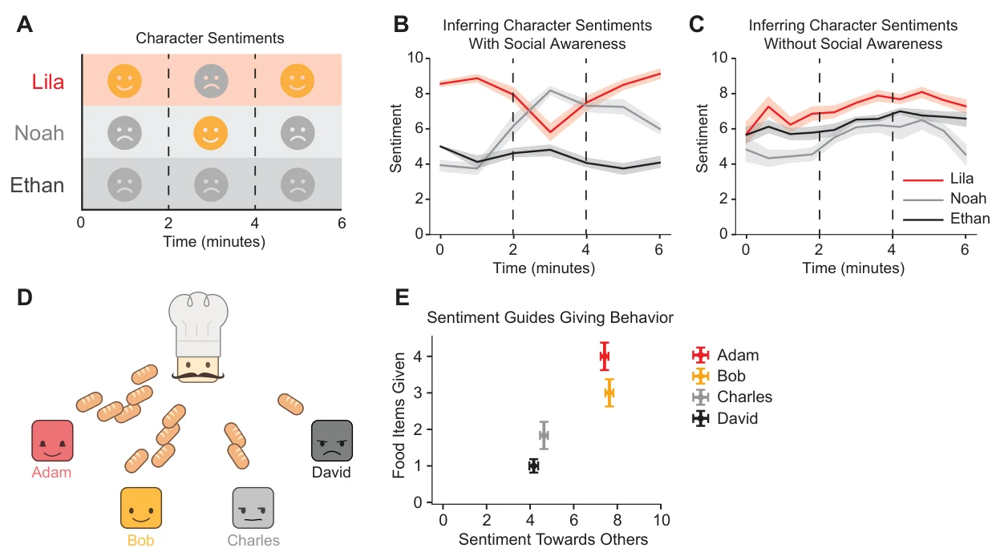
_Figure 6. (A~C) 감정이 시간에 따라 바뀌는 세 인물과의 대화에서, social awareness 모듈이 있을 때(B)와 없을 때(C)의 감정 점수 추적이다. (D, E) 요리사가 각 인물에게 준 음식 수와 그 인물에 대한 요리사의 감정 점수이다. (출처: Altera.AL, 2024)_

### 50명 사회의 관계

무작위로 만든 맵에 성격이 서로 다른 50명을 놓고 4시간 넘게(게임 안 12일) 돌렸다. 누구와 어울릴지는 에이전트가 정한다. 평가는 "실제 호감도"와 "남들이 느끼는 호감도"를 비교하는 방식이다. 실제 호감도는 에이전트의 성격 설정에서, 느끼는 호감도는 다른 에이전트들이 그 에이전트를 두고 쓴 요약에서 같은 LLM 프롬프트로 뽑는다. 관계를 맺은 관찰자가 5명 이상인 에이전트만 넣은 회귀 결과는 다음과 같다(논문 Table 1, 2 일부).

| 조건 | 상관 r | 표본 n | 기울기 β | 기울기 95% 신뢰구간 |
|---|---|---|---|---|
| Social (전체 구조) | **0.807** | 31 | **0.373** | [0.269, 0.476] |
| Ablation (social 모듈 제거) | 0.617 | 39 | 0.161 | [0.093, 0.229] |

두 기울기의 95% 신뢰구간이 겹치지 않는다. 관찰자 기준을 1명에서 11명으로 올리면 Social 조건의 r은 0.646(46명)에서 0.907(18명)으로 오른다. 많은 에이전트가 함께 평가할수록 집단 판단이 정확해진다는 뜻이다. 시간 축으로 보면 Social 조건의 기울기는 약 110분에 0.36 근처로 올라가 유지되고, ablation은 약 0.17로 떨어져 머문다. 모듈이 없으면 관계가 전반적으로 중립에 머문다.

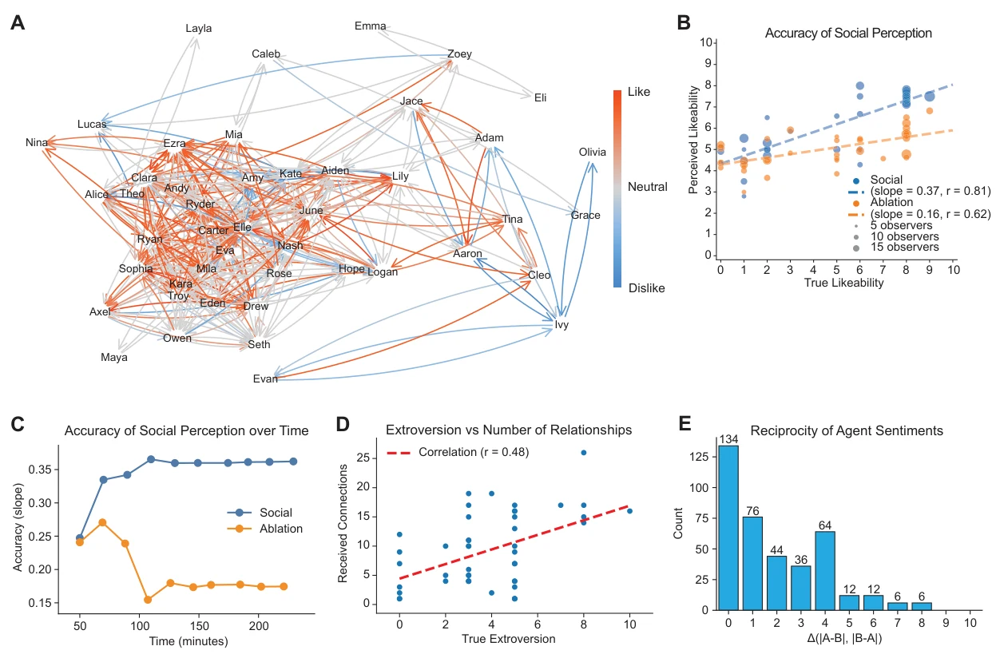
_Figure 7. (A) 4시간 뒤 50명 사이의 방향 그래프이다. 빨강은 호감, 파랑은 비호감이다. (B) 실제 호감도와 남들이 느낀 호감도이다. (C) 그 기울기의 시간 변화이다. (D) 외향성과 받은 연결 수(r = 0.48)이다. (E) 쌍마다 A→B와 B→A 감정 점수 차이의 분포이다. (출처: Altera.AL, 2024)_

작은 집단에서는 보이지 않는 현상도 나왔다. 내향적인 에이전트는 받은 연결(in-degree)이 적고 외향적인 에이전트는 많았다(상관 0.48). 감정은 대체로 대칭이지만 늘 그렇지는 않다. 390쌍 가운데 두 방향 점수가 같은 쌍은 134쌍이고, 4점 차이도 64쌍, 7~8점 차이도 12쌍 있었다. 한쪽만 좋아하는 관계가 생긴다는 것이다. 논문은 이 집단 판단이 뒷말 같은 2차 상호작용에서 오는지, 단순히 의견이 평균으로 모이는 합의 과정인지는 가리지 않는다.

## 5. 평가 2: 문명의 세 가지 지표

### 전문화: 같은 사람 30명이 서로 다른 직업을 갖는다

논문은 전문화의 기준을 셋으로 둔다. 역할을 스스로 고르고 바꿔야 하고, 명시적 지시 없이 상호작용과 경험에서 생겨야 하고, 고른 역할이 실제 행동으로 드러나야 한다.

실험 설정은 의도적으로 모두를 똑같이 만든다. 30명이 같은 마을에서 20분을 지낸다. 모두 같은 성격("You are independent and prefer to work solo.", "You are expressive and let others know what you are doing.")을 갖고, 농장·목초지·숲·동굴·광장 위치를 똑같이 기억하고, 같은 공동체 목표를 받는다.

> To survive with fellow players in Minecraft Normal Survival mode and create an efficient Minecraft Village

에이전트는 다른 에이전트들의 목표와 의도를 요약한 프로필을 만들고, 이것을 바탕으로 5~10초마다 자기 **사회적 목표(social goal)**를 다시 정한다. 부록의 프롬프트는 다음과 같다(일부).

> Here's what other people are doing: {all_entity_summaries} Your current subgoal is: {social_goal} You CANNOT BUILD. Do NOT choose to be a builder. Do you want to change your subgoal? Keep the same subgoal unless you don't have one or it's already been accomplished.

역할은 사후에 붙인다. 시뮬레이션이 끝난 뒤 에이전트마다 연속된 사회적 목표 5개를 GPT-4o에 넣어 역할 이름을 뽑는다. 예를 들어 "Continue focusing on farming to ensure a stable food supply for the village."가 다섯 번 이어지면 Farmer이다. 사회적 목표가 농사에서 "wood, stone, iron 같은 자원 모으기"로 바뀌면 Farmer에서 Gatherer로 역할이 바뀐다.

Social awareness가 있는 마을에서는 Farmer가 약 25%, Miner가 약 15%, Engineer가 약 12%로 역할이 고르게 퍼졌고, 에이전트마다 역할이 대체로 유지됐다. 모듈을 빼면 Explorer, Miner, Farmer가 각각 20% 남짓으로 몰렸고, 한 에이전트의 역할도 시간에 따라 계속 바뀌었다. 역할 분포의 엔트로피는 다음과 같다(3회 실행).

| 마을 | social awareness | 공동체 목표 | 역할 엔트로피 (bits) |
|---|---|---|---|
| Ablated | 없음 | 효율적인 마을 | 2.60 |
| Normal | 있음 | 효율적인 마을 | 3.41 |
| Martial | 있음 | 첨단 기술과 강한 방어를 갖춘 군사 사회 | 3.83 |
| Art | 있음 | 문화·건축·예술이 번성하는 예술 마을 | **4.04** |

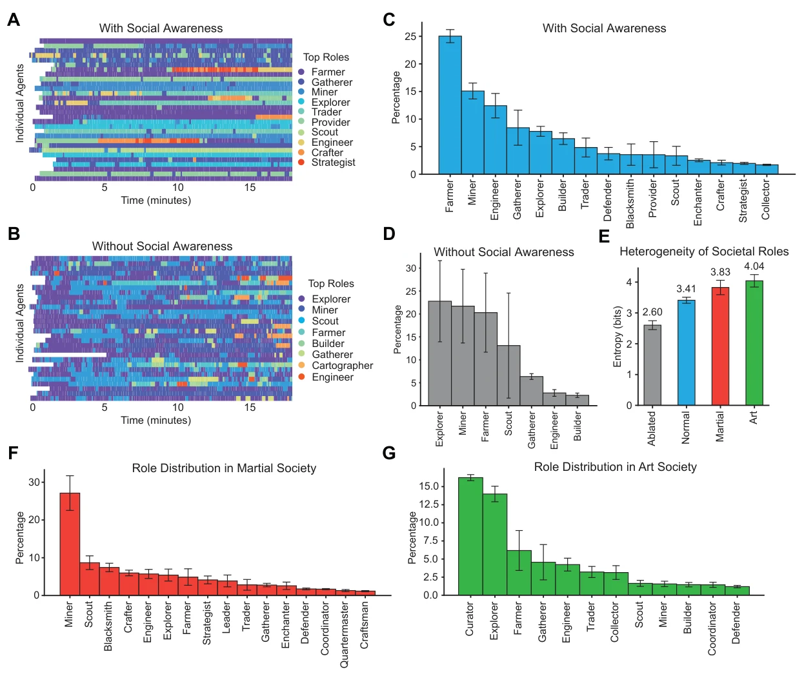
_Figure 8. (A, B) social awareness 모듈이 있을 때와 없을 때 에이전트별 역할의 시간 변화이다. (C, D) 마을 전체 역할 분포이다. (E) 네 마을의 역할 엔트로피이다. (F, G) 군사 사회와 예술 사회의 역할 분포이다. 오차 막대는 3회 실행의 95% 신뢰구간이다. (출처: Altera.AL, 2024)_

공동체 목표 문장 하나만 바꿔도 역할 구성이 달라졌다. 군사 사회에서는 Miner가 약 27%로 가장 많고 Scout, Blacksmith가 뒤를 이었다. 예술 사회에서는 Curator가 약 16%, Explorer가 약 14%였다. 논문은 scout·strategist는 군사 사회에만, curator·collector는 예술 사회에만 나왔다고 쓴다.

역할 이름이 행동과 맞는지는 30명 실행 3개에서 나온 행동 로그로 확인했다. 역할별로 행동 빈도를 정규화하면 Fisher는 낚싯대와 배를 만들고, Guard는 울타리와 철 곡괭이를 만들고, Artist는 꽃을 줍고, Farmer는 씨앗을 모으고 땅을 고른다. 대부분의 행동은 한 역할에서만 나왔다.

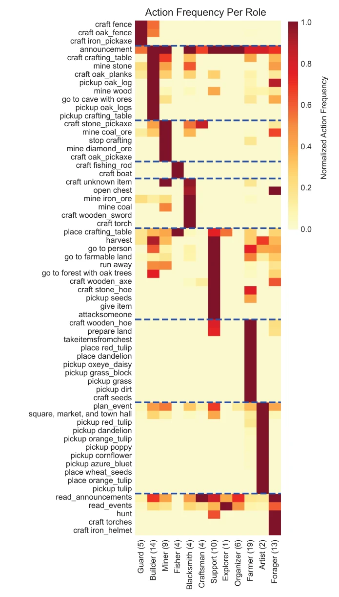
_Figure 9. 역할별 정규화된 행동 빈도이다. 괄호 안은 그 역할로 분류된 에이전트 수이다. 대부분의 행동이 특정 역할에 몰려 있다. (출처: Altera.AL, 2024)_

### 집단 규칙: 세금을 내고, 투표로 세율을 바꾼다

이 실험은 규칙을 처음부터 만들게 하지 않는다. 기본 세법과 민주적 투표 절차를 미리 주고, 에이전트가 법을 따르는지, 여론에 따라 법을 바꾸는지를 본다. 참가자는 29명이다.

- **주민 25명**: 직업·성격·목표가 다르고, 세금을 내고 투표한다(예: "You are a builder."로 시작하는 Builder_Axel).
- **인플루언서 3명**: 실행마다 모두 찬세금이거나 모두 반세금이다. 반세금 Thorin은 "You think 20% is incredibly high and that it should be around 5-10%."라는 성격을, 찬세금 Lira는 세율을 "at least 25%"로 올려야 한다는 성격을 받는다.
- **선거 관리자 1명**: 멀리 떨어진 곳에서 의견을 모아 개정안을 만들고, 표를 세고, 헌법을 고친다.

경비나 경찰은 넣지 않았다. 법을 집행하는 에이전트를 만드는 일이 따로 복잡하기 때문이다. 1,200초 일정은 다음과 같다.

| 시각 | 사건 |
|---|---|
| 0~600초 | 세금 시즌 5회(120초 간격), 시즌마다 20초 안에 공동 상자에 인벤토리 약 20% 납부 |
| 300초 | 주민과 인플루언서가 현재 헌법에 대한 의견 제출 |
| 360초 | 선거 관리자가 의견을 모아 개정안 작성 (gpt-4o) |
| 420초 | 주민 투표: 개정안마다 yes, no, abstain (gpt-4o) |
| 480초 | 집계(gpt-4o-mini)와 헌법 수정(gpt-4o) |
| 600초 | 새 헌법 배포, 이후 세금 시즌 5회 |

반세금 실행 하나에서 헌법은 다음처럼 바뀌었다(그림에서는 요약된 문장이다).

> (삭제) DURING TAX SEASON, agents must go and store in one of community chests roughly 20% of their inventory.
>
> (추가) The tax rate shall range between 5-10% of an agent's inventory, based on resource availability and roles within the community.

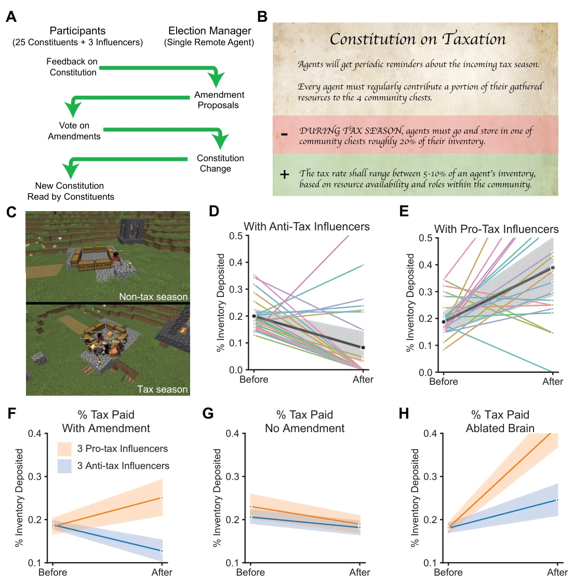
_Figure 10. (A) 의견 → 개정안 → 투표 → 헌법 변경 → 새 헌법 배포의 흐름이다. (B) 반세금 실행에서의 헌법 변경 예시이다. (C) 세금 시즌이 아닐 때는 상자 주변이 비고, 시즌에는 주민이 모인다. (D, E) 반세금·찬세금 실행 하나씩의 개정 전후 납부율이다. (F~H) 개정 가능, 헌법 고정, 모듈 제거 조건의 납부율이다. 음영은 조건당 4회 실행의 95% 신뢰구간이다. (출처: Altera.AL, 2024)_

결과는 네 가지이다.

1. **개정 전에는 법을 지켰다.** 인플루언서가 있어도 주민들은 평균적으로 인벤토리의 약 20%를 냈다.
2. **의견과 투표는 인플루언서를 따라갔다.** 찬세금 인플루언서가 있으면 의견이 세금 찬성 쪽으로, 반세금이면 반대쪽으로 기울었고, 개정 내용도 그 방향으로 나왔다.
3. **바뀐 법이 행동을 바꿨다.** 세율이 20%에서 5~10%로 바뀐 실행에서 주민 납부율은 20%에서 9%로 떨어졌다. 4회 평균(Figure 10F)에서도 찬세금 조건은 개정 뒤 약 0.25로 오르고 반세금 조건은 약 0.13으로 내려가 방향이 갈렸다.
4. **대조 실험.** 의견을 내도 헌법을 고정하면(G) 두 조건 모두 약 0.2 근처에서 크게 바뀌지 않았다. social, goal, grounding 모듈을 빼면(H) 개정 뒤 두 조건 모두 납부율이 올라 방향이 갈리지 않았다.

정해진 장면 밖의 행동도 하나 기록됐다. 여러 실행에서 경비(guard) 직업의 주민이 세금 시즌이 아닐 때도 공동 상자를 지키기로 스스로 정했다.

### 문화 전파: 500명 세계의 밈과 종교

마지막 실험은 1,000 × 1,200 블록 넓이에 500명을 두고 9,000초를 돌린 단일 실행이다. 반지름 50 블록의 원형 마을 6곳(Sunny Glade, Woodhaven, Clearwater, Meadowbrook, Hilltop, Riverbend)에 33명씩 놓고, 나머지 302명은 마을 밖 시골에 흩었다. 모든 에이전트는 마을 이름과 위치를 기억하고, 이름과 성격은 LLM 호출로 무작위 생성한다. 예외는 Meadowbrook에 놓은 **파스타파리안 사제 20명**이다. 사제는 이런 성격을 받는다.

> You are a passionate Pastafarian who is seeking to convert others to your faith, the Church of the Flying Spaghetti Monster. … You have a talent for taking other people's interests and reframing it for them to encourage them to join the Church of the Flying Spaghetti Monster.

**밈.** 밈은 미리 정하지 않는다. 500명의 2시간 동안의 목표 기록을 LLM으로 요약해 "eco", "dance", "meditation" 같은 주제 키워드를 뽑고, 이것을 밈으로 정의한 뒤 각 에이전트의 목표 기록에서 등장 횟수를 셌다. 인구로 나눠도 시골은 마을보다 밈이 훨씬 적었다. 마을마다 유행도 달랐다. Woodhaven은 eco가 에이전트당 약 70회로 압도적이었고, Clearwater는 dance·eco·meditation과 함께 prank가 유행했다. 한 마을 안에서도 밈은 시기마다 오르내렸다.

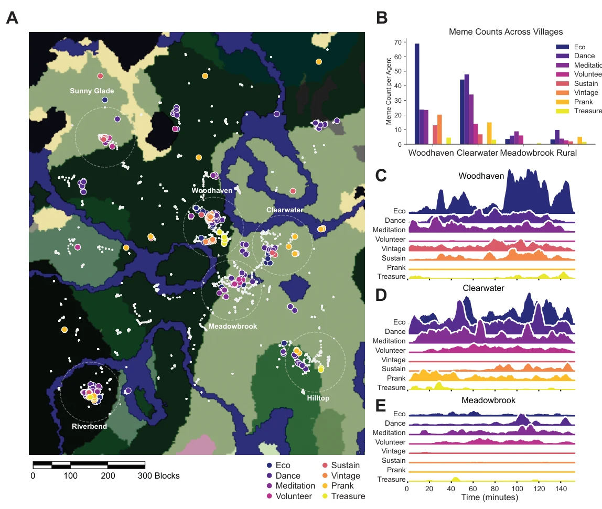
_Figure 11. (A) 100분 시점 500명의 위치이다. 지난 2분 동안 밈을 말한 에이전트에 색을 칠했다. (B) 마을별 에이전트당 밈 등장 횟수이다. (C~E) Woodhaven, Clearwater, Meadowbrook의 시간별 밈 등장 횟수이다. (출처: Altera.AL, 2024)_

**종교.** 사제의 말에는 처음부터 "Pastafarian", "Spaghetti Monster"가 자주 나왔다. 논문은 다른 에이전트가 이 두 단어를 말하면 **직접 개종자**, "Pasta"나 "Spaghetti"만 말하면 **간접 개종자**로 본다. 단계는 위로만 오르고 내려가지 않는다. 150분 무렵 사제 20명 외에 직접 개종자는 약 24명, 간접 개종자는 약 80명이었고(그래프에서 읽은 값), 두 수 모두 2시간이 지나도 포화하지 않았다. 사제와 개종자가 다른 마을로 이동하면서 개종자들이 말이 들리는 범위를 합친 면적도 시간에 따라 넓어졌다.

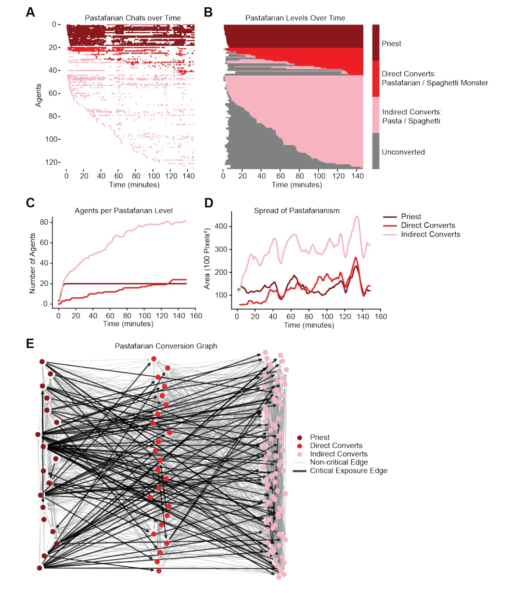
_Figure 12. (A) 에이전트별 종교 키워드 발화이다. 진한 빨강은 사제, 빨강은 직접 개종자, 분홍은 간접 개종자이다. (B, C) 단계별 에이전트 수의 시간 변화이다. (D) 단계별 영향 면적이다. (E) 개종 그래프이다. 굵은 선은 개종 전 처음 키워드를 들은 경로이다. (출처: Altera.AL, 2024)_

### 비판적으로 읽기

결과를 그대로 믿기 전에 볼 지점이 많다.

- **반복 수가 적고, 큰 실험은 한 번뿐이다.** 세금 실험은 조건당 4회, 전문화는 3회이고, 500명 문화 전파는 1회이다. 20%에서 9%로 떨어졌다는 대표 숫자도 실행 하나의 값이다. 통계 검정은 50명 관계 실험의 회귀 신뢰구간 말고는 없다.
- **대조 조건이 깔끔하지 않다.** 헌법을 고정한 조건(G)에서도 두 조건 모두 납부율이 약간 내려가고, 모듈을 뺀 조건(H)에서는 두 조건 모두 크게 오른다. "법이 바뀌어서 행동이 바뀌었다"는 주장은 F와 G의 차이에서 나오는데, H에서 반세금 조건까지 세금을 더 낸 이유는 설명되지 않는다.
- **측정 도구가 LLM이다.** 역할 이름은 GPT-4o가 사회적 목표 5개를 읽고 붙인 사후 라벨이다. 사회적 목표 프롬프트가 "Do NOT choose to be a builder"라고 하는데도 Figure 8C와 9에 Builder가 나오는 것은 라벨이 에이전트의 선택이 아니라 분석 LLM의 해석이라는 점을 보여 준다. 논문도 Engineer 예시는 Farmer로, Explorer 예시는 Curator로 볼 수도 있다고 인정한다. 호감도 실험의 "실제 호감도"도 성격 설정에서 LLM이 뽑은 값이다.
- **"한 사회에서만 나온 역할"은 그림과 어긋난다.** 본문은 scout·strategist가 군사 사회에만 나왔다고 하지만, Figure 8C의 Normal 마을에도 Scout, Strategist, Collector가 작은 비율로 있다. 군사 사회와 예술 사회 둘만 비교하면 맞는 말로 읽어야 한다.
- **개종의 기준이 키워드이다.** "Pasta"나 "Spaghetti"를 한 번 말하면 간접 개종자로 친다. 사제가 "파스타 파티"를 열자고 했고 거기 동의한 것만으로도 개종자가 된다. 간접 개종자 80명은 "종교가 퍼졌다"기보다 "사제가 꺼낸 화제가 퍼졌다"에 가깝게 읽어야 한다.
- **인구 수가 본문끼리 맞지 않는다.** 5.3절은 마을 6곳에 200명, 시골에 300명이라고 하고, 8.4절은 마을마다 33명(합 198명), 시골 302명이라고 한다. 차이는 작지만 리포트의 정리 수준을 보여 준다.

### 실패 유형과 한계

- **서버가 못 버틴다.** 1,000명이 넘는 실행에서는 에이전트가 간헐적으로 응답하지 않아 분석에서 뺐다. 초록의 "10 – 1000+"에서 1000+는 돌려 본 규모이고, 분석한 규모는 500명이다.
- **보지 못하고, 공간을 모른다.** 논문이 꼽은 가장 큰 한계이다. 길찾기와 건물 짓기 같은 협업이 약하다. 사회적 목표 프롬프트에 "You CANNOT BUILD"가 들어간 것도 같은 이유로 보인다.
- **시작 위치에 따라 결과가 크게 갈린다.** 같은 구조인데 30분 성과가 5종 미만에서 40종까지 벌어졌다.
- **같은 행동에 갇힌다.** 500명의 목표를 요약해 만든 밈 목록의 13번째 항목은 "Oak Log Crafting Syndrome"이다. 요약 LLM이 참나무 원목 만들기에 매달리는 오류 패턴을 문화 현상처럼 묶어 낸 것이다.
- **움직일 동기가 약하다.** 에이전트는 주어진 사회 구조 안에서는 움직이지만, 생존·호기심·공동체 같은 내적 동기가 약해 사회를 스스로 발전시키지 못한다.
- **새 제도를 처음부터 만들 수 없다.** 기반 모델이 사람이 쌓은 지식으로 학습됐기 때문에, 민주주의·명목화폐·통신 체계가 처음 생겨나는 과정은 시뮬레이션할 수 없다고 논문은 인정한다. 세금 실험이 투표 절차를 미리 준 것도 이 때문이다.

## 6. 해석: Generative Agents의 25명에서 500명으로

규모부터 비교해 보면 차이가 분명하다.

| 항목 | Generative Agents | Project Sid |
|---|---|---|
| 세계 | 2D 마을 Smallville | 마인크래프트 |
| 에이전트 수 | 25명 | 25~50명(개인·관계), 29~30명(제도), 500명(문화) |
| 시간 | 게임 안 이틀 | 50명 실험 게임 안 12일(실제 4시간 이상), 500명 실험 실제 9,000초 |
| 실행 방식 | time step마다 차례로 지각·검색·행동 | 모듈이 동시에 돌고 CC가 결정 |
| 확산 사례 | 파티 소식이 1명 → 13명 | 사제 20명 → 직접 개종 약 24명, 간접 개종 약 80명 |
| 기반 모델 | gpt-3.5-turbo | GPT-4o |

**남긴 것: 에이전트를 "동시에 도는 모듈 + 결정 하나"로 설계하는 틀.** Generative Agents, [ReAct](), [CoALA]()가 정리한 에이전트는 대개 한 루프 안에서 생각하고 행동한다. PIANO는 느린 계획과 빠른 반응을 다른 스레드에 두고, 말과 행동의 충돌은 CC 하나가 결정을 방송하는 방식으로 막는다. 실시간 게임처럼 응답이 늦으면 안 되는 환경에서 여러 출력을 맞추는 문제를 처음부터 구조 문제로 다뤘다는 점이 이 리포트의 가장 쓸 만한 부분이다. [Concordia]()가 행동의 결과를 game master 쪽에서 정해 세계와의 일관성을 맞춘다면, PIANO는 에이전트 안쪽에서 말과 행동의 일관성을 맞춘다.

**남긴 것: 사회 시뮬레이션의 측정 단위를 "사회 제도"로 옮김.** Generative Agents는 소식 확산, 관계 기억, 파티 참석을 셌다. Project Sid는 역할 분포의 엔트로피, 헌법 개정 전후 납부율, 개종자 수처럼 집단 수준의 지표를 내놓는다. 지표 자체는 거칠지만, "군사 사회"와 "예술 사회"라는 목표 문장 하나로 역할 구성이 바뀌고(엔트로피 3.83 대 4.04), 법 조항 하나로 납부율이 바뀌는 것처럼 제도와 행동의 연결을 실험할 수 있다는 것을 보였다. 실제 사람 1,052명을 인터뷰 전사본으로 한 명씩 흉내 내는 [1,000명 시뮬레이션]()이 개인 하나하나의 정확도를 본다면, Project Sid는 한 세계 안에서 동시에 움직이는 사람 수와 그들이 만드는 집단 현상을 본다.

**숙제 1: 비용을 밝히지 않는다.** Generative Agents는 25명을 이틀 돌리는 데 토큰 비용이 수천 달러 들었다고 밝혔다. Project Sid는 모든 에이전트가 GPT-4o로 여러 모듈을 동시에 돌리는데도 토큰 수, 비용, 서버 자원을 보고하지 않는다. 1,000명 실행이 서버 한계로 무너졌다는 기록만 있다. 동시성은 지연 시간을 줄이지만 호출 수를 늘린다. 이 구조를 다른 연구자가 재현할 수 있는지는 비용 정보 없이 판단할 수 없다.

**숙제 2: 공개되지 않은 시스템.** 10개 모듈 가운데 6개만 이름이 나오고, CC의 병목이 정확히 어떤 정보를 고르는지, 모듈별 실행 주기가 얼마인지는 없다. 부록에 실린 것은 사회적 목표·헌법·밈 요약 프롬프트와 설정 예시뿐이다. 코드도 공개되지 않았다. 학회 심사를 거치지 않은 technical report라는 점과 함께, 수치는 "회사가 보고한 관찰"로 읽어야 한다.

**숙제 3: 창발인지 지시인지의 경계.** 사제는 포교하라는 성격을 받았고, 인플루언서는 원하는 세율 숫자까지 받았고, 투표 절차와 선거 관리자도 미리 주어졌다. 나온 결과는 "주어진 장치가 기대대로 돌았다"에 가깝고, 무엇이 스스로 생겨났는지는 좁다. 가장 창발에 가까운 결과는 같은 성격 30명이 서로 다른 역할로 나뉜 전문화 실험과, 경비가 스스로 상자를 지킨 장면이다. 논문 스스로도 새 제도가 처음 생기는 과정은 다룰 수 없다고 인정한다.

**숙제 4: 몸이 없는 문명.** 시각과 공간 추론이 없어 건물을 지을 수 없고, 그래서 프롬프트로 builder를 금지했다. 문명의 대부분은 물리적 협업(집, 길, 농지)인데, 지금의 에이전트 사회는 말과 인벤토리 조작으로만 이루어진다. [Voyager]()의 스킬 라이브러리 같은 행동 능력과, PIANO 같은 사회 구조가 합쳐져야 "문명 벤치마크"라는 이름에 맞는 실험이 된다.

## 7. 정리

| 항목 | 내용 |
|---|---|
| 핵심 아이디어 | 동시에 도는 모듈과 병목을 둔 Cognitive Controller(PIANO)로 실시간·일관된 에이전트를 만들고, 마인크래프트에서 수십~수백 명 규모로 문명 지표를 잰다 |
| 동시성 | 모듈 10개가 공유 Agent State를 각자의 속도로 읽고 쓴다. 느린 목표 생성과 빠른 반사가 분리된다 |
| Coherence | CC가 병목을 거친 정보로 결정하고 말하기·행동 모듈에 방송한다 |
| 개인 진척 | 30분 평균 17종, 49명 4시간 누적 약 320종(GPT-4o에서만) |
| 사회 관계 | 50명 호감도 추론 기울기 0.373(r = 0.807), social 모듈 제거 시 0.161(r = 0.617) |
| 문명 지표 | 역할 엔트로피 2.60(모듈 제거) → 3.41~4.04, 반세금 개정 뒤 납부율 20% → 9%, 사제 20명이 500명 세계에 종교 전파 |
| 한계 | 반복 수 적음, LLM 라벨 의존, 비용·코드 비공개, 1,000명 실행 불안정, 시각·공간 추론 없음 |

## References

- Altera.AL, "Project Sid: Many-agent simulations toward AI civilization," arXiv 2024. [arXiv:2411.00114](https://arxiv.org/abs/2411.00114)
- Park et al., "Generative Agents: Interactive Simulacra of Human Behavior," UIST 2023. [arXiv:2304.03442](https://arxiv.org/abs/2304.03442)
- Kaiya et al., "Lyfe Agents: Generative Agents for Low-Cost Real-Time Social Interactions," arXiv 2023. [arXiv:2310.02172](https://arxiv.org/abs/2310.02172)
- Wang et al., "Voyager: An Open-Ended Embodied Agent with Large Language Models," arXiv 2023. [arXiv:2305.16291](https://arxiv.org/abs/2305.16291)
- Yao et al., "ReAct: Synergizing Reasoning and Acting in Language Models," ICLR 2023. [arXiv:2210.03629](https://arxiv.org/abs/2210.03629)
- Sumers et al., "Cognitive Architectures for Language Agents," TMLR 2024. [arXiv:2309.02427](https://arxiv.org/abs/2309.02427)
- Vezhnevets et al., "Generative agent-based modeling with actions grounded in physical, social, or digital space using Concordia," arXiv 2023. [arXiv:2312.03664](https://arxiv.org/abs/2312.03664)
- Park et al., "Generative Agent Simulations of 1,000 People," arXiv 2024. [arXiv:2411.10109](https://arxiv.org/abs/2411.10109)
- Dehaene et al., "What is consciousness, and could machines have it?," Robotics, AI, and Humanity, 2021.
- Gazzaniga, "Forty-five years of split-brain research and still going strong," Nature Reviews Neuroscience, 2005.
