> - **논문**: AgentSociety: Large-Scale Simulation of LLM-Driven Generative Agents Advances Understanding of Human Behaviors and Society
> - **저자**: Jinghua Piao, Yuwei Yan, Jun Zhang, Nian Li, Junbo Yan, Xiaochong Lan 외 (Tsinghua University)
> - **공개**: arXiv 2025 · [arXiv:2502.08691](https://arxiv.org/abs/2502.08691) · [Code](https://github.com/tsinghua-fib-lab/AgentSociety)
{: .prompt-tip }

> [Generative Agents]()는 25명이 사는 작은 마을에서 LLM 에이전트가 이틀 동안 사람처럼 살 수 있음을 보였다. 사회과학 도구로 쓰려면 두 가지가 더 필요하다. 사람 수가 수천, 수만 명이어야 하고, 마을이 게임 맵이 아니라 실제 도로·가게·임금·세금이 있는 도시여야 한다. **AgentSociety**는 감정과 욕구를 가진 LLM 에이전트, 실제 지도와 거시경제 모형으로 만든 환경, Ray와 MQTT로 짠 분산 실행 엔진을 묶어 1만 명 이상이 하루 평균 500번씩 환경·서로와 상호작용하는 도시를 만든다. 이 도시에 허리케인 예보를 넣으면 에이전트의 외출 비율이 70~90%에서 약 30%로 떨어졌다가 허리케인이 지나간 뒤 되돌아온다.

## 1. 문제: 사회 시뮬레이션의 에이전트는 사람처럼 행동하지 않았다

사회과학에는 "만들 수 있어야 이해한 것"이라는 생성적 사회과학(generative social science)의 흐름이 있다. 대표 방법이 행위자 기반 모델링(agent-based modeling, ABM)이다. 개인 행동 규칙을 정해 놓고 많이 돌려서 양극화나 시장 붕괴 같은 집단 현상이 아래에서 위로 생겨나는지 본다. 문제는 개별 에이전트가 사람과 너무 다르다는 것이다.

- **규칙·수식 에이전트는 말을 하지 않는다.** 의견 역학 모델에서 의견은 스칼라나 벡터이고 상호작용은 수식이다. 실제 사람은 숫자가 아니라 말로 설득한다.
- **LLM 에이전트는 한 측면만 흉내 낸다.** 이동, 취업, 소비, 대화를 각각 다룬 연구는 많지만, 출퇴근이 직장과 이동을 함께 묶고 쇼핑하다 대화가 생기는 식의 행동 간 의존성을 담은 연구는 드물다.
- **환경이 현실과 떨어져 있다.** 데이터셋 기반 환경은 행동에 피드백을 주지 못하고, 텍스트 환경은 LLM이 결과를 지어내며, Minecraft 같은 규칙 기반 게임은 실제 사회의 복잡성을 담지 못한다.
- **규모가 작다.** 창발 현상은 규모에 따라 달라지는데, 논문이 비교한 LLM 시뮬레이터 16개 중 1만 명을 넘는 것은 OASIS와 GenSim 둘뿐이다.

논문의 답은 세 부품이다. **사회적 생성 에이전트**(감정·욕구·인지 + 이동·사회·경제 행동), **현실적 사회 환경**(도시·사회·경제 공간), **대규모 시뮬레이션 엔진**(agent group, MQTT 메시징, 실험 도구)이다.

### 기존 시뮬레이터와 비교

논문은 LLM 사회 시뮬레이터를 마음(Minds), 행동, 마음-행동 결합(M-B), 규모, 환경으로 나눈 평가 틀을 제시하고 기존 연구를 표로 비교한다. 아래는 논문 Table 1의 일부이다.

| 시뮬레이터 | 마음 (RP / AM / SI) | 이동 궤적 | 경제 교환 | 사회 관계 | 마음→행동 구동 | 규모 | 환경 |
|---|---|---|---|---|---|---|---|
| GA (Park et al., 2023) | ✓ / ✓ / – | ✓ | – | ✓ | ✓ | <100 | Rules |
| GA 1,000명 (Park et al., 2024) | ✓ / ✓ / ✓ | – | – | – | – | 1k–10k | × |
| OASIS | ✓ / ✓ / – | – | – | ✓ | – | >10k | Rules |
| Project Sid | ✓ / ✓ / ✓ | ✓ | ✓ | ✓ | ✓ | 1k–10k | Rules |
| Sotopia | ✓ / – / – | – | – | – | – | <100 | × |
| AgentSociety | ✓ / ✓ / ✓ | ✓ | ✓ | ✓ | ✓ | >10k | Society |

RP는 role-play, AM은 agentic module(기억·reflection 등), SI는 심리학 이론을 넣은 social intelligence이다. 표만 보면 Project Sid와 AgentSociety의 차이는 규모(1k–10k 대 >10k)와 환경(게임 규칙 대 실제 사회)뿐이다. 이 표는 저자들이 직접 매긴 체크리스트이고, 체크 하나가 어느 수준의 구현을 뜻하는지는 연구마다 다르다.

## 2. 사회적 생성 에이전트

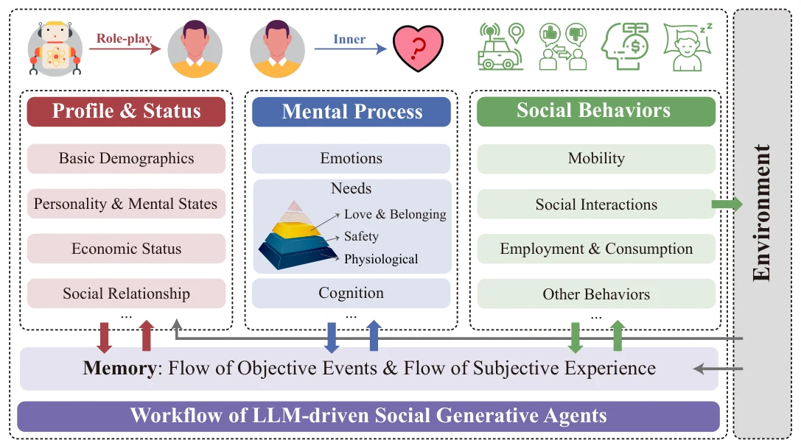
_Figure 3. 에이전트는 profile과 status, 감정·욕구·인지의 정신 과정, 이동·사회적 상호작용·취업과 소비 행동으로 이루어지고, 이 모두를 객관적 사건과 주관적 경험의 흐름을 담는 memory가 잇는다. (출처: Piao et al., 2025)_

에이전트는 네 부분으로 이루어진다.

1. **Profile과 status**: 이름, 나이, 성별, 학력, 성격 같은 고정 속성(profile)과 정신 상태, 경제 상태, 사회관계 같은 변하는 속성(status)이다.
2. **정신 과정**: 감정, 욕구, 인지 세 층이다.
3. **사회적 행동**: 이동, 사회적 상호작용, 취업·소비 세 가지는 따로 모델링하고, 잠자기 같은 단순 행동은 LLM이 바로 처리한다.
4. **워크플로**: 이 모두를 memory로 묶는 실행 순서이다.

설계 근거로 심리학(Maslow의 욕구 위계, 계획 행동 이론), 경제학(동적 확률 일반균형, DSGE), 행동과학(중력 모형)을 끌어온다. 모델 학습은 없고, LLM은 API로 부른다. 성능 실험에서 쓴 모델은 DeepSeek-V3이다. 사회 실험에서 쓴 LLM은 논문에 따로 적혀 있지 않다.

### 감정, 욕구, 인지

| 층 | 표현 | 갱신 |
|---|---|---|
| 감정 | 상태를 나타내는 키워드 1개 + 그 감정에 관한 생각 한 문장 + 6개 기본 감정(sadness, joy, fear, disgust, anger, surprise)의 강도 0~10 | 다른 에이전트·환경과의 상호작용마다 |
| 욕구 | Maslow 위계를 따른 욕구 계층(생리 → 안전 → 소속과 사랑 …), 긴급도와 중요도로 우선순위 | 능동 행동, 통제할 수 없는 외부 사건, 현재 심리 상태 세 요인으로 |
| 인지 | 주제별 태도(attitude) 0~10(반대 ↔ 지지)와 생각(thought) | 행동 뒤 그 행동을 서술한 문장 하나로 태도와 감정을 함께 갱신 |

감정 측정은 Shvo et al.(2019)의 틀을 그대로 가져왔다. 욕구는 계획 행동 이론(Theory of Planned Behavior)을 거쳐 "가장 급한 욕구를 채우는 계획"으로 바뀐다. 논문의 예시는 이렇다. 사회적 욕구가 채워지지 않았음을 감지하면 연락할 사람을 찾고 메시지를 보내는 계획을 세운다. 이때 기분이 좋으면 메시지 말투가 밝아진다. 대화가 잘 끝났는지는 다시 감정과 인지에 반영되고, 그 결과로 욕구 우선순위가 바뀐다.

### 이동: 욕구에서 장소까지 4단계

이동은 다른 모든 행동의 바탕이다. 배고프면 식당에, 회의가 있으면 사무실에 가야 한다. 논문은 이것을 "욕구 → 계획 → 행동 순서" 사슬로 본다. 친구 모임에 가려는 계획은 "시간 정하기(금요일 저녁), 장소 고르기(카페), 이동"으로 쪼개진다.

1. **의도 추출**: 욕구 위계에서 이동 의도를 뽑는다. 사회적 욕구가 켜지면 "사교 장소로 이동"을 뽑는다.
2. **장소 유형 선택**: 의도를 지도 데이터의 POI(Point of Interest) 유형과 맞춘다. 사교라면 카페나 공원이다.
3. **반경 결정**: 나이·체력 같은 내부 상태와 날씨·교통 같은 환경 변수로 갈 수 있는 범위를 정한다. 폭우가 오면 반경 1km 안의 실내 장소로 줄이거나 아예 집에 머문다.
4. **장소 선택**: 중력 모형(gravity model)으로 확률적으로 고른다.

$$
P_{ij} = \frac{S_j / D_{ij}^{\beta}}{\sum_k S_k / D_{ik}^{\beta}}
$$

$$S_j$$는 장소 $$j$$의 매력도, $$D_{ij}$$는 거리, $$\beta$$는 거리 감쇠 계수이다. 1~3단계는 LLM이, 마지막 선택은 이 식이 맡는다. 논문은 이렇게 하면 LLM 계산량을 줄이면서 근접성, 집적 효과 같은 사람의 공간 패턴과 맞출 수 있다고 설명한다.

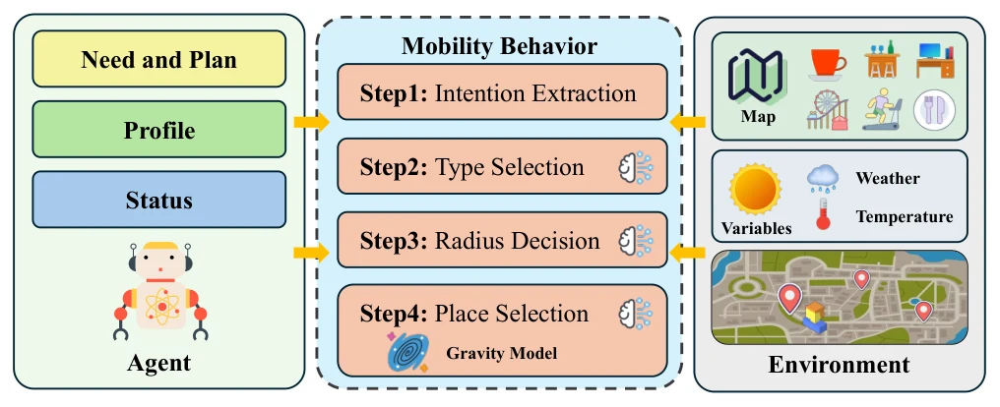
_Figure 5. 이동 행동 모델링이다. 에이전트의 욕구와 계획, profile, status를 받아 의도 추출, 유형 선택, 반경 결정, 장소 선택 순서로 목적지를 정하고, 지도와 날씨·기온 같은 환경 변수가 각 단계에 들어간다. (출처: Piao et al., 2025)_

논문은 $$\beta$$ 값을 밝히지 않는다. $$\beta$$가 결과를 얼마나 바꾸는지 보려고, 매력도와 거리가 다른 카페 네 곳을 두고 식을 그대로 계산했다.

```python
import numpy as np

# 후보 카페 4곳: (이름, 매력도 S_j, 집에서 거리 D_ij [km])
places = [("동네 카페", 1.0, 0.5), ("체인 카페", 3.0, 1.5),
          ("대형 몰 카페", 10.0, 4.0), ("교외 명소", 30.0, 12.0)]
names, S, D = zip(*places)
S, D = np.array(S), np.array(D)

def gravity(beta):                  # P_ij = (S_j / D_ij^β) / Σ_k (S_k / D_ik^β)
    w = S / D**beta
    return w / w.sum()

for beta in [0.5, 1.0, 2.0]:
    p = gravity(beta)
    row = "  ".join(f"{n} {v:.2f}" for n, v in zip(names, p))
    print(f"beta={beta}: {row}  | 평균 이동거리 {np.dot(p, D):.2f} km")

rng = np.random.default_rng(0)       # 같은 확률로 1,000명이 각자 고르면
picks = rng.choice(len(S), size=1000, p=gravity(2.0))
print("1,000명 샘플(beta=2):", np.bincount(picks, minlength=len(S)))
```

```text
beta=0.5: 동네 카페 0.08  체인 카페 0.14  대형 몰 카페 0.29  교외 명소 0.49  | 평균 이동거리 7.32 km
beta=1.0: 동네 카페 0.22  체인 카페 0.22  대형 몰 카페 0.28  교외 명소 0.28  | 평균 이동거리 4.89 km
beta=2.0: 동네 카페 0.65  체인 카페 0.22  대형 몰 카페 0.10  교외 명소 0.03  | 평균 이동거리 1.46 km
1,000명 샘플(beta=2): [625 246  94  35]
```

매력도와 거리를 그대로 두고 $$\beta$$만 0.5에서 2로 바꿨는데, 가장 많이 고르는 곳이 교외 명소(0.49)에서 동네 카페(0.65)로 바뀌고 평균 이동거리는 7.32km에서 1.46km로 줄었다. 이 도시의 이동 패턴은 LLM보다 $$\beta$$와 $$S_j$$를 어떻게 정했느냐에 크게 달려 있다. 1,000명이 각자 확률적으로 고르면 결과가 한 곳에 몰리지 않고 퍼진다는 점도 보인다. 같은 입력이면 같은 답으로 몰리기 쉬운 LLM 단독 선택과 다른 성질로 보인다. 다만 이 계산은 4단계만 떼어 본 것이고, 앞 단계에서 LLM이 고른 유형과 반경이 후보 집합 자체를 바꾼다는 점은 보여 주지 못한다.

### 사회적 행동: 관계 강도와 말투

관계는 가족, 친구, 동료 세 종류이고, 각 관계는 0~100의 강도를 가진다. 강도가 높은 상대와 더 자주 대화하고, 관계 종류에 따라 말투를 바꾼다(동료에게는 격식 있게, 친한 친구에게는 편하게). 대화 내용과 시각은 상대별 기록으로 남아 다음 대화에 영향을 준다.

상대 고르기는 목적에 따라 다르다. 가벼운 잡담이면 강도가 가장 높은 친구를, 특정 주제면 그 분야를 아는 사람을 고른다. 논문 예시로, 보안 문제를 상담하려는 에이전트는 경찰인 친구에게 연락한다. 메시지의 주제는 욕구와 의도가, 내용은 생각과 신념이, 말투는 감정이 정한다. 지금 구현은 온라인 메시지만 다루고, 오프라인 만남은 온라인으로 약속을 잡는 형태로 계획 중이라고 밝힌다.

### 경제 행동: 일할 의향과 쓸 의향

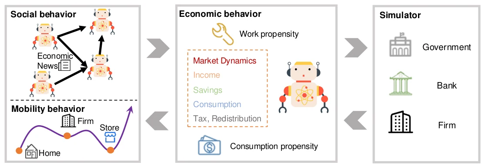
_Figure 7. 경제 행동 모델링이다. 사회적 행동으로 받은 경제 뉴스와 시장 상황, 소득, 저축, 세금이 일할 의향과 소비 의향을 정하고, 그 결과가 정부·은행·기업 시뮬레이터로 들어갔다가 다시 이동 행동(집, 회사, 가게)으로 돌아온다. (출처: Piao et al., 2025)_

경제 행동은 두 개의 의향(propensity)으로 줄였다. **work propensity**는 근무 시간과 월 소득을, **consumption propensity**는 월 소비 예산을 정한다. 어디서 무엇을 살지는 에이전트가 정한다. 결정에는 지난달 소비, 물가, 세금 같은 경제 변수가 들어간다. 이 부분은 같은 연구실의 EconAgent(Li et al., 2024) 설계를 가져왔다. 이직, 부채, 투자는 향후 과제로 남겼다.

### 워크플로: 두 갈래 memory

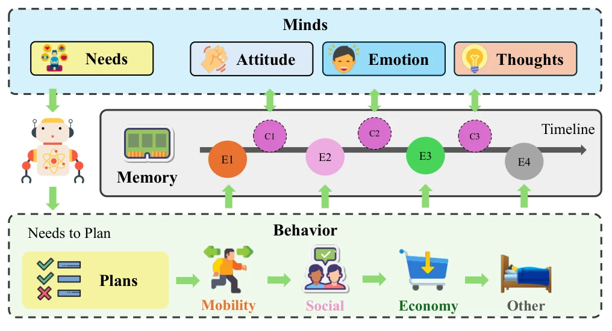
_Figure 8. stream memory 기반 워크플로이다. 욕구에서 계획이 나오고, 계획은 이동·사회·경제·기타 행동으로 실행된다. 행동은 타임라인 위 사건 노드(E)로, 그 사건에 대한 생각·태도·감정은 인지 노드(C)로 기록된다. (출처: Piao et al., 2025)_

memory는 세 부분이다.

| 구성 | 내용 |
|---|---|
| Profile | 성별, 나이 같은 정적 속성 |
| Status | 현재 욕구, 만족도, 재정 상태 같은 동적 상태(key-value) |
| Stream Memory | **Event Flow**(능동 행동, 수동 사건, 환경 변화를 시간순으로)와 **Perception Flow**(각 사건에 대한 생각과 태도, 하나 이상의 사건 노드에 연결) |

MemoryNode 하나는 시간, 장소, 사건 서술을 가진다. 실행 순서는 다음과 같다.

1. **행동 결정**: status를 보고 감정·인지 평가로 다음 행동을 정한다. 사교 욕구가 있고 기분이 좋으면 대화를 건다.
2. **사건 피드백**: 행동의 결과를 받는다. 모임 장소로 이동했다면 날씨 등을 고려해 실제로 도착했는지 확인한다.
3. **memory 갱신**: 사건과 피드백을 Event Flow에, 감정·인지 반응을 Perception Flow에 적는다.
4. **감정·인지 분석**: 결과에 따라 감정 상태와 태도를 갱신한다.
5. **수동 사건 처리**: 외부 사건이나 환경 자극도 같은 방식으로 기록하고 반응한다.

GA의 memory stream이 관찰·reflection·계획을 한 목록에 섞어 retrieval 점수로 꺼낸다면, AgentSociety는 "무슨 일이 있었나"와 "그걸 어떻게 느꼈나"를 두 줄로 나눈다. 대신 retrieval 점수나 reflection 주기 같은 구체적 규칙은 논문에 나오지 않는다.

## 3. 현실적 사회 환경: LLM이 지어내면 안 되는 것은 시뮬레이터가 맡는다

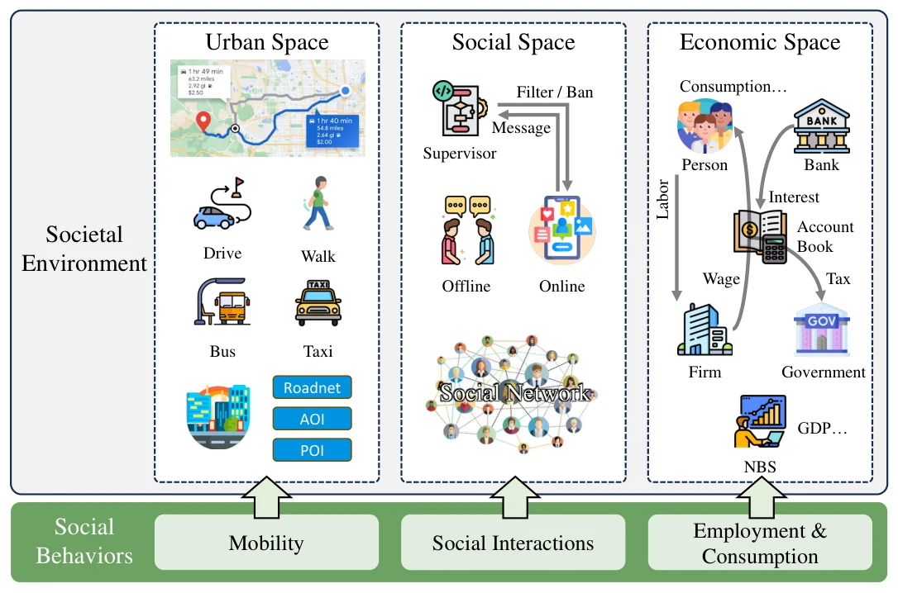
_Figure 9. 사회 환경은 도시 공간(도로망, AOI, POI, 운전·도보·버스·택시), 사회 공간(온·오프라인 상호작용, 메시지를 걸러 내는 supervisor, 소셜 네트워크), 경제 공간(개인, 기업, 정부, 은행, 통계국)으로 나뉘고, 각각 이동, 사회적 상호작용, 취업·소비 행동을 받친다. (출처: Piao et al., 2025)_

이동은 시공간 위치가 연속으로 바뀌는 일이고, 임금과 세금은 정확한 숫자이다. 이것을 LLM 지식에만 맡기면 hallucination 때문에 결과가 현실에서 벗어난다. 그래서 논문은 객관적인 부분을 환경 시뮬레이터로 떼어 내고, 에이전트 설계는 사람의 주관적 행동 논리에만 집중하게 한다.

| 공간 | 구성 | 데이터·모델 |
|---|---|---|
| 도시 | 도로망(lane, road, junction), AOI(주거지·상업지 같은 구역), POI(가게 같은 개별 장소), 운전·도보·버스·택시 | 도로와 AOI는 OpenStreetMap, POI는 SafeGraph. 차량 가속은 IDM, 차선 변경은 MOBIL. 버스는 고정 시간표, 택시는 가장 가까운 차를 배차 |
| 사회 | 소셜 네트워크(관계와 강도, 시뮬레이션 중 변함), 온라인·오프라인 상호작용, supervisor | supervisor는 메시지 전송 전 미들웨어로, 규칙에 따라 메시지를 걸러 내거나 사용자·연결을 차단 |
| 경제 | 기업(노동 → 생산, 임금·가격 조정), 정부(누진 소득세), 은행(이자, Taylor Rule로 금리 조정), 통계국(실질 GDP, 1인당 근무 시간, 소비) | 거시경제 모형 |

에이전트는 Python API로 환경에 위치를 묻고, 이동 계획을 넘기고, 시뮬레이션 시각을 받는다. 논문은 경제 공간의 한계를 직접 밝힌다. 재화 시장은 총수요에 따른 가격 조정으로만 단순화했고, 노동 시장은 실업이나 임금 협상 없이 임금을 받는 것으로 추상화했다.

## 4. 대규모 시뮬레이션 엔진

기존 멀티 에이전트 프레임워크(CAMEL, AgentScope)는 에이전트끼리 메시지를 주고받는 순서, 즉 표준 작업 절차(SOP)를 중심으로 설계됐다. 코딩이나 대화 게임처럼 순서가 정해진 일에는 맞지만, 사회에서는 각자가 자기 기억과 상태로 독립적으로 판단한다. 그래서 AgentSociety는 각 에이전트를 실행 순서가 없는 독립 단위로 두고, 영향은 메시지로만 주고받게 한다.

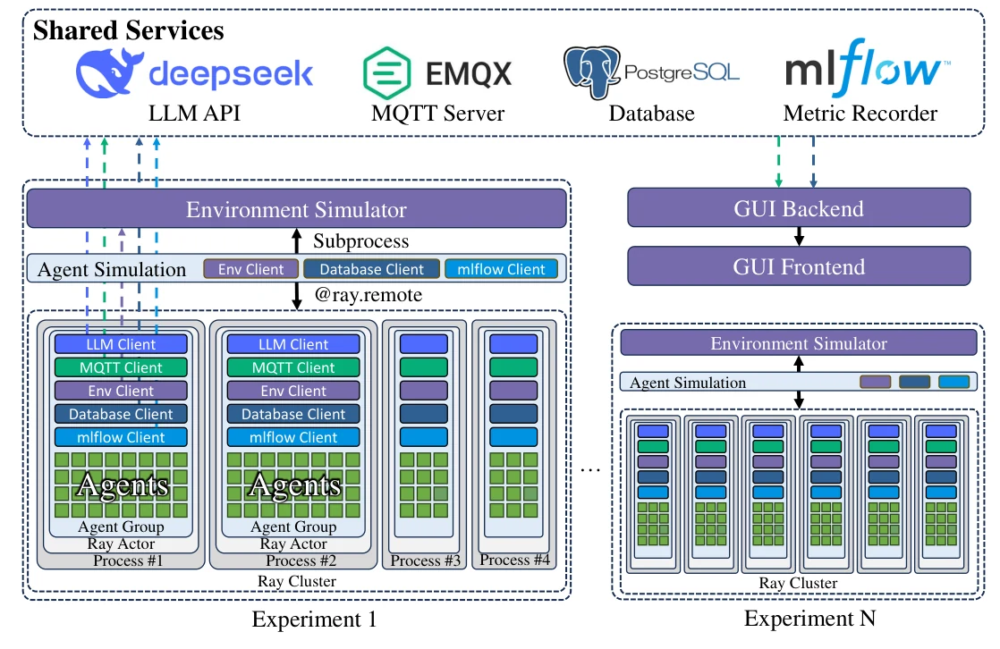
_Figure 10. 대규모 사회 시뮬레이션 엔진의 시스템 구조이다. LLM API, MQTT 서버, 데이터베이스, 지표 기록기는 모든 실험이 공유하고, 실험마다 환경 시뮬레이터와 Ray 클러스터를 따로 띄운다. 각 Ray actor는 한 프로세스에서 agent group을 돌리며 서비스 연결을 공유한다. (출처: Piao et al., 2025)_

### Agent group: 포트가 모자라서 생긴 설계

에이전트마다 프로세스를 따로 띄우고 각자 MQTT 서버, 데이터베이스, 지표 기록기에 연결하면, 에이전트 수만큼 TCP 연결이 생겨 포트 상한(65,535개)을 넘는다. 그래서 여러 에이전트를 **agent group**으로 묶어 한 프로세스(Ray actor)에서 돌린다. 그룹마다 LLM, MQTT, 환경, 데이터베이스, 지표 클라이언트를 하나씩 두고, 그룹 안 에이전트가 연결을 공유한다. 필요한 포트 수는 그룹 수의 배수로 줄어든다.

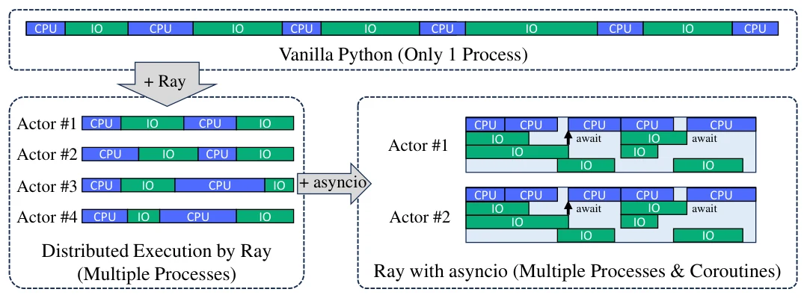
_Figure 11. 단일 프로세스 Python은 CPU 작업과 I/O 대기를 차례로 한다. Ray로 여러 프로세스에 나누고, 각 프로세스 안에서 asyncio로 I/O를 기다리는 동안 다른 에이전트의 CPU 작업을 돌린다. (출처: Piao et al., 2025)_

LLM 사회 시뮬레이션은 대부분의 시간을 LLM 응답과 환경 응답을 기다리는 데 쓰는 I/O 위주 작업이다. 프로세스 사이는 Ray로 병렬화하고, 프로세스 안에서는 asyncio로 LLM 요청을 겹쳐 보낸다. 그 사이 CPU는 중력 모형 같은 계산을 한다. 논문은 그룹 크기를 고정하면 전체 속도가 가장 느린 그룹에 묶인다는 점을 한계로 적고, 적응형 부하 분산을 향후 과제로 남긴다.

### MQTT 메시징

수십만 에이전트에게 ID로 메시지를 보내는 문제는 수백만 IoT 기기에 메시지를 보내는 문제와 닮았다. 그래서 IoT 프로토콜인 MQTT(서버는 emqx)를 쓴다. 각 에이전트는 자기 접두사 `exps/<exp_uuid>/agents/<agent_uuid>/`만 구독하고, 그 아래 세 토픽으로 메시지 종류를 나눈다.

| 토픽 끝 | 용도 |
|---|---|
| `agent-chat` | 에이전트 사이의 메시지 |
| `user-chat` | 연구자가 GUI로 에이전트와 대화 |
| `user-survey` | 연구자가 JSON 형식 설문을 보냄 |

이 밖에 OpenAI 호환 LLM API 어댑터(OpenAI, DeepSeek, Qwen, ChatGLM), 기본 3회 재시도, 응답에서 JSON 블록을 뽑는 파서, mlflow 기반 지표 기록, AVRO 파일과 PostgreSQL 저장, 실시간 모니터링 GUI가 있다.

### 사회과학 실험 도구

| 도구 | 방식 | 예 |
|---|---|---|
| Agent Configuration | 시작 전에 성격, 목표, 선호를 설정 | 실험 조건별 인구 구성 |
| State Manipulation | 실행 중 profile, 기분, 생각을 바꿈 | 감정을 바꿔 의사결정 변화를 관찰 |
| Message Notification | 실행 중 문자 메시지를 보냄 | "Severe weather changes expected, a hurricane is coming" |
| Interview | MQTT로 질문을 보내면 진행 중인 행동을 멈추지 않고 답함 | 공유 동기 인터뷰 |
| Survey | 정해진 응답 형식의 문항 묶음을 위에서부터 차례로 답함 | CES-D 우울 척도, 친환경 규범 설문 |

## 5. 성능 평가

실험은 Huawei Cloud c7.16xlarge.4 서버에서 했다. LLM은 DeepSeek-V3 API를 썼고, 요청 제한이 없다고 공지된 플랫폼을 고른 뒤 혼잡이 적은 현지 시각 05:00~07:00에 돌렸다.

### 환경 시뮬레이터

1,000명에서 100만 명까지 개인을 만들어 아침 8:30 출근 시간대부터 하루를 돌리고, 설정 질의와 조회 질의를 1:999로 섞어 보냈다(논문 Table 2).

| 개인 수 | step당 평균 시간(s) ± SD |
|---|---|
| $$10^3$$ | 8.578×10⁻³ ± 3.0×10⁻⁵ |
| $$10^4$$ | 9.129×10⁻³ ± 1.5×10⁻⁵ |
| $$10^5$$ | 1.800×10⁻² ± 5.66×10⁻⁴ |
| $$10^6$$ | 0.1680 ± 5.34×10⁻⁴ |

1만 명까지는 step 시간이 거의 그대로이고, 100만 명에서도 0.168초이다. 환경은 병목이 아니다.

### 메시징 시스템

10만 에이전트가 100바이트 메시지를 각자 무작위 10명에게 보내는 조건이다. 모든 에이전트가 5초마다 메시지를 하나 만든다고 가정하면 필요한 처리량은 20,000 msg/s이다(논문 Table 3).

| 시스템 | 최적 프로세스 수 | 처리량(msg/s) | 보조 도구 |
|---|---|---|---|
| MQTT (emqx v5.8.1) | 32 | 44,702.1 ± 111.3 | 내장 GUI |
| Redis Pub/Sub (v6.2) | 16 | **81,216.2** ± 333.6 | – |
| RabbitMQ (v4.0.5) | 16 | 23,667.3 ± 1,777.7 | 내장 GUI |
| Kafka | – | 5분 안에 10만 에이전트 초기화 실패 | – |

처리량은 Redis가 MQTT의 약 1.8배이다. 저자들은 둘 다 요구치를 넘으니 모니터링·디버깅용 GUI가 있는 MQTT를 기본값으로 골랐다고 설명하고, 나중에 백엔드를 바꿀 수 있게 하겠다고 한다.

### 전체 시뮬레이터

64코어 기계에서 32코어는 환경, 32코어는 엔진에 주고, 에이전트가 활발한 시간대에 5라운드를 돌렸다(논문 Table 4).

| 에이전트 | 그룹 | LLM 호출 | 입력 토큰/호출 | 출력 토큰/호출 | 라운드당 시간(s) | LLM(s/호출) | 환경(ms/호출) |
|---|---|---|---|---|---|---|---|
| $$10^3$$ | 8 | 4,803.0 | 430.04 | 79.17 | 82.45 | 4.51 | 12.26 |
| $$10^3$$ | 16 | 3,120.8 | 398.78 | 77.18 | **41.17** | 2.92 | 14.31 |
| $$10^3$$ | 32 | 4,790.4 | 412.82 | 75.56 | 43.30 | 2.94 | 9.55 |
| $$10^4$$ | 8 | 54,135.4 | 430.35 | 75.84 | 5,681.18 | 52.54 | 33.55 |
| $$10^4$$ | 16 | 54,002.2 | 430.24 | 75.80 | 1,422.48 | 3.53 | 33.55 |
| $$10^4$$ | 32 | 54,075.0 | 430.47 | 76.14 | **458.82** | 8.05 | 30.53 |

1만 명에서 그룹을 8개에서 32개로 늘리면 라운드당 시간이 5,681초에서 459초로 약 12배 줄어든다. 환경 응답은 모든 조건에서 수십 ms 수준이고, 시간 대부분은 LLM 호출이다. 1만 명이 한 라운드에 약 1만 번(5라운드에 약 5.4만 번) LLM을 부르고, 호출당 입력 약 430토큰, 출력 약 76토큰을 쓴다.

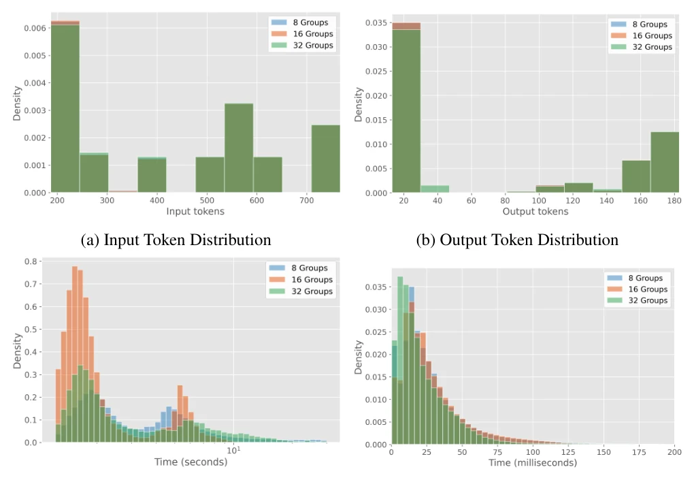
_Figure 13. 1만 에이전트 실행의 입력 토큰, 출력 토큰, LLM 호출 시간, 환경 호출 시간 분포이다. 토큰 분포는 그룹 수와 관계없이 같고, LLM 호출 시간만 병렬화 정도에 따라 달라진다. (출처: Piao et al., 2025)_

이 표는 조심해서 읽어야 한다. LLM 호출당 시간이 8그룹 52.54초, 16그룹 3.53초, 32그룹 8.05초로 단조롭지 않다. 1,000명 16그룹 조건은 LLM 호출 수가 3,120.8번으로 다른 두 조건(약 4,800번)보다 3분의 1가량 적다. 외부 API 서버의 부하가 결과를 크게 흔든다는 뜻이고, 논문도 LLM이 주 병목이며 서버 쪽 부하 때문에 예측하기 어렵다고 인정한다. 1만 명을 넘는 규모에서는 자체 LLM 추론 서버를 두라고 권하지만, 그 비용은 수치로 제시하지 않는다.

하루 동안 에이전트 한 명이 환경과 상호작용하는 횟수는 다음과 같다(논문 Table 5). 초록의 "1만 명, 500만 상호작용"은 이 하루 약 500회에서 나온다.

| 공간 | 종류 | 횟수 |
|---|---|---|
| 도시 | Get / Set | 465.67 / 4.27 |
| 경제 | Get / Set | 9.26 / 3.30 |
| 사회 | SendMessage | 9.08 |
| 합계 | | 491.68 |

500회 가운데 약 466회는 위치·시간 같은 도시 정보 조회이고, 다른 에이전트에게 보내는 메시지는 하루 9번 남짓이다. "상호작용 500만 회"라는 숫자의 대부분은 LLM 판단이 아니라 환경 API 조회이다.

## 6. 사회 실험

### 하루 생활

한 에이전트의 하루를 보면 욕구가 계획을, 계획이 행동을 정하는 흐름이 보인다(논문 Table 6 일부).

| 시간 | 욕구 / 감정 | 인지 | 행동 |
|---|---|---|---|
| 08:00–12:30 | 안전 / Resentment | "Sequential task execution ensures workflow integrity" | 출근(이동), 이메일 답장·기획 회의(경제) |
| 12:30–13:30 | 배고픔 / Disappointment | "Economic constraints necessitate adaptive consumption patterns" | 장 보며 출근길 경유(이동), 가격 비교(경제), 점심 |
| 13:30–14:00 | 사회 / Gratification | "Social capital accumulation facilitates opportunity discovery" | SNS 보기, 친구 찾아 메시지(사회) |
| 20:00–22:00 | Whatever / Relief | "Entertainment makes me feel relaxed" | 웹 서핑, 게임 |
| 22:00–24:00 | 피곤 / Satisfaction | "Resource allocation efficiency impacts systemic stability" | 잠자리 준비, 취침 |

행동 순서는 그럴듯하지만 인지 칸은 어색하다. 잠들기 전 생각이 "자원 배분 효율이 시스템 안정성에 영향을 준다"이다. LLM이 경제 상태 같은 내부 변수를 사람의 속생각 대신 보고서 문장으로 옮긴 것으로 보인다.

이어지는 실험의 설정은 다음과 같다.

| 실험 | 주제 | 장소 / 규모 | 개입 | 측정 |
|---|---|---|---|---|
| 양극화 | 총기 규제 | New York / 100명 | 같은 편 또는 반대편 설득 메시지 | 의견 변화 |
| 선동 메시지 | 쉬저우 쇠사슬 여성 사건 | 100명(본문은 "수백 명") | 선동 메시지, 노드·엣지 개입 | 정보 확산, 감정 강도, 인터뷰 |
| UBI | 기본소득 | Texas / 100명 | 매달 $1,000 | 소비, 우울(CES-D) |
| 허리케인 | Dorian(2019) | Columbia, SC / 1,000명 | 실시간 날씨 | 활동 수준, 일별 이동 |
| 도시 지속가능성 | 저탄소 이동 | 베이징 / 200명 | 연구팀 6곳의 규범 개입 | 규범 설문, CO₂ |

1만 명 규모는 성능 평가에서만 돌렸고, 사회 실험은 100~1,000명으로 했다.

### 양극화: 끼리끼리 대화는 극단을, 반대편 대화는 완화를

총기 규제를 두고 에이전트가 토론한다. 대조군은 개입 없이 자유롭게 대화하고, 동질 상호작용군은 자기 의견과 같은 설득 메시지만, 이질 상호작용군은 반대 의견의 설득 메시지만 받는다.

| 조건 | 더 극단적 | 더 온건 | 반대편으로 | 변화 없음 |
|---|---|---|---|---|
| 대조군 | 39% | 33% | 10% | 18% |
| 동질 상호작용 | **52%** | 13% | 0% | 35% |
| 이질 상호작용 | 0% | **89%** | 11% | 0% |

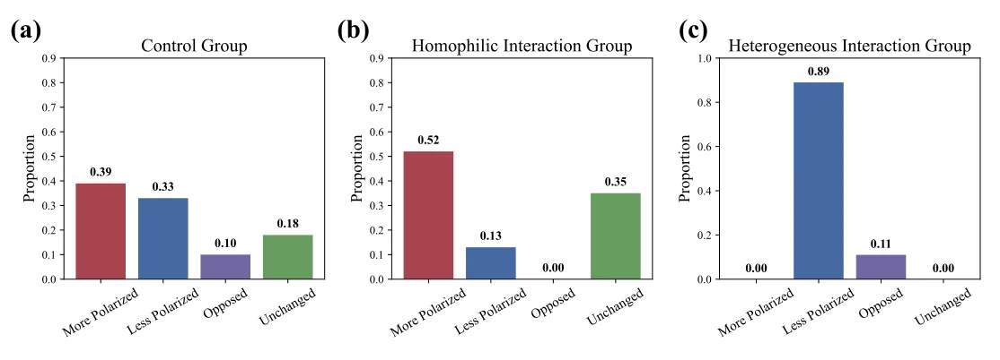
_Figure 16. 총기 규제 의견 변화이다. (a) 대조군, (b) 같은 의견만 접한 동질 상호작용군, (c) 반대 의견만 접한 이질 상호작용군에서 더 극단적, 더 온건, 반대편으로 바뀐, 변화 없는 에이전트의 비율이다. (출처: Piao et al., 2025)_

저자들은 동질군의 52%를 반향실(echo chamber) 효과로, 이질군의 89%를 반대 의견 노출이 양극화를 줄일 수 있다는 근거로 읽는다. 그런데 사람을 대상으로 한 현장 실험에서는 반대 성향 계정의 글을 한 달간 보게 하자 오히려 의견이 더 극단으로 간 결과도 있다(Bail et al., 2018). 이질군에서 더 극단적으로 바뀐 에이전트가 0%라는 결과는, 정렬된 LLM이 반대 논거에 지나치게 순순히 설득되는 성향을 보여 주는 것일 수도 있다. 100명, 1회 실행이라 통계 검정도 없다.

### 선동 메시지 확산: 계정 정지가 연결 끊기보다 낫다

실제 사건인 쉬저우 쇠사슬 여성 사건을 바탕으로 네 조건을 비교했다.

- **대조군**: 선동적이지 않은 시드 메시지를 일부 노드에 넣는다.
- **실험군**: 감정적이고 선택적으로 서술한 선동 메시지를 넣는다.
- **노드 개입**: 플랫폼이 LLM으로 선동 여부를 판정하고, 일정 횟수 이상 선동 메시지를 보낸 계정을 정지한다.
- **엣지 개입**: 선동 메시지가 오간 두 노드 사이의 연결을 영구히 끊는다.

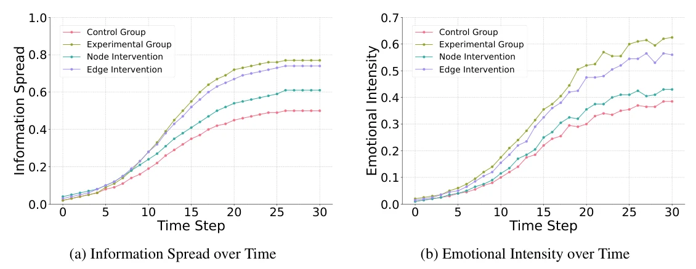
_Figure 17. 선동 메시지 확산 실험이다. (a)는 시간에 따른 정보 확산 비율, (b)는 감정 강도이다. 실험군이 가장 높고, 노드 개입이 엣지 개입보다 확산과 감정 강도를 더 많이 낮춘다. (출처: Piao et al., 2025)_

본문은 결과를 정성적으로만 서술한다. 그래프에서 30 step 시점의 값을 읽으면 정보 확산은 대조군 약 0.50, 실험군 약 0.77, 노드 개입 약 0.61, 엣지 개입 약 0.74이고, 감정 강도는 각각 약 0.39, 0.62, 0.43, 0.56이다. 엣지 개입은 실험군과 거의 차이가 없다. 인터뷰에서는 동정과 걱정 같은 강한 감정, 그리고 "사회 문제를 알려야 한다"는 책임감이 공유 동기로 나왔다. 개입의 효과 크기가 노드 정지 기준(몇 번)과 LLM 판정기의 정확도에 달려 있을 텐데, 논문은 두 값을 밝히지 않는다.

### UBI: 매달 1,000달러

Texas의 인구 분포로 에이전트를 만들어 거시경제 시뮬레이션을 두 번 돌린다. 하나는 그대로, 하나는 96 step째부터 모든 에이전트에게 매달 조건 없이 $1,000을 준다. 그 뒤 24 step 동안의 소비와 우울(CES-D 설문)을 비교했다.

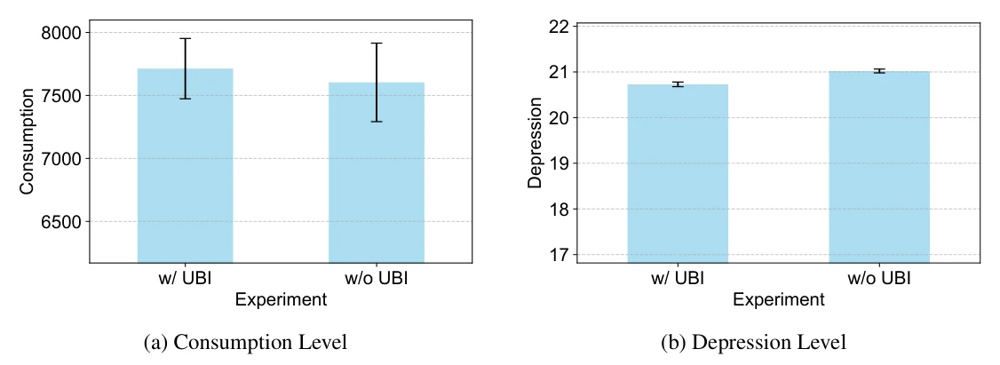
_Figure 20. UBI 유무에 따른 (a) 소비 수준과 (b) 우울 수준이다. UBI를 주면 소비가 늘고 우울이 줄어든다. (출처: Piao et al., 2025)_

논문은 소비 증가와 우울 감소가 Texas의 실제 UBI 실험(Bartik et al., 2024)과 비슷하다며 시뮬레이션이 현실적이라고 결론짓는다. 그래프로 보면 소비는 약 7,700 대 7,600으로 차이가 오차 막대 안에 있고, 우울은 약 20.7 대 21.0이다. 방향은 맞지만 크기를 실제 실험 수치와 비교하지 않았고, 통계 검정도 없다. 인터뷰 응답에서는 이자율, 장기적 이득, 저축, 생필품 같은 단어가 많이 나왔다.

### 허리케인: 실제 이동 데이터와 비교한 유일한 실험

2019년 허리케인 Dorian 때의 사우스캐롤라이나주 Columbia를 1,000명으로 재현했다. 인구는 Census Block Group(CBG) 데이터로 성별·나이·인종·소득·거주 CBG를 뽑아 만들고, 이동 실측값은 SafeGraph의 2019.8.28~9.5 데이터를 쓴다. 에이전트에게는 실시간 날씨 정보를 넣는다.

활동 수준(이동한 사람 ÷ 구역 인구)은 상륙 전 70~90%였다가 상륙 기간에 약 30%로 떨어지고, 지나간 뒤 원래 수준으로 돌아왔다.

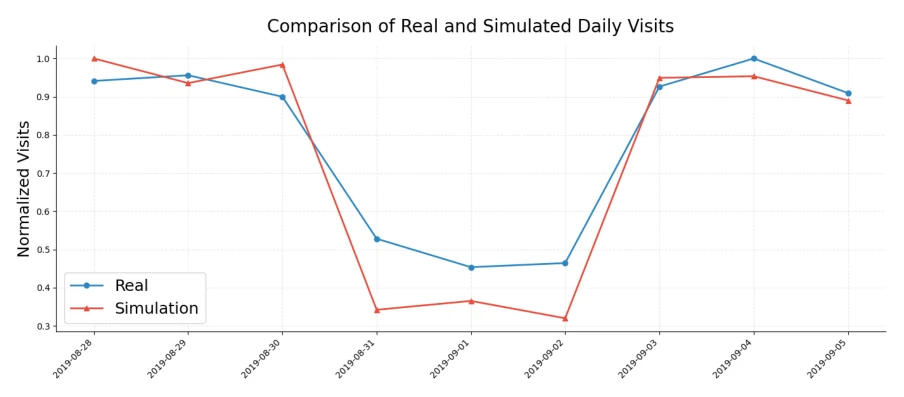
_Figure 23. 실제 데이터와 시뮬레이션의 일별 방문 수(정규화)이다. 두 곡선 모두 8월 31일 무렵 떨어졌다가 9월 3일에 회복한다. (출처: Piao et al., 2025)_

추세는 잘 맞는다. 하지만 그래프에서 읽으면 상륙 기간 저점이 실제는 약 0.45~0.53, 시뮬레이션은 약 0.32~0.37이다. 시뮬레이션은 8월 30일까지 실제보다 높다가 31일에 더 깊게 떨어진다. 논문은 이것을 "약간의 편차"로 적고 상관계수나 오차 같은 수치는 내지 않는다. 사람은 허리케인 중에도 약을 사거나 출근하지만, "허리케인이 온다"는 메시지를 받은 LLM 에이전트는 교과서대로 집에 머무는 쪽으로 기우는 것으로 보인다.

### 도시 지속가능성: 연구팀 여섯 곳의 친환경 개입

개정판(v2)에서 추가된 실험이다. 베이징의 실제 GIS 데이터로 도시를 만들고, 2024년 베이징 인구 센서스에 맞춰 나이·성별·학력·혼인 상태를 뽑은 200명을 넣었다. 독립 연구팀 6곳이 각자 저탄소 이동을 장려하는 "친환경 규범 체계"를 설계해 투입한다.

1. **1일째(개입)**: 세 경로로 규범을 퍼뜨린다. 특정 주민과 직접 대화(무료, 횟수 제한), 지정 AOI에 포스터(1회 1,000), 도시 전체 공지(1회 10,000)이고, 팀별 예산 상한은 100,000이다.
2. **2일째(관찰)**: 개입 없이, 10문항 설문(예: "형편이 넉넉하고 자가용이 있다. 3km 떨어진 식당에 간다면?")으로 규범 강도를 재고, 실제 선택한 교통수단과 이동 거리로 CO₂ 배출을 추정한다.

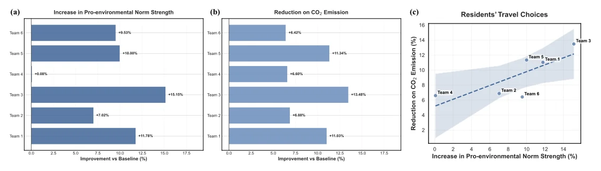
_Figure 24. 여섯 친환경 규범 개입의 효과이다. (a) 기준선 대비 친환경 규범 강도 증가, (b) 이동 관련 CO₂ 배출 감소, (c) 두 값의 관계이다. 규범 내면화가 강할수록 저탄소 이동으로 더 많이 바뀌는 양의 관계가 보인다. (출처: Piao et al., 2025)_

| 팀 | 규범 강도 증가 | CO₂ 감소 | 개인 규범 비중 | 명령 규범 비중 | 정체성 규범 비중 |
|---|---|---|---|---|---|
| Team 1 | +11.78% | 11.03% | 25% | 25% | 19% |
| Team 2 | +7.02% | 6.88% | 17% | 83% | – |
| Team 3 | **+15.15%** | **13.48%** | 42% | 17% | 33% |
| Team 4 | +0.08% | 6.60% | 23% | 23% | 38% |
| Team 5 | +10.00% | 11.34% | 21% | 29% | 36% |
| Team 6 | +9.53% | 6.42% | 32% | 37% | 21% |

규범 비중은 Figure 25에서 옮겼고, 나머지는 기술 규범(descriptive norm, 남들이 실제로 하는 것)이다.

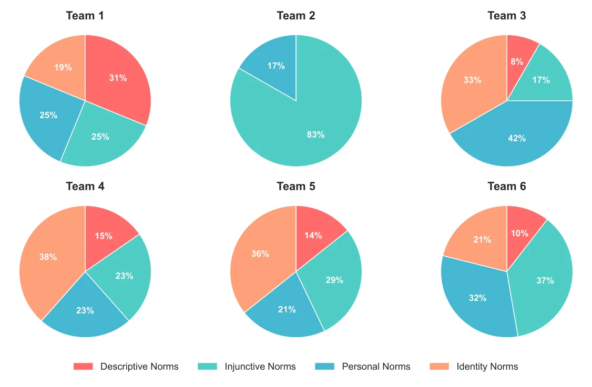
_Figure 25. 여섯 팀 개입 체계의 규범 구성이다. 기술 규범(남들이 하는 것), 명령 규범(해야 한다고 기대되는 것), 개인 규범(내면화된 도덕적 의무), 정체성 규범(책임 있는 사람이라는 자기 개념)의 비율이다. (출처: Piao et al., 2025)_

저자들은 개인 규범 비중이 가장 큰 Team 3이 두 지표 모두 최고이고, 명령 규범이 83%인 Team 2는 중간에 그쳤다며, 개인 규범이 친환경 행동의 가장 강한 예측 변수라는 기존 연구(Helferich et al., 2023)와 맞는다고 해석한다. 하지만 표에는 이 해석과 맞지 않는 점도 있다. Team 4는 규범 강도가 0.08%만 올랐는데 CO₂는 6.60% 줄어 Team 2·6과 비슷하다. 설문으로 잰 규범과 실제 이동 사이가 6개 점의 회귀선만큼 단단하지 않다는 뜻이다. 개인 규범 비중 2위인 Team 6(32%)은 CO₂ 감소가 가장 작다. 팀이 여섯뿐이고, 개입은 규범 구성뿐 아니라 경로(대화, 포스터, 공지)와 예산 배분도 달랐다.

### 실패 유형과 약한 곳

논문은 실패 사례를 따로 보고하지 않는다. 결과에서 읽히는 약점은 다음과 같다.

- **크기는 맞히지 못하고 방향만 맞힌다.** 허리케인 실험의 저점은 실제보다 약 0.1~0.2 낮고, UBI의 소비 차이는 오차 막대 안이다. "실제 실험과 일치한다"의 근거는 대부분 방향이 같다는 것이다.
- **반대 의견에 지나치게 순종한다.** 이질 상호작용군의 89%가 온건해지고 0%가 극단으로 간다.
- **속생각이 보고서처럼 나온다.** 하루 생활 표의 인지 칸은 "Multi-layered verification prevents operational risks" 같은 문장이다.
- **설문 태도와 행동이 어긋난다.** 친환경 실험의 Team 4는 규범이 거의 안 변했는데 행동은 바뀌었다.
- **재현성 정보가 없다.** 실험마다 실행 횟수, 시드, 사용한 LLM, 프롬프트 전문이 없다.

## 7. 해석: AgentSociety가 남긴 것과 숙제

**남긴 것: 객관적인 것은 시뮬레이터에, 주관적인 것은 LLM에.** [Generative Agents]()는 물건 상태까지 LLM에게 물어 정했고, 그 결과 한 명만 쓰는 화장실에 여럿이 들어가고 문 닫은 가게에 들어가는 실패가 나왔다. AgentSociety는 도로·대중교통·임금·세금·금리를 IDM·MOBIL 교통 모델과 거시경제 모형으로 계산하고, LLM에는 "어디에 가고 싶은가", "얼마나 일하고 싶은가"만 묻는다. GA가 갈수록 장소를 못 고른다고 보고한 문제도, 이 논문에서는 유형과 반경만 LLM이 정하고 최종 선택은 중력 모형이 맡는 구조로 우회한다. 숫자를 Python 변수로 따로 관리한 [Concordia]()의 grounded variable과 같은 방향이고, 이 논문은 그것을 실제 도시 데이터와 경제 모형까지 키웠다.

**남긴 것: 내적 상태를 이론에 묶기.** [Humanoid Agents]()는 GA에 0~10 욕구 점수 5개, 7가지 감정, 0~30 친밀도를 붙여 숫자가 나빠지면 계획을 고치게 했다. AgentSociety도 6개 기본 감정의 0~10 강도, 0~10 태도, 0~100 관계 강도처럼 비슷한 수치 상태를 쓴다. 차이는 그 위에 Maslow 위계와 계획 행동 이론을 얹어 "어떤 욕구가 먼저인가"를 정하고, 그 욕구를 이동·사회·경제 행동 모듈과 직접 잇는다는 점이다. Humanoid Agents가 "배고프면 계획을 바꾼다"였다면, AgentSociety는 "배고프면 반경 몇 km 안의 식당 유형을 골라 중력 모형으로 가게를 정하고, 돈을 쓴다"까지 간다.

**남긴 것: 규모를 시스템 문제로 다룬 것.** 25명 시뮬레이션에서는 보이지 않던 TCP 포트 고갈, 메시지 처리량, LLM API 지연 분포를 실제 숫자로 보여 준다. 1만 명 한 라운드에 LLM 호출 약 1만 번, 호출당 입력 약 430토큰이라는 Table 4의 숫자는 비슷한 시스템을 만들 사람이 GPU 규모를 추정하는 데 바로 쓸 수 있다.

**숙제 1: "실제와 일치한다"의 기준.** 다섯 실험 중 실측 데이터와 곡선을 직접 겹친 것은 허리케인 하나이고, 거기서도 오차를 수치로 내지 않았다. 나머지는 "기존 연구와 방향이 같다"는 비교이다. [1,000명 시뮬레이션]()이 실제 사람 1,052명의 응답과 개인 단위로 맞춰 보고, 정확도를 사람의 2주 뒤 재응답률로 나눠 정규화한 것과 비교하면 검증의 엄밀함 차이가 크다. 1만 명 규모 엔진을 만들었지만 사회 실험은 100~1,000명에서 했다는 점도, 규모가 결과를 바꾸는지를 아직 보여 주지 않았다는 뜻이다.

**숙제 2: 비용과 재현성.** 라운드당 시간은 그룹 수와 API 서버 상태에 따라 41초에서 5,681초까지 흔들렸고, 같은 조건에서도 호출당 LLM 시간이 3.53초에서 52.54초까지 차이 났다. 상용 API의 혼잡 시간을 피해 새벽에 돌려야 했다는 사실 자체가, 외부 API에 기대는 시뮬레이션은 다시 돌렸을 때 같은 결과를 보장하기 어렵다는 뜻이다. 비용 절감은 [Affordable Generative Agents]()처럼 LLM 호출 자체를 줄이는 방향과 함께 봐야 한다.

**숙제 3: 정렬된 LLM이 만드는 "착한 사회".** GA가 지적한 지나친 공손함은 여기서 정책 실험의 결과로 이어진다. 반대 의견을 들은 에이전트의 89%가 온건해지고, 허리케인 메시지에 실제 사람보다 더 확실하게 집에 머문다. 이런 경향이 있으면 "반대 의견 노출이 양극화를 줄인다", "경보가 이동을 줄인다" 같은 개입 효과가 체계적으로 크게 나온다. 시뮬레이터를 정책 평가에 쓰려면 이 편향을 기준선 실험으로 따로 재야 한다.

**숙제 4: 이론을 넣었다는 것과 이론대로 움직인다는 것.** Maslow 위계, 계획 행동 이론, DSGE를 바탕으로 했다고 밝히지만, 욕구 갱신 규칙, 태도 갱신 프롬프트, 중력 모형의 $$\beta$$와 매력도 같은 구체적 값은 논문에 나오지 않는다. 토이 계산에서 보듯 $$\beta$$ 하나로 평균 이동거리가 5배 달라진다. 결과가 LLM의 판단에서 나온 것인지, 저자들이 고른 모형 파라미터에서 나온 것인지 가르려면 ablation이 필요한데, 논문에는 구성요소를 빼 보는 실험이 하나도 없다.

## 8. 정리

| 항목 | 내용 |
|---|---|
| 핵심 아이디어 | 이론 기반 LLM 에이전트 + 실제 데이터 기반 도시·사회·경제 환경 + 분산 실행 엔진으로 1만 명 이상의 사회를 시뮬레이션 |
| 에이전트 | 6개 감정 0~10, Maslow 욕구 위계, 주제별 태도 0~10, 관계 강도 0~100. Event Flow와 Perception Flow 두 갈래 memory |
| 행동 | 이동은 의도 → 유형 → 반경 → 중력 모형 4단계, 경제는 일·소비 의향 두 값, 사회는 관계 종류·강도에 따른 메시지 |
| 환경 | OpenStreetMap·SafeGraph 도로와 POI, IDM·MOBIL 교통, supervisor, 기업·정부·은행·통계국 거시경제 |
| 엔진 | Ray agent group + asyncio, MQTT(44,702 msg/s), 1만 명 32그룹에서 라운드당 458.82초, 병목은 LLM |
| 실험 | 양극화(동질군 52% 극단화, 이질군 89% 온건화), 선동 메시지(노드 개입 > 엣지 개입), UBI($1,000, 소비↑ 우울↓), 허리케인(활동 70~90% → 약 30%), 친환경 개입(Team 3 규범 +15.15%, CO₂ −13.48%) |
| 한계 | 정량 검증은 허리케인뿐, 사회 실험은 100~1,000명, 반복·통계·ablation 없음, 파라미터 미공개, 정렬된 LLM의 편향 |

## References

- Piao et al., "AgentSociety: Large-Scale Simulation of LLM-Driven Generative Agents Advances Understanding of Human Behaviors and Society," arXiv 2025. [arXiv:2502.08691](https://arxiv.org/abs/2502.08691)
- Park et al., "Generative Agents: Interactive Simulacra of Human Behavior," UIST 2023. [arXiv:2304.03442](https://arxiv.org/abs/2304.03442)
- Park et al., "Generative Agent Simulations of 1,000 People," arXiv 2024. [arXiv:2411.10109](https://arxiv.org/abs/2411.10109)
- Wang et al., "Humanoid Agents: Platform for Simulating Human-like Generative Agents," EMNLP 2023 System Demonstrations. [arXiv:2310.05418](https://arxiv.org/abs/2310.05418)
- Vezhnevets et al., "Generative Agent-Based Modeling with Actions Grounded in Physical, Social, or Digital Space using Concordia," arXiv 2023. [arXiv:2312.03664](https://arxiv.org/abs/2312.03664)
- AL et al., "Project Sid: Many-agent Simulations toward AI Civilization," arXiv 2024. [arXiv:2411.00114](https://arxiv.org/abs/2411.00114)
- Yang et al., "OASIS: Open Agents Social Interaction Simulations on One Million Agents," arXiv 2024. [arXiv:2411.11581](https://arxiv.org/abs/2411.11581)
- Zhou et al., "SOTOPIA: Interactive Evaluation for Social Intelligence in Language Agents," arXiv 2023. [arXiv:2310.11667](https://arxiv.org/abs/2310.11667)
- Li et al., "EconAgent: Large Language Model-Empowered Agents for Simulating Macroeconomic Activities," ACL 2024.
- Shvo et al., "An Interdependent Model of Personality, Motivation, Emotion, and Mood for Intelligent Virtual Agents," IVA 2019.
- Moritz et al., "Ray: A Distributed Framework for Emerging AI Applications," OSDI 2018.
- Bail et al., "Exposure to Opposing Views on Social Media Can Increase Political Polarization," PNAS 2018.
- Bartik et al., "The Impact of Unconditional Cash Transfers on Consumption and Household Balance Sheets: Experimental Evidence from Two US States," NBER 2024.
- Helferich et al., "Direct and Mediated Impacts of Social Norms on Pro-environmental Behavior," Global Environmental Change 2023.
