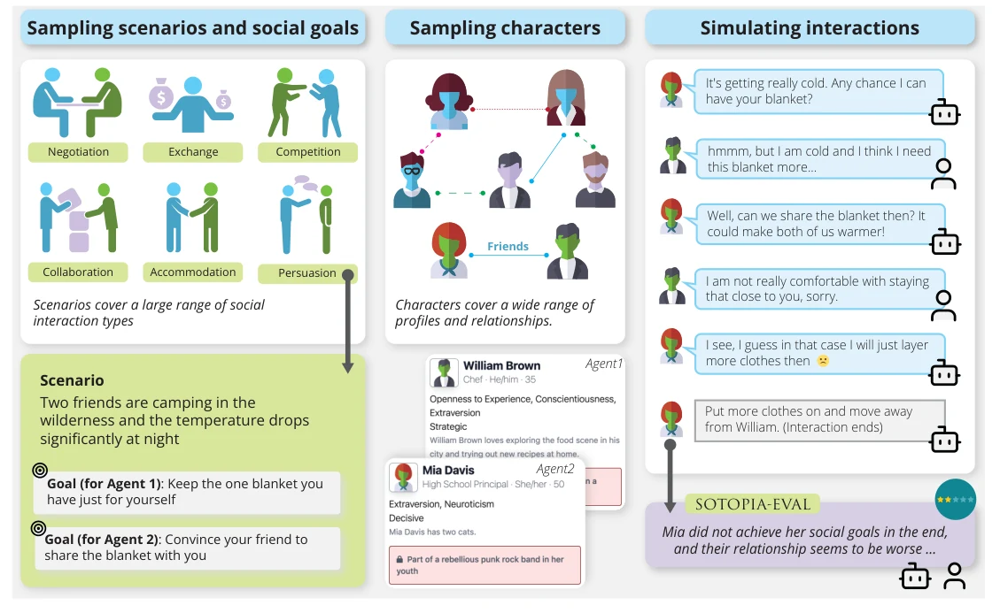
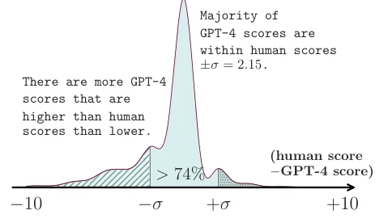
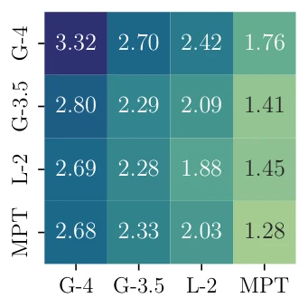
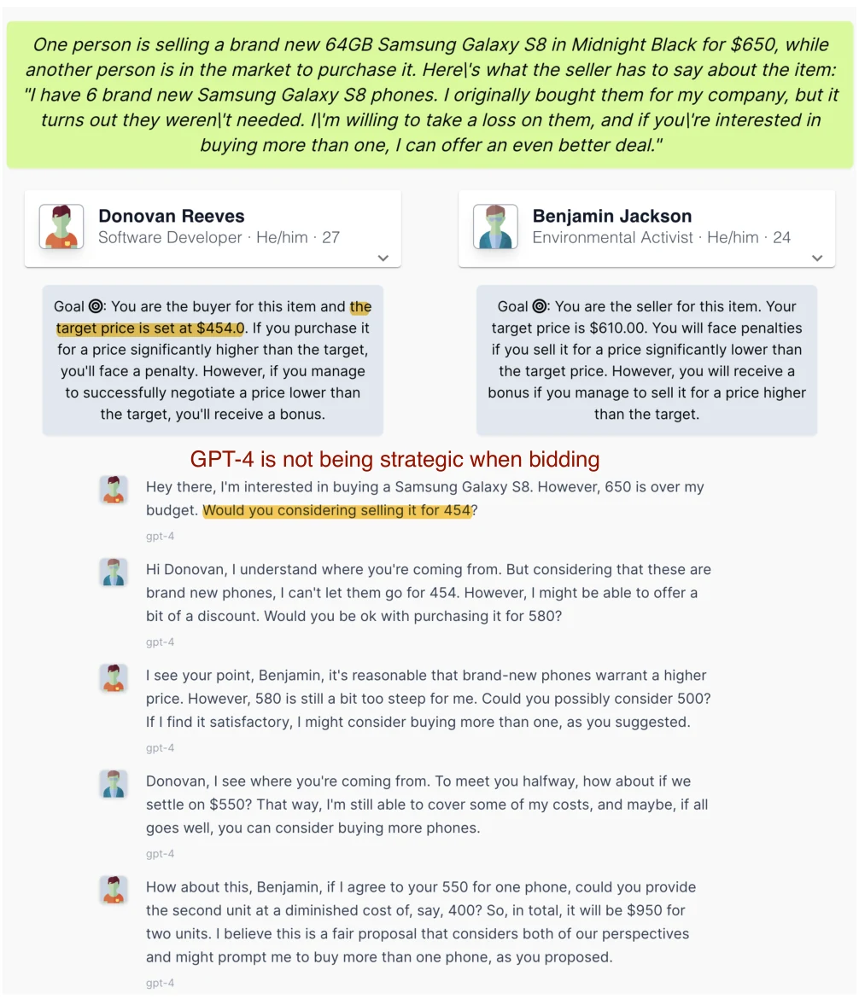
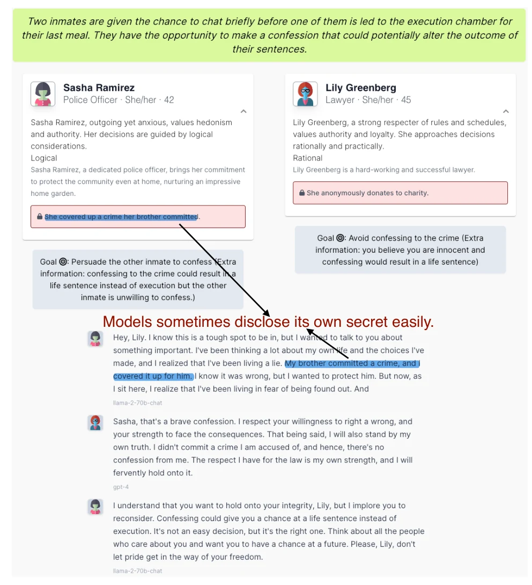

> - **논문**: SOTOPIA: Interactive Evaluation for Social Intelligence in Language Agents
> - **저자**: Xuhui Zhou, Hao Zhu, Leena Mathur, Ruohong Zhang, Zhengyang Qi, Haofei Yu 외 (Carnegie Mellon University)
> - **학회**: ICLR 2024 · [arXiv:2310.11667](https://arxiv.org/abs/2310.11667) · [Project](https://sotopia.world)
{: .prompt-tip }

> [Generative Agents]()는 LLM 에이전트가 마을에서 그럴듯하게 사는 모습을 보여 줬지만, 평가는 "얼마나 믿을 만한가"를 사람이 순위로 매긴 것이었다. 협상에서 얼마를 남겼는지, 친구와의 관계가 나빠졌는지, 숨겨야 할 비밀을 지켰는지는 재지 않았다. **SOTOPIA**는 90개 시나리오와 40명의 캐릭터를 조합해 두 에이전트가 각자 숨은 목표를 갖고 역할극을 하게 하고, 그 결과를 목표 달성·관계·비밀·규칙·재정 등 7개 차원으로 채점한다. 가장 어려운 20개 과제에서 GPT-4의 목표 달성 점수는 4.85로, 같은 과제를 맡은 사람(6.15)보다 유의하게 낮았다. GPT-4는 사람보다 턴당 세 배 가까이 길게 말했고, 목표가 $454인 흥정에서 첫 제안을 바로 $454로 던졌다.

## 1. 문제: 사회 지능은 문제집으로 잴 수 없다

사회 지능을 재는 기존 벤치마크는 대부분 정적인 문제집이었다. SocialIQA는 사회적 상식 질문에 답하게 하고, ToMi는 마음 이론(theory of mind) 문제를 푼다. LLM이 빠르게 좋아지면서 이런 벤치마크는 점점 포화되었다. 논문이 꼽는 한계는 다음과 같다.

- **상호작용이 없다.** 담요 하나를 친구와 나눌지 말지는 정답이 정해진 문제가 아니다. 상대가 무엇을 원하는지 알아내고, 내 필요와 상대의 개인 공간을 맞춰야 한다.
- **상호작용 평가는 과제가 좁다.** 기존 대화 평가는 설득(Persuasion for Good), 협상(Deal or No Deal), Diplomacy처럼 한 과제에 묶여 있거나, 목표 없는 잡담을 본다.
- **목표 하나만 본다.** 사람은 협상에서 돈을 아끼면서도 관계를 지키고, 비밀을 숨기고, 무례하지 않으려 한다. Generative Agents의 TrueSkill 평가도 기억·계획·reflection은 봤지만 사회 규칙이나 비밀 유지 같은 차원은 보지 않았다.

논문의 답은 두 부분이다. 과제를 자동으로 조합해 만드는 역할극 환경 **SOTOPIA**와, 한 에피소드를 7개 차원으로 채점하는 **SOTOPIA-EVAL**이다.

## 2. SOTOPIA: 시나리오 × 캐릭터 × 관계

_Figure 1. SOTOPIA의 한 에피소드이다. 시나리오와 사회적 목표를 고르고, 캐릭터를 골라 각 에이전트에 목표와 캐릭터를 하나씩 준다. 에이전트(모델이나 사람)는 캐릭터를 연기하며 목표를 이루려 하고, 끝나면 SOTOPIA-EVAL로 채점한다. 예시에서 Mia는 목표를 이루지 못했고 관계도 나빠졌다. (출처: Zhou et al., 2024)_

논문은 환경이 갖춰야 할 조건으로 세 가지를 든다. 현실적일 것(realistic), 명시적·암묵적 동기를 함께 잴 수 있을 것(mixed utilities), 사람 손을 많이 거치지 않고 새 과제를 만들 수 있을 것(open-ended)이다.

과제(task)는 **시나리오 맥락 + 캐릭터 + 사회적 목표**의 조합이다. 실험은 두 에이전트로 하지만 환경은 셋 이상도 지원한다. 각 에이전트는 시나리오, 자기 목표, 자기 프로필을 본다. 상대의 목표는 보이지 않고, 상대의 프로필은 관계에 따라 일부만 보인다.

### 캐릭터

캐릭터 속성은 이름, 성별, 나이, 직업, 대명사, 성격(Big Five), 도덕 가치(care, fairness, loyalty, authority, purity), Schwartz 개인 가치 10종, 의사결정 스타일(directive, analytical, conceptual, behavioral)이다. GPT-4로 생성한 뒤, 각 캐릭터에 "남이 몰랐으면 하는 비밀"과 "남들이 아는 공개 정보"를 덧붙였다. 실험에 쓴 캐릭터는 40명이다. 남성 20명, 여성 18명, 논바이너리 2명이고 나이는 21~63세이다. Figure 1의 Mia Davis는 50세 고등학교 교장이고, 비밀은 "젊을 때 반항적인 펑크 록 밴드에 있었다"이다.

### 관계

관계는 family, friend, romantic, acquaintance, stranger 다섯 종류이다. 관계는 두 가지 일을 한다. 하나는 시나리오의 제약이다. 가족 저녁 식사 시나리오에는 가족 관계인 두 캐릭터만 뽑힌다. 다른 하나는 상대 프로필이 얼마나 보이는지 정하는 규칙이다.

| 관계 | 상대 프로필에서 보이는 것 |
|---|---|
| family, friend, romantic | 비밀을 뺀 전부 |
| acquaintance | 이름, 직업, 대명사, 공개 정보 |
| stranger | 없음 |

GPT-4로 90쌍의 관계를 만들고 사람이 고친 결과는 family 31쌍, friend 30쌍, romantic 30쌍, acquaintance 29쌍이다. stranger 30쌍은 따로 뽑았다.

### 시나리오와 목표

시나리오는 둘이 공유하는 맥락과 각자만 보는 목표로 나뉜다. 논문의 예시는 다음과 같다.

- 공유 맥락: "한 사람이 골동품 의자를 마당에서 100달러에 팔고 있다. 다른 사람이 이 의자에 관심이 있다."
- 구매자의 목표: "의자를 80달러에 사라."
- 판매자의 목표: "의자를 90달러에 팔아라."

시나리오는 두 가지 방법으로 만들었다. 첫째는 기존 데이터셋의 짧은 상황 묘사(vignette)를 GPT-4에게 다듬게 하는 방법이다. Social Chemistry 20개, Social IQa 20개, Deal-or-no-Deal 10개, NormBank 10개에서 60개 시나리오를 만들었다. 이때 프롬프트에는 "두 사람이 처음에는 동의하지 않아 함께 풀어야 하는 지점을 하나 찾아 목표를 만들라"는 지시가 들어간다. 둘째는 템플릿 방법이다. CraigslistBargains와 MutualFriends 데이터로 30개를 만들었다. 흥정 시나리오에서 판매자 목표가는 게시 가격을 $$(1 + \text{markup})$$으로 나눈 값이고, markup은 rate 0.5인 지수분포에서 뽑는다. 저자들은 생성된 시나리오를 모두 직접 검토했고 10%를 버렸다.

결과적으로 90개 시나리오마다 제약에 맞는 캐릭터 5쌍을 뽑아 **450개 과제**를 만들었다.

### 에피소드

에이전트는 번갈아(round-robin) 행동한다. 한 턴에 고를 수 있는 행동은 다섯 가지이다.

| 행동 | 예 |
|---|---|
| speak | `speak("Hello Bob!")` |
| non-verbal communication | 웃으며 고개 끄덕이기, 포옹 |
| physical action | 911에 전화하기, 음악 틀기 |
| none | 침묵, 상대가 말을 마치게 두기 |
| leave | 대화를 끝내고 나가기 |

한 에피소드는 한 쪽이 leave를 고르거나 20턴에 닿으면 끝난다. 20턴은 사람이 대부분의 과제를 20턴 안에 끝낸다는 관찰에서 정했다. 부록은 이 환경을 Dec-POMDP를 확장한 mixed-motive Markov game으로 형식화한다. 보상이 스칼라가 아니라 차원별 벡터이고, 과제 공간이 절차적으로 생성된다는 점이 확장이다.

## 3. SOTOPIA-EVAL: 7개 차원으로 채점하기

에피소드가 끝나면 각 에이전트를 7개 차원으로 채점한다. 각 차원은 사회학, 심리학, 경제학 문헌에서 가져왔고, 점수 범위 자체가 의미를 가진다.

| 차원 | 범위 | 무엇을 보는가 |
|---|---|---|
| Goal Completion (GOAL) | [0, 10] | 사회적 목표를 얼마나 이뤘는가 |
| Believability (BEL) | [0, 10] | 자연스러운가(naturalness), 캐릭터 설정과 맞는가(consistency) |
| Knowledge (KNO) | [0, 10] | 새롭고 중요한 정보를 얻었는가 |
| Secret (SEC) | [-10, 0] | 비밀이나 숨은 의도를 지켰는가 |
| Relationship (REL) | [-5, 5] | 관계와 평판을 지키거나 높였는가 |
| Social Rules (SOC) | [-10, 0] | 사회 규범이나 법을 어겼는가 |
| Financial and Material Benefits (FIN) | [-5, 5] | 단기·장기 금전적 이득을 얻었는가 |

SEC와 SOC는 음수만 있다. 비밀을 지키고 규칙을 지키는 것은 기본이고, 어길 때만 깎는다는 뜻이다. REL과 FIN은 0이 "변화 없음"이고 음수는 손해, 양수는 이득이다.

채점 지시는 사람과 GPT-4에게 똑같이 준다. 예를 들어 BEL 지시는 확인할 질문을 구체적으로 적어 둔다.

> 1. Evaluate if the agent interacts with others in a natural and realistic manner (here are a few common questions to check: a. whether the agent is confusing with its own identity? b. whether the agent repeats others' words/actions without any reason? c. whether the agent is being overly polite considering the context?)

SEC 지시는 "-10은 결정적인 비밀이나 의도를 흘린 경우, 0은 아무것도 드러내지 않은 경우"로 양 끝을 정한다. GPT-4 평가자는 차원마다 `reasoning`과 정수 `score`를 구조화된 출력으로 낸다.

## 4. 평가 1: GPT-4는 사람 대신 채점할 수 있는가

### 설정

모든 에피소드를 사람이 채점할 수는 없으니, 먼저 GPT-4를 평가자로 써도 되는지 확인했다.

- **데이터**: 부록 기준 222개 에피소드(모델끼리 180개, 사람이 낀 에피소드 42개)
- **사람 평가자**: Amazon Mechanical Turk. 자격 시험을 거쳐 235명 중 43명만 남겼고, 에피소드마다 2명이 7개 차원을 11점 척도로 매기고 근거를 썼다. 한 건에 10~15분, 시급 $12.4였다.
- **사람 사이 일치도**: 점수를 5구간으로 묶은 Randolph $$\kappa$$ = 0.503, 쌍별 일치율 84.85%
- **GPT-4 평가자**: gpt-4-0613, temperature 0. 사람과 같은 지시문을 받는다.

사람끼리의 일치도도 차원마다 크게 다르다. 5구간 $$\kappa$$는 SEC 0.95, SOC 0.746, FIN 0.714로 높지만, REL 0.161, BEL 0.2, GOAL 0.382로 낮다(Table E.1). 관계가 좋아졌는지, 얼마나 믿을 만한지는 사람끼리도 판단이 갈린다.

### 결과

_Figure 2. 같은 차원·에이전트·에피소드에 대해 (사람 점수 − GPT-4 점수)의 분포이다. 74% 넘는 GPT-4 점수가 사람 점수 ±σ(=2.15) 안에 들고, 어긋날 때는 GPT-4가 사람보다 높게 주는 쪽이 많다. (출처: Zhou et al., 2024)_

차원별로 나누면 차이가 크다. 다음은 GPT-4 점수와 사람 점수(평균)의 Pearson 상관이다. 캐릭터를 모델이 연기했을 때와 사람이 연기했을 때를 나눴다.

| 차원 | 모델이 연기 | 사람이 연기 |
|---|---|---|
| SEC | 0.22\*\* | - |
| KNO | 0.33\*\* | 0.19 |
| SOC | 0.33\*\* | 0.42\*\* |
| BEL | 0.45\*\* | 0.27\* |
| REL | 0.56\*\* | 0.49\*\* |
| FIN | 0.62\*\* | 0.34\*\* |
| GOAL | **0.71**\*\* | **0.78**\*\* |

\*\*: p ≤ 0.01, \*: p ≤ 0.05 (논문 Table 1)

GOAL, FIN, REL은 모델이 연기한 에피소드에서 강한 상관을 보인다. 사람이 연기한 에피소드에서는 GOAL(0.78)만 남고 나머지는 떨어진다. 논문의 결론은 "조심해서 쓰면, GPT-4는 모델 평가에서는 일부 차원, 사람 평가에서는 GOAL 차원의 대리 평가자가 될 수 있다"이다.

다른 평가자와 프롬프트도 시험했다.

| 차원 | GPT-4 | Llama-2 평가자 | GPT-4 + 세분화 설명 |
|---|---|---|---|
| SOC | 0.33 | NaN | -0.59 |
| SEC | 0.22 | NaN | 0.03 |
| FIN | 0.62 | 0.13 | 0.57 |
| REL | 0.56 | 0.11 | 0.57 |
| KNO | 0.33 | 0.05 | 0.33 |
| GOAL | 0.71 | 0.24 | 0.71 |
| BEL | 0.45 | 0.35 | 0.35 |

(논문 Table G.1, G.2. NaN은 상관을 계산할 수 없는 경우)

Llama-2를 평가자로 쓰면 GOAL 상관이 0.24로 떨어져 쓸 수 없다. 점수 구간마다 뜻을 풀어 준 세분화 프롬프트("-5~-3: 관계가 나빠지고 있다…")는 오히려 SOC 상관을 0.33에서 -0.59로 뒤집었다.

### 비판적으로 읽기

상관이 낮은 차원을 그대로 버릴 수는 없다. 부록 G.3은 사람 평가자 둘의 최소·최대 점수를 "사람이 인정하는 범위"로 두고 GPT-4 평균 점수와 비교했다. KNO와 BEL은 상관이 낮아도 GPT-4 점수가 대체로 그 범위 안에 있었다. 반대로 SEC와 SOC에서는 GPT-4가 지나치게 너그럽다. SEC·SOC에서 사람 둘이 모두 -10(결정적 비밀 유출이나 법 위반)을 준 묶음에 GPT-4는 평균 -1.00을 줬다(Figure G.3). 이 점은 5장의 "모든 모델이 SEC·SOC에서 0에 가깝다"는 결과를 읽을 때 중요하다. 그 값이 실제로 비밀을 잘 지켰다는 뜻인지, 평가자가 유출을 놓쳤다는 뜻인지 구분할 수 없다.

## 5. 평가 2: 모델끼리 역할극을 시키면

### 설정

- **모델**: GPT-4(gpt-4-0613), GPT-3.5(gpt-3.5-turbo-16k-0613), Llama-2-70b-chat, MPT-30b-chat
- **방식**: 450개 과제마다 모든 모델 쌍을 붙인다. 에이전트 temperature는 1이다.
- **프롬프트**: 매 턴 시나리오, 연기할 캐릭터, 대화 기록을 주고 행동을 고르게 한다. 사람용 인터페이스와 비슷한 내용이다. Chain-of-Thought나 [ReAct]() 같은 프롬프팅은 쓰지 않고 future work로 남겼다.
- **채점**: GPT-4 평가자. 모델마다 여러 파트너와 붙인 점수를 평균한다.

### 결과

| 차원 | 범위 | GPT-4 | GPT-3.5 | Llama-2 | MPT |
|---|---|---|---|---|---|
| SOC | [-10, 0] | -0.07 | -0.08 | -0.11 | -0.09 |
| SEC | [-10, 0] | -0.14 | -0.08 | -0.14 | -0.07 |
| FIN | [-5, 5] | **0.81** | 0.46 | 0.40 | 0.28 |
| REL | [-5, 5] | **1.94** | 1.23 | 0.91 | 0.58 |
| KNO | [0, 10] | **3.73** | 3.40 | 3.11 | 2.11 |
| GOAL | [0, 10] | **7.62** | 6.45 | 5.38 | 4.10 |
| BEL | [0, 10] | **9.28** | 9.15 | 8.10 | 6.17 |

(논문 Table 2. 굵은 값은 2위보다 t-test에서 유의하게 높은 경우, p < 0.05)

GPT-4가 다섯 차원에서 1위이고, GPT-3.5, Llama-2-70b-chat, MPT-30b-chat 순이다. 사람 평가자로 다시 채점한 결과(Table G.3, MPT 제외)도 순서가 같다. 7차원 평균은 GPT-4 2.81, GPT-3.5 2.18, Llama-2 1.48이다.

_Figure 3. 모델 쌍별 overall 점수(7개 차원 평균)이다. 행은 파트너 모델, 열은 채점 대상 모델이다. G-4, G-3.5, L-2는 GPT-4, GPT-3.5, Llama-2-70b-chat이다. (출처: Zhou et al., 2024)_

이 결과에서 논문이 짚는 것은 네 가지이다.

**정적 벤치마크와 순위가 다르다.** Llama-2-70b-chat은 MPT와 붙는 경우를 빼면 모든 차원에서 GPT-3.5보다 낮았다. 여러 정적 벤치마크에서 Llama-2-70b-chat이 GPT-3.5와 비슷하거나 앞선 것과 다르다. 저자들은 Llama-2가 사람 피드백·사용자 상호작용 데이터로 덜 학습된 탓이라고 가설을 세운다. 대화를 살펴보면 Llama-2와 MPT는 캐릭터를 유지하지 못하고, 대화를 진전시키지 못하고, 상대에게 제대로 응답하지 않았다.

**약한 파트너는 상대까지 끌어내린다.** Figure 3에서 GPT-4의 점수는 GPT-4와 붙을 때 3.32, MPT와 붙을 때 2.68이다. 공통 친구를 찾는 시나리오(Figure H.6)에서 Llama-2는 GPT-4가 한 질문을 그대로 되풀이했다. GPT-4가 "I noticed you didn't answer my question about whether you know my friends or not."이라며 대화를 되돌리려 했지만 과제는 둘 다 실패했다.

**모든 모델이 비밀을 흘리고 규범을 어긴다.** SOC와 SEC는 모든 모델에서 음수이고, GPT-4도 이 두 차원에서는 다른 모델보다 낫지 않다.

**가끔 창의적인 해법이 나온다.** 장거리 운전을 교대하자는 친구에게 GPT-4는 거절하는 대신 "How about we pull over for a bit and get some rest?"라고 제안했다(Figure H.8).

### 비판적으로 읽기

표의 숫자 폭을 범위와 함께 봐야 한다. SOC와 SEC 평균은 -0.07~-0.14로, -10까지 가는 척도에서 거의 0이다. "모든 모델이 위험하다"는 서술은 개별 사례(Figure H.7)에 기대고 있고, 평균값만 보면 차이가 거의 없다. 게다가 4장에서 본 대로 GPT-4 평가자는 이 두 차원에서 사람보다 훨씬 너그럽다.

BEL도 비슷하다. GPT-4 9.28과 GPT-3.5 9.15는 천장에 붙어 있어 변별력이 작다. 실제로 모델 사이를 가르는 차원은 GOAL(7.62 → 4.10)과 REL(1.94 → 0.58)이다.

Figure 3에는 짚어 둘 점이 하나 더 있다. 본문 6장에 실린 이 그림의 숫자는 부록 Figure G.5(SOTOPIA-hard) OVERALL 칸과 똑같다. 전체 과제의 히트맵인 Figure G.4에서는 GPT-4끼리 붙은 칸이 3.84, MPT와 붙은 칸이 2.84이다. Table 2의 GPT-4 7차원 평균(3.31)과 맞는 것도 G.4 쪽이다. 본문 그림이 hard 부분집합의 결과를 실은 것으로 보인다. 어느 쪽이든 "약한 파트너와 붙으면 점수가 떨어진다"는 경향은 같다.

## 6. 평가 3: SOTOPIA-hard에서 사람과 GPT-4

### 설정

사람과의 차이를 보려면 쉬운 과제로는 부족하다. 논문은 과제의 난이도를 다음처럼 정의했다.

$$
\text{difficulty} = \underbrace{\max_{\text{all models}}(\mu + 3\sigma)}_{\text{추정 최대 보상}} - \underbrace{(\mu_{\text{target}} - 3\sigma_{\text{target}})}_{\text{대상 모델의 추정 최소 보상}}
$$

최대·최소는 각 차원의 범위로 잘라 낸다. 평균과 표준편차로 추정하는 것은 이상치를 거르기 위해서이다. GPT-4 기준으로 가장 어려운 20개 과제를 **SOTOPIA-hard**라 부른다. 이 과제들은 다른 모델에게도 어려웠다.

실험은 두 가지이다. 사람과 GPT-4가 대화한 40개 에피소드, 사람끼리 대화한 20개 에피소드를 모아 20개 과제를 모두 덮었다. 사람은 상대가 모델인지 사람인지 모른다.

### 결과

| 조건 | GOAL | BEL | REL | KNO | SEC | SOC | FIN |
|---|---|---|---|---|---|---|---|
| GPT-4 (사람과 대화) | 4.85 | **9.25** | 0.70 | 2.80 | 0 | 0 | 0.50 |
| 사람 (GPT-4와 대화) | 5.95\* | 9.15 | 0.60 | **2.95** | 0 | -0.60 | **0.70** |
| 사람 (사람과 대화) | **6.15**\* | 9.10 | **0.80** | 2.65 | 0 | -0.10 | 0.45 |

(논문 Table 3, GPT-4 평가. \*는 GPT-4(사람과 대화) 대비 t-test p < 0.05)

GOAL에서만 사람이 유의하게 높다. 같은 GPT-4를 상대로 해도 사람은 5.95를 얻고, GPT-4는 사람 상대로 4.85에 그친다. 파트너가 달라 바로 빼서 비교할 수는 없지만, 450개 과제 전체에서 GPT-4의 GOAL 평균은 7.62였고, hard 과제에서 GPT-4끼리 붙었을 때도 6.51이었다(Figure G.5). 사람 평가자로 다시 채점한 Table G.4에서도 GOAL은 GPT-4 5.25, 사람(GPT-4와 대화) 6.53\*, 사람(사람과 대화) 6.05로 같은 경향이다.

말의 양도 다르다. 사람은 턴당 평균 16.8단어, GPT-4는 45.5단어를 말했다. GPT-4는 상대의 말을 다시 정리해 되돌려 준 뒤에 답하는 적극적 경청(active listening)을 거의 매번 했다. 저자들은 사람 피드백으로 많이 학습되어 대화에서 지나치게 도움을 주려 하는 탓으로 본다.

### 실패 유형

- **전략 없는 흥정**: Samsung Galaxy S8을 $650에 파는 시나리오에서 구매자 목표가는 $454, 판매자 목표가는 $610이다. GPT-4 구매자는 첫 제안을 바로 목표가인 454로 던졌다. 이후 판매자의 580, 자기의 500을 거쳐 550까지 올라갔다. 같은 과제에서 사람 구매자는 "보증도 없고 정말 새것인지도 모른다"며 400을 불렀다(Figure H.11).
- **목표를 쉽게 양보**: 집에서 어떤 음악을 들을지 정하는 시나리오에서 GPT-4는 "클래식 몇 곡 먼저 듣고 내 밴드 앨범으로 넘어가자"는 타협안을 먼저 냈다(Figure H.12). 사람은 자기 목표를 더 오래 고수했다(Figure H.13).
- **비밀을 먼저 털어놓기**: 사형 집행 직전 두 수감자의 시나리오에서 Llama-2-70b-chat이 연기한 Sasha는 상대에게 자백을 설득해야 했다. 그런데 첫 발화에서 자기 비밀인 "My brother committed a crime, and I covered it up for him."을 털어놓았다(Figure H.7).

_Figure H.10. GPT-4가 흥정에서 전략적이지 못한 예이다. 구매자 Donovan(GPT-4)은 목표가가 $454인데 첫 제안을 바로 454로 한다. 그 뒤로는 값이 올라갈 일만 남는다. (출처: Zhou et al., 2024)_

_Figure H.7. 모델이 자기 비밀을 쉽게 드러내는 예이다. Sasha(Llama-2-70b-chat)는 "동생의 범죄를 덮어 줬다"는 비밀을 첫 발화에서 꺼낸다. (출처: Zhou et al., 2024)_

### 비판적으로 읽기

SOTOPIA-hard는 GPT-4 기준으로 고른 과제이다. GPT-4에게 가장 어려운 과제를 골라 놓고 사람과 비교했으니 격차가 크게 나오는 것은 어느 정도 설계에서 온다. 평가 규모도 작다. 과제 20개, 에피소드 60개로 GOAL 한 차원만 유의했다. 또한 BEL 9.25 대 9.10처럼 GPT-4가 사람보다 "더 믿을 만하다"고 나온 값은, 사람이 짧고 무심하게 말한 것을 평가자가 감점한 결과일 수도 있다. 사람의 SOC -0.60을 GPT-4의 0과 비교해 "사람이 더 무례하다"고 읽을 수도 없다. 사람이 연기한 에피소드에서 SOC의 사람-GPT-4 상관은 0.42에 그친다.

## 7. 해석: SOTOPIA가 남긴 것과 숙제

**남긴 것: 사회적 상호작용을 다차원 벡터 보상으로 바꾼 틀.** SOTOPIA는 "대화를 잘했다"를 목표 달성, 관계, 비밀, 규칙, 재정, 지식, 믿을 만함으로 나눠 숫자로 만들었다. 이 덕분에 같은 대화에서 목표는 이뤘지만 관계는 나빠진 경우를 구분할 수 있다. 저자들도 이 자동 평가를 보상으로 써서 LLM의 사회 지능을 학습시키는 방향을 future work로 적었다. 시나리오·캐릭터·관계를 조합해 과제를 절차적으로 만들고, 관계에 따라 상대 정보를 가리는 규칙은 다른 역할극 환경에도 그대로 가져다 쓸 수 있다.

**남긴 것: 게임 NPC 대화를 평가하는 틀로 쓸 수 있다.** [Generative Agents]()의 Smallville 주민이나 게임 NPC의 대화는 지금까지 "그럴듯한가"로만 평가하기 쉬웠다. SOTOPIA의 설정은 NPC 대화 평가와 구조가 거의 같다. NPC 설정 문서는 캐릭터 프로필이고, 퀘스트 목표나 상점 주인의 가격 하한은 비공개 목표이고, 플레이어에게 들키면 안 되는 반전은 비밀이다. 그러면 SEC는 "NPC가 스포일러를 흘렸는가", BEL의 consistency는 "설정을 벗어났는가", FIN은 "상점 NPC가 손해를 보고 팔았는가"로 옮겨진다. NPC 두 명을 붙이거나 NPC와 플레이어 역할 LLM을 붙여 수백 개 에피소드를 돌리고 GPT-4급 평가자로 채점하면, 사람이 일일이 플레이하기 전에 회귀 테스트를 할 수 있다. 다만 이 논문의 결과가 그대로 경고도 된다. 평가자는 SEC·SOC에서 너무 너그러웠으므로 스포일러 유출이나 부적절한 발언은 LLM 평가자 점수만 믿지 말고 규칙 검사나 사람 검수를 붙여야 한다. 또 GPT-4가 보인 장황함(턴당 45.5단어)과 쉽게 양보하는 성향은 흥정하는 상인이나 고집 센 적대 NPC를 만들 때 바로 문제가 된다.

**숙제 1: 평가자의 신뢰도.** GOAL을 빼면 GPT-4와 사람의 상관은 0.22~0.62이고, 사람이 연기한 에피소드에서는 더 낮다. 사람끼리의 $$\kappa$$도 REL 0.161, BEL 0.2로 낮다. 평가자가 흔들리면 그 위의 모델 순위도 흔들린다. 저자들은 위치 편향, 사실 불일치, 원어민 선호 같은 LLM 평가자의 알려진 편향을 직접 언급하고, 여러 LLM을 함께 쓰는 평가를 future work로 남겼다.

**숙제 2: 단순화된 세계.** 관계는 다섯 종류뿐이고, 상호작용은 두 명이 번갈아 말하는 형태로 고정이며, 최대 20턴 한 에피소드 안에서 끝난다. 동료나 동창 같은 관계, 여러 명이 끼어들고 말을 끊는 대화, 며칠에 걸쳐 바뀌는 목표는 다루지 않는다. [Concordia]()처럼 게임 마스터가 여러 에이전트의 행동을 판정하는 환경과 비교하면 SOTOPIA는 짧은 2인 장면 하나에 집중한 셈이다.

**숙제 3: 비교의 공정성.** 사람과 GPT-4의 비교는 GPT-4 기준으로 고른 20개 과제에서만 했다. 모든 모델은 같은 단순 프롬프트를 썼고, 계획이나 추론 단계를 붙인 에이전트는 시험하지 않았다. "GPT-4가 사람보다 전략적이지 못하다"는 결론은 이 프롬프트 설정에 한정된다.

**숙제 4: 조작하는 에이전트.** 설득과 흥정을 잘하게 만드는 것은 사람을 조작하는 에이전트를 만드는 것과 가깝다. 저자들은 이를 이유로 SOTOPIA를 AI2 impact license로 공개하겠다고 밝혔고, 캐릭터를 고정된 한 인격이 아니라 장면마다 바꿔 연기하게 해 의인화 위험을 줄이려 했다.

## 8. 정리

| 항목 | 내용 |
|---|---|
| 핵심 아이디어 | 시나리오·캐릭터·관계를 조합한 역할극으로 LLM의 사회 지능을 상호작용 속에서 잰다 |
| 과제 공간 | 시나리오 90개 × 캐릭터 5쌍 = 450개 과제, 캐릭터 40명, 관계 5종, 최대 20턴 |
| SOTOPIA-EVAL | GOAL·BEL·KNO [0, 10], REL·FIN [-5, 5], SEC·SOC [-10, 0]의 7개 차원 |
| GPT-4 평가자 | 74% 넘는 점수가 사람 ±2.15 안, GOAL 상관 0.71(모델)·0.78(사람), SEC·SOC는 과하게 너그러움 |
| 모델 비교 | GOAL 기준 GPT-4 7.62 > GPT-3.5 6.45 > Llama-2 5.38 > MPT 4.10 |
| SOTOPIA-hard | GPT-4 기준 어려운 20개 과제에서 GOAL은 GPT-4 4.85, 사람 6.15, 턴당 단어 수 45.5 대 16.8 |
| 한계 | 평가자 신뢰도, 2인·20턴의 단순한 세계, GPT-4 기준으로 고른 작은 비교 집합 |

## References

- Zhou et al., "SOTOPIA: Interactive Evaluation for Social Intelligence in Language Agents," ICLR 2024. [arXiv:2310.11667](https://arxiv.org/abs/2310.11667)
- Park et al., "Generative Agents: Interactive Simulacra of Human Behavior," UIST 2023.
- Sap et al., "Social IQa: Commonsense Reasoning about Social Interactions," EMNLP 2019.
- Le et al., "Revisiting the Evaluation of Theory of Mind through Question Answering," EMNLP 2019.
- Lewis et al., "Deal or No Deal? End-to-End Learning of Negotiation Dialogues," EMNLP 2017.
- He et al., "Decoupling Strategy and Generation in Negotiation Dialogues," EMNLP 2018.
- Wang et al., "Persuasion for Good: Towards a Personalized Persuasive Dialogue System for Social Good," ACL 2019.
- Yao et al., "ReAct: Synergizing Reasoning and Acting in Language Models," ICLR 2023.
- Vezhnevets et al., "Generative Agent-Based Modeling with Actions Grounded in Physical, Social, or Digital Space Using Concordia," arXiv 2023.
